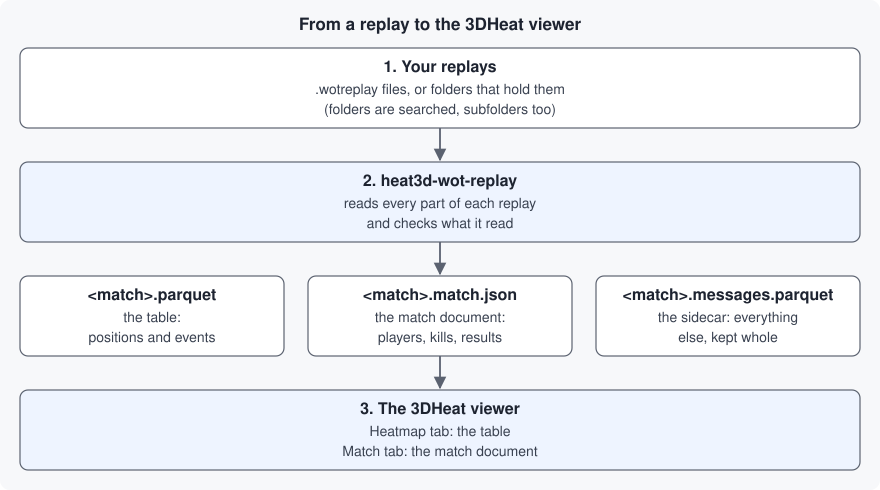

# 3DHeat World of Tanks replays

**What is it?** World of Tanks can save every battle you play as a replay
file. This tool turns those files into a table and a match document (the
battle's summary) that the
[3DHeat viewer](https://holdi601.github.io/3DHeat/) shows in 3D: where every
tank drove, shot and was hit.

**Why would I use it?** To watch a battle again from above, every tank at
once; to see heatmaps of where you and others drive, fight and die over
hundreds of battles; or to read a replay with your own scripts (pandas,
DuckDB), since the output is plain Parquet and JSON.

**Example:** `example.wotreplay` in, `out/<map>/<match>.parquet` (the table)
and `<match>.match.json` (the match document) out.



**Documentation, step by step with pictures:
<https://holdi601.github.io/3DHeat-Ext-WoT/>** (Documentation in your
language: choose it at the top of any page there.)

Part of [3DHeat](https://github.com/Holdi601/3DHeat), the realtime 3D
telemetry and replay viewer ([documentation](https://holdi601.github.io/3DHeat/)).

Each game reader is its own small project with its own licence file, releases
and issue tracker, so it can be installed, updated, maintained - or withdrawn
on a rights holder's request - on its own, without affecting the viewer or the
other tools.

## The standalone program

No Python needed: download the file for your system (Windows, Linux (also Steam Deck) and macOS) from the
[latest release](https://github.com/Holdi601/3DHeat-Ext-WoT/releases/latest), check it against `SHA256SUMS`, unpack it and start `heat3d-wot`. Its window
finds your install, converts the battles in its `replays` folder (or any folder you pick),
and asks before it updates itself. `heat3d-wot --help` lists its commands (`heat3d-wot heat3d-wot-replay ...` runs every command below).
The 3DHeat app's Extractors panel can install and update it for you. See
[the install page](https://holdi601.github.io/3DHeat-Ext-WoT/installing.html).

The window walks through four steps (find the game, choose, work, done) in the 3DHeat look, dark or light. On Windows the program opens only its window, with no console window; in a terminal it prints as usual, and `heat3d-wot-cli.cmd` in the same folder makes the terminal wait for it and pass on its exit code.

Replays from the command line: `heat3d-wot convert <replay>... -o <folder> [--progress-json]` converts them (one JSON line per replay with `--progress-json`), and `heat3d-wot info <replay> --json` prints what a replay says about its match (map, mode, date, length, players, teams, result, game version), read from its header without converting it. The 3DHeat Library uses both.

## Quick start for new users (Python)

You need: Windows, [Python](https://www.python.org/downloads/) 3.10 or later
("Add python.exe to PATH" ticked in its installer), and World of Tanks with
battle recording switched on (Settings > General > Record battles; the game
then saves each battle in the `replays` folder of its install). No Git is
needed.

1. Install the tool (one line, in PowerShell or a command prompt):

   ```bash
   python -m pip install https://github.com/Holdi601/3DHeat-Ext-WoT/archive/refs/tags/v0.1.0.zip
   ```

2. Convert the replays (the folder of your install, or single `.wotreplay`
   files; run it again later and only the new ones are converted):

   ```bash
   heat3d-wot-replay "C:\Games\World_of_Tanks_EU\replays" -o out
   ```

3. The output is a folder per map in `out`: per battle `<match>.parquet`
   (the table), `<match>.match.json` (the match document) and
   `<match>.messages.parquet`. It prints one line per replay, ending in
   `-> out/<map>/<match>.parquet`.
4. Open it in the [3DHeat viewer](https://github.com/Holdi601/3DHeat#quick-start):
   download the viewer (**Code -> Download ZIP**, unpack) and double-click
   `start.bat`; it offers to install [Node.js](https://nodejs.org/) when it is
   missing and opens Chrome or Edge at `http://127.0.0.1:5273`. There,
   **Source -> Files...** and pick the `<match>.parquet` files (or drop them
   on the Source panel) for the Heatmap tab; for the battle itself, the
   **Match** tab's **Load match files...** and the `<match>.match.json`.

When a new release is out, the tool says so when it starts and offers to
update itself (`python -m heat3d_ext_wot.update` does the same).

## Install from a checkout

New to the command line? Read
[Before you start](https://holdi601.github.io/3DHeat-Ext-WoT/before-you-start.html)
first. Needs Python 3.10 or later.

```bash
git clone https://github.com/Holdi601/3DHeat-Ext-WoT.git
cd 3DHeat-Ext-WoT
pip install -e .                 # installs the heat3d-wot-replay command
heat3d-wot-replay --version      # you should see: heat3d-wot-replay 0.1.0
```

`python -m heat3d_ext_wot ...` does the same as `heat3d-wot-replay ...`.

## Use

Switch battle recording on in the game (Settings > General > Record
battles). The game then saves replays in the `replays` folder of your World
of Tanks install.

```bash
heat3d-wot-replay "<World of Tanks>/replays" -o out
heat3d-wot-replay a.wotreplay b.wotreplay -o out
```

You should see one line per replay:

```text
example.wotreplay: 534 positions of 3 vehicles at 10.0 Hz, 1 deaths, 99_testmap (2.4.1.0) -> out/99_testmap/123456789.parquet
```

| Option | Default | Does |
|---|---|---|
| `replays` (one or more) | - | `.wotreplay` files, or folders searched for them (subfolders too) |
| `-o`, `--out` | required | the folder to write into; a folder per map inside |
| `--force` | off | convert again what is already written (else it is skipped) |
| `--version` | - | print `heat3d-wot-replay <version>` and stop |
| `-h`, `--help` | - | print the options and stop |

Exit status: `0` every replay converted (or skipped), `1` any failed (the
rest are still converted), `2` no replay file found. Every start first looks
for a newer release and asks before installing it; `HEAT3D_NO_UPDATE=1`
switches that off. All options, as the program prints them:
[Command reference](https://holdi601.github.io/3DHeat-Ext-WoT/cli-reference.html).

## Output

Loose files only (this converter writes no `.3dheat`; the viewer can pack
them into one, see [One file a match](https://holdi601.github.io/3DHeat/container.html)).
Per replay, into `out/<map>/`:

| File | What | In the viewer |
|---|---|---|
| `<match>.parquet` | the table: every tank's position about ten times a second, and every event where it happened | Heatmap tab |
| `<match>.match.json` | the match document: map, client version, players, kills, results, everything else | Match tab |
| `<match>.messages.parquet` | the sidecar: every item of the replay the two above do not hold whole | - |

`<match>` is the battle's id, or the file's name when the recording stopped
before the results.

The table's columns (38), in short:

| Columns | What |
|---|---|
| `match`, `map`, `time`, `battleTime`, `event` | which battle, when (seconds), what the row is |
| `player`, `team`, `own`, `vehicle`, `type`, `entity` | who: name, team `1`/`2`, `1` on the recording player's rows, the tank |
| `x`, `y`, `z` | where, in metres: x east, y up, z north |
| `dirX`, `dirY`, `dirZ`, `pitch`, `roll`, `turretYaw`, `gunStep` | which way the hull and the gun point |
| `other`, `reason`, `value`, `health`, `text`, `shot` | the event: the other tank, why, how much, health left, chat text, shell id |
| `hitComponent`, `hitCode`, `hitU/V/W`, `hitExitU/V/W`, `hitDirX/Y/Z` | where a shell struck a tank |

Events: `position`, `death`, `kill`, `hurt`, `damage`, `struck`, `shot`,
`tracer`, `impact`, `chat`, `command`, `camera`, `zoom`, `lock`, `unlock`.
Every column with its unit: [The table](https://holdi601.github.io/3DHeat-Ext-WoT/table.html);
every key of the match document:
[The match document](https://holdi601.github.io/3DHeat-Ext-WoT/match-document.html);
how the viewer reads columns and roles:
[Column mapping](https://holdi601.github.io/3DHeat/column-mapping.html).

## Good to know

- A replay is what one game client was told: your team all the time,
  enemies only while spotted.
- What the converter reads, and that nothing from the game is shipped with
  it: [Terms and licence](https://holdi601.github.io/3DHeat-Ext-WoT/terms.html).
- How a replay is read and how it was checked:
  [How it reads a replay](https://holdi601.github.io/3DHeat-Ext-WoT/how-it-reads.html)
  and [Completeness](https://holdi601.github.io/3DHeat-Ext-WoT/completeness.html).

## The 3DHeat tools

| Tool | What it does | Source | Documentation |
|---|---|---|---|
| 3DHeat viewer | shows the data in 3D: heatmaps, replays, race analysis | [3DHeat](https://github.com/Holdi601/3DHeat) | [site](https://holdi601.github.io/3DHeat/) |
| GameFiles | courses and levels out of the files games ship | [3DHeat-GameFiles](https://github.com/Holdi601/3DHeat-GameFiles) | [site](https://holdi601.github.io/3DHeat-GameFiles/) |
| GameCapture | lap telemetry, and levels rebuilt from gameplay video | [3DHeat-GameCapture](https://github.com/Holdi601/3DHeat-GameCapture) | [site](https://holdi601.github.io/3DHeat-GameCapture/) |
| Unreal Exporter | an Unreal Editor plugin that exports a level | [3DHeat-UnrealExporter](https://github.com/Holdi601/3DHeat-UnrealExporter) | [site](https://holdi601.github.io/3DHeat-UnrealExporter/) |
| CS2 | Counter-Strike 2 demos and maps | [3DHeat-CS2](https://github.com/Holdi601/3DHeat-CS2) | [site](https://holdi601.github.io/3DHeat-CS2/) |
| Watcher | records what games publish while you play | [3DHeat-Watcher](https://github.com/Holdi601/3DHeat-Watcher) | [site](https://holdi601.github.io/3DHeat-Watcher/) |
| War Thunder replays | `.wrpl` replays and War Thunder levels | [3DHeat-Ext-WarThunder](https://github.com/Holdi601/3DHeat-Ext-WarThunder) | [site](https://holdi601.github.io/3DHeat-Ext-WarThunder/) |
| World of Tanks replays | `.wotreplay` replays | [3DHeat-Ext-WoT](https://github.com/Holdi601/3DHeat-Ext-WoT) | [site](https://holdi601.github.io/3DHeat-Ext-WoT/) |
| World of Warships replays | `.wowsreplay` replays | [3DHeat-Ext-WoWs](https://github.com/Holdi601/3DHeat-Ext-WoWs) | [site](https://holdi601.github.io/3DHeat-Ext-WoWs/) |
| Squad demos | Squad server demos | [3DHeat-Ext-Squad](https://github.com/Holdi601/3DHeat-Ext-Squad) | [site](https://holdi601.github.io/3DHeat-Ext-Squad/) |
| DCS maps | DCS World maps as 3D levels | [3DHeat-Ext-DCS](https://github.com/Holdi601/3DHeat-Ext-DCS) | [site](https://holdi601.github.io/3DHeat-Ext-DCS/) |
| IL-2 maps | IL-2 Great Battles maps as 3D levels | [3DHeat-Ext-IL2](https://github.com/Holdi601/3DHeat-Ext-IL2) | [site](https://holdi601.github.io/3DHeat-Ext-IL2/) |
| Dota 2 map | the Dota 2 map from your own install as a 3D level | [3DHeat-Ext-Dota](https://github.com/Holdi601/3DHeat-Ext-Dota) | [site](https://holdi601.github.io/3DHeat-Ext-Dota/) |
| Dota 2 replays | Dota 2 replays | [3DHeat-Ext-DotaReplay](https://github.com/Holdi601/3DHeat-Ext-DotaReplay) | [site](https://holdi601.github.io/3DHeat-Ext-DotaReplay/) |
| Riot replays | League of Legends and VALORANT replays (what they carry unencrypted) | [3DHeat-Ext-Riot](https://github.com/Holdi601/3DHeat-Ext-Riot) | [site](https://holdi601.github.io/3DHeat-Ext-Riot/) |
| Forza maps | Forza courses, races and cars from your own install | [3DHeat-Ext-Forza](https://github.com/Holdi601/3DHeat-Ext-Forza) | [site](https://holdi601.github.io/3DHeat-Ext-Forza/) |
| Battlefield maps | Battlefield levels (Frostbite) as 3D levels | [3DHeat-Ext-Battlefield](https://github.com/Holdi601/3DHeat-Ext-Battlefield) | [site](https://holdi601.github.io/3DHeat-Ext-Battlefield/) |
| BeamNG maps | BeamNG.drive courses | [3DHeat-Ext-BeamNG](https://github.com/Holdi601/3DHeat-Ext-BeamNG) | [site](https://holdi601.github.io/3DHeat-Ext-BeamNG/) |
| AC Rally maps | Assetto Corsa Rally stages as courses | [3DHeat-Ext-ACRally](https://github.com/Holdi601/3DHeat-Ext-ACRally) | [site](https://holdi601.github.io/3DHeat-Ext-ACRally/) |
| Reforger maps | Arma Reforger worlds (Enfusion) as 3D levels | [3DHeat-Ext-Reforger](https://github.com/Holdi601/3DHeat-Ext-Reforger) | [site](https://holdi601.github.io/3DHeat-Ext-Reforger/) |
| R6 replays | Rainbow Six Siege match replays | [3DHeat-Ext-R6](https://github.com/Holdi601/3DHeat-Ext-R6) | [site](https://holdi601.github.io/3DHeat-Ext-R6/) |

## Licence

MIT ([`LICENSE`](LICENSE)). Needs numpy (BSD-3-Clause) and pyarrow
(Apache-2.0). All code is written for this project; no code was taken from
other replay tools. Tests: `pip install -e .[test]` then `pytest` (the tests
build replays in code; no real replay is kept here). For maintainers:
[Maintaining](https://holdi601.github.io/3DHeat-Ext-WoT/maintaining.html).

3DHeat is not affiliated with or endorsed by Wargaming. World of Tanks and
related names and trademarks belong to their owners. Rights holders: open an
issue at <https://github.com/Holdi601/3DHeat-Ext-WoT/issues> - we respond quickly
and remove anything on request.
