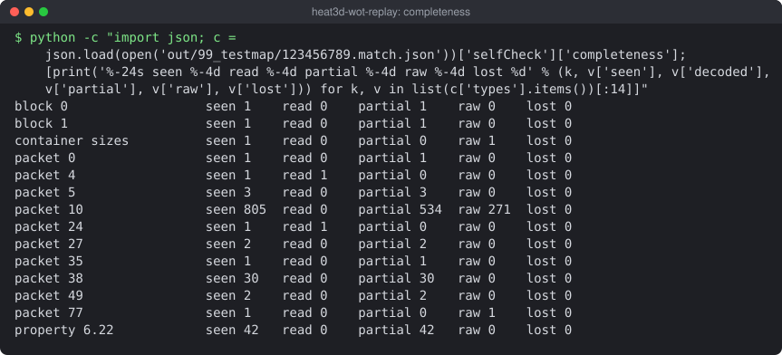

# Паўната {#completeness}

Нічога ў запісе не выкідваецца. Тое, што чытае канвертар, ідзе ў табліцу і
дакумент матча; кожны іншы пункт захоўваецца цалкам у дапаможным файле
`<match>.messages.parquet`; а `selfCheck.completeness` дакумента матча лічыць,
што стала з кожным відам пунктаў. Гэта правіла, агульнае для ўсіх
канвертараў 3DHeat:
[Converters keep everything](https://holdi601.github.io/3DHeat/converters.html).

## Падлік {#the-count}

Для кожнага віду пунктаў `selfCheck.completeness.types` дае:

| Лічба | Азначае |
|---|---|
| `seen` | колькі трымае запіс |
| `decoded` | прачытана цалкам |
| `partial` | прачытана часткова і захавана цалкам у дапаможным файле |
| `raw` | толькі захавана цалкам у дапаможным файле, не прачытана |
| `lost` | згублена: заўсёды `0` |

Віды - гэта ўласныя віды запісу: `block 0` (загаловак), `block 1`
(вынікі), `container sizes` і `deflate tail` (уласныя байты кантэйнера),
`packet <type>`, а для выклікаў сутнасцей - `method <entity type>.<number>`
і `property <entity type>.<number>`. Тыпы сутнасцей - гэта лікі, якія даюць
пакеты стварэння; `selfCheck.entities.roles` кажа, які з іх аватар гульца,
які вядзе запіс, а якія - машыны. Від, пра які ніхто не ведаў, з'яўляецца са
сваёй лічбай.

## Дапаможны файл {#the-sidecar}

| Слупок | Што |
|---|---|
| `time` | гадзіннік запісу, як у табліцы |
| `type`, `name` | від пункта; як яго называе канвертар, дзе ён яго чытае |
| `entity` | машына або аватар, да якога ён належыць, як `entity` табліцы |
| `decoded` | што з яго прачытана, як JSON |
| `payload`, `text` | яго байты, цалкам; блокі JSON, цалкам |
| `entityType`, `packet`, `method` | лікі |

Радкі адсартаваны па пакеце, метадзе, сутнасці і часе.

## Што чытаецца і як гэта правярана {#what-is-read-and-how-it-was-checked}

- **Тангаж і крэн** кожнай пазіцыі: тангаж - гэта мінус нахіл уласнага шляху
  танка, пакуль ён едзе наперад; два танкі ў адным месцы з адным курсам маюць
  аднолькавы крэн, а з супрацьлеглымі курсамі - супрацьлеглы крэн.
- **Сутнасці** (`entities`): калі кожная ўвайшла ў поле зроку кліента і
  выйшла з яго. Ніводзін танк не мае пазіцыі паміж выхадам і вяртаннем.
- **Версія ў струмені** (`streamVersion`): тая ж, што ў загалоўку.
- **Прыцэл гульца, які вядзе запіс** (пакет 38): напрамак, у `decoded`
  дапаможнага файла (`forward`); пры стрэлах гульца ён адрозніваецца на долю
  градуса ад таго, куды ляцеў снарад.

Усё астатняе прачытанае (здароўе, трапленні, стрэлы, трасіруючыя, выбухі,
вуглы гарматы, абнаўленні арэны, чат, рэжымы камеры, падзеі кліента,
пазіцыі) - `partial`: у табліцы або дакуменце матча і захавана цалкам у
дапаможным файле.

**Захавана, але не прачытана** (`raw`), найбольшыя віды: абнаўленні пазіцый,
якіх няма ў табліцы (аватара, пасля смерці танка, сутнасцей не са спісу),
пакеты 26, 28, 29, 31, 36, 50, 54 і 57, некаторыя частыя ўласцівасці
машыны і аватара, кожны метад і ўласцівасць без чытача (сярод іх пашкоджанні
модуляў, экіпаж і расходныя матэрыялы) і ўласцівасці стварэнняў сутнасцей.

## Недаступна {#not-available}

- Тое, чаго сервер ніколі не слаў кліенту, які вёў запіс: прыцэл, камера і
  ўвод іншых гульцоў, праціўнікі, пакуль іх не заўважылі. Запіс - гэта тое,
  што сказалі адному кліенту.
- Назвы тыпаў сутнасцей, метадаў і ўласцівасцей: яны ў файлах азначэнняў
  гульні, а не ў запісе. Лікі захоўваюцца.
- Вышыня гарматы ў градусах і ўсё, што патрабуе ўласных дадзеных танкаў з
  файлаў гульні.

---

Частка [3DHeat](https://github.com/Holdi601/3DHeat) ([дакументацыя](https://holdi601.github.io/3DHeat/)). Крыніца: [3DHeat-Ext-WoT](https://github.com/Holdi601/3DHeat-Ext-WoT).
