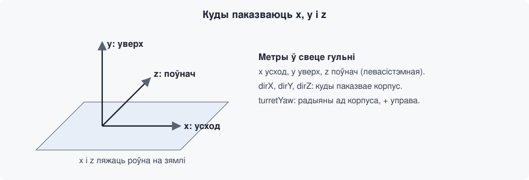

# Табліца {#the-table}

Адзін радок на адлік або падзею ў `<match>.parquet`: 38 слупкоў
([Спіс слупкоў](../columns.md), ствараецца з кода).

| Слупок | Што |
|---|---|
| `match`, `map` | id бою; id карты (`99_testmap` на малюнках) |
| `time` | секунды ад пачатку запісу (адлік перад боем уключаны) |
| `battleTime` | секунды ад пачатку бою; адмоўны падчас адліку |
| `event` | чым з'яўляецца радок (ніжэй) |
| `player`, `team`, `own` | імя гульца; каманда `1` або `2`; `1` у радках гульца, які вядзе запіс |
| `vehicle`, `type` | танк пад назвай гульні (`ussr:R144_K_91`); `tank`, або `shell` для трасіруючай ці выбуху, чый стралок невядомы (няма гульца) |
| `x`, `y`, `z` | метры: x усход, y уверх, z поўнач (уласны свет гульні, левасістэмны) |
| `dirX`, `dirY`, `dirZ` | куды паказвае корпус, адзінкавы вектар у той жа сістэме (`dirY` 0: толькі курс); для стрэлу ці трасіруючай - куды ляцеў снарад |
| `turretYaw` | вугал вежы ад курсу корпуса, радыяны, дадатны ўправа |
| `gunStep` | вышыня гарматы як крок 0-63 паміж уласнымі межамі гарматы (межы - дадзеныя танка, а не запісу) |
| `other`, `reason` | другая машына падзеі (забойца, ахвяра, нападнік, мэта); нумар прычыны атакі ў гульні |
| `value`, `health` | лік падзеі (урон, чарга, хуткасць снарада, маштаб, каманда); здароўе пасля змены |
| `text` | назва прычыны, радок чата, рэжым камеры, ключ каманды |
| `shot` | id снарада: стрэл, яго трасіруючая і яго выбух падзяляюць яго |
| `entity` | id машыны ў запісе |
| `hitComponent`, `hitCode`, `hitU/V/W`, `hitExitU/V/W`, `hitDirX/Y/Z` | толькі ў радках `struck`: куды трапіў снарад (гл. падзею `struck` ніжэй) |
| `pitch`, `roll` | у пазіцыі - тангаж корпуса (радыяны, дадатны носам уніз) і крэн, як іх дасылае гульня |

| `event` | У радку | Што |
|---|---|---|
| `position` | кожная машына | каля дзесяці разоў у секунду, пакуль кліент ведаў, дзе яна |
| `death`, `kill` | ахвяра, забойца | кожная смерць двойчы: дзе ахвяра ўпала і дзе стаяў забойца |
| `hurt`, `damage` | ахвяра, нападнік | змена здароўя: `value` урон, `health` што засталося, `reason`/`text` чаму (`shot`, `fire`, `ramming`, ...) |
| `struck` | ахвяра | снарад, які ў яе трапіў, у тым ліку тыя, што рыкашэцілі або не прабілі: адзін радок на пункт траплення, `value` урон, які ён нанёс (у першым); `hitComponent` - кампанент сутыкнення, `hitU/V/W` - куды снарад увайшоў, а `hitExitU/V/W` - дзе скончыўся яго шлях, у долях скрынкі гэтага кампанента (u управа, v уверх, w наперад; праверана па пеленгу нападніка), `hitDirX/Y/Z` - напрамак уваходу ў сістэме корпуса, `turretYaw` - тагачасная вежа ахвяры, `hitCode` - байт, дасланы з пунктам (невядома: ён не залежыць ад урону) |
| `shot` | стралок | `value` - чарга; напрамак, у якім ляцела яго трасіруючая, інакш напрамак корпуса плюс вежы |
| `tracer` | стралок | дзе снарад упершыню ўбачылі і як ён ляцеў; `value` - яго хуткасць у адзінках гульні |
| `impact` | стралок | дзе снарад узарваўся |
| `chat` | адпраўнік | `text` - радок |
| `command` | адпраўнік | каманда баявога чата (атака, дапамога, пункт на карце), у яе пункце, калі ён ёсць; `value` - нумар каманды, `other` - машына, якую яна называе |
| `camera`, `zoom`, `lock`, `unlock` | гулец, які вядзе запіс | рэжым камеры (`sniper`, `arcade`, ...), маштаб, аўтапрыцэл уключаны і выключаны на мэце |

Калонтытул Parquet нясе падказкі `heat3d`: Y уверх, Z перакулены (каб карта
не была люстраной), маштаб адзінак 1, машына шырынёй сем метраў, `player`
як чалавек, `team` як група, `match` як сесія.

---

Частка [3DHeat](https://github.com/Holdi601/3DHeat) ([дакументацыя](https://holdi601.github.io/3DHeat/)). Крыніца: [3DHeat-Ext-WoT](https://github.com/Holdi601/3DHeat-Ext-WoT).
