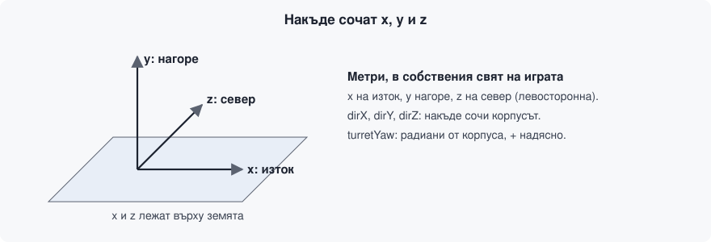

# Таблицата {#the-table}

По един ред за всяка проба или събитие, в `<match>.parquet`: 38 колони
([Списък на колоните](../columns.md), генериран от кода).

| Колона | Какво е |
|---|---|
| `match`, `map` | идентификаторът на битката; идентификаторът на картата (`99_testmap` на картинките) |
| `time` | секунди от началото на записа (в него е и обратното броене) |
| `battleTime` | секунди от началото на битката; отрицателни по време на обратното броене |
| `event` | какво е редът (по-долу) |
| `player`, `team`, `own` | името на играча; отбор `1` или `2`; `1` на редовете на записващия играч |
| `vehicle`, `type` | танкът, както го назовава играта (`ussr:R144_K_91`); `tank` или `shell` за трасиращ снаряд или експлозия, чийто стрелец не е известен (няма играч) |
| `x`, `y`, `z` | метри: x на изток, y нагоре, z на север (собственият свят на играта, левосторонна система) |
| `dirX`, `dirY`, `dirZ` | накъде сочи корпусът, единичен вектор в същата координатна система (`dirY` 0: само курс); при изстрел или трасиращ снаряд – накъде е летял снарядът |
| `turretYaw` | ъгълът на кулата спрямо курса на корпуса, радиани, положителен надясно |
| `gunStep` | възвишението на оръдието като стъпка 0-63 между собствените граници на оръдието (границите са данни на танка, не на повторението) |
| `other`, `reason` | другата техника на събитие (убиец, жертва, нападател, цел); номерът на причината за атака в играта |
| `value`, `health` | числото на събитието (щета, откос, скорост на снаряда, увеличение, команда); здраве след промяна |
| `text` | името на причината, ред от чата, режим на камерата, ключ на команда |
| `shot` | идентификаторът на снаряда: изстрелът, трасерът и експлозията му го споделят |
| `entity` | идентификаторът на техниката в повторението |
| `hitComponent`, `hitCode`, `hitU/V/W`, `hitExitU/V/W`, `hitDirX/Y/Z` | само на редове `struck`: къде е ударил снарядът (вижте събитието `struck` по-долу) |
| `pitch`, `roll` | при позиция: наклонът на корпуса (радиани, положителен с носа надолу) и кренът, както ги изпраща играта |

| `event` | На реда на | Какво е |
|---|---|---|
| `position` | всяка техника | около десет пъти в секунда, докато клиентът знае къде е |
| `death`, `kill` | жертвата, убиеца | всяка смърт два пъти: къде е паднала жертвата и къде е стоял убиецът |
| `hurt`, `damage` | жертвата, нападателя | промяна на здравето: `value` – щетата, `health` – какво е останало, `reason`/`text` – защо (`shot`, `fire`, `ramming`, ...) |
| `struck` | жертвата | снаряд, който я е ударил, включително тези, които са отскочили или не са проникнали: по един ред за всяка точка на удар, `value` – щетата, която е нанесъл (на първия); `hitComponent` – компонентът за сблъсък, `hitU/V/W` – къде е влязъл снарядът и `hitExitU/V/W` – където е свършил пътят му, като дроби от кутията на този компонент (u надясно, v нагоре, w напред; проверено спрямо посоката на нападателя), `hitDirX/Y/Z` – накъде е дошъл в координатната система на корпуса, `turretYaw` – кулата на жертвата тогава, `hitCode` – байт, изпратен с точката (не е известен: не следва щетата) |
| `shot` | стрелецът | `value` – откосът; посоката, в която е летял трасерът, иначе тази на корпуса плюс тази на кулата |
| `tracer` | стрелецът | където снарядът е бил видян за първи път и посоката, в която е летял; `value` – скоростта му в единиците на играта |
| `impact` | стрелецът | където снарядът е експлодирал |
| `chat` | изпращача | `text` – редът |
| `command` | изпращача | команда от битковия чат (атака, помощ, точка на картата), на нейната точка, когато има такава; `value` – номерът на командата, `other` – техниката, която назовава |
| `camera`, `zoom`, `lock`, `unlock` | записващия играч | режимът на камерата (`sniper`, `arcade`, ...), увеличението, включването и изключването на автоматичното прицелване към цел |

Футърът на Parquet носи подсказките `heat3d`: Y нагоре, Z обърнато (така картата не е огледална),
мащаб на единицата 1, техника, широка седем метра, `player` като човека, `team` като групата, `match` като сесията.

---

Част от [3DHeat](https://github.com/Holdi601/3DHeat) ([документация](https://holdi601.github.io/3DHeat/)). Източник: [3DHeat-Ext-WoT](https://github.com/Holdi601/3DHeat-Ext-WoT).
