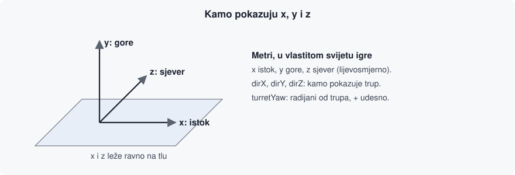

# Tabela {#the-table}

Jedan red po uzorku ili događaju, u `<match>.parquet`: 38 kolona
([Lista kolona](../columns.md), generisana iz koda).

| Kolona | Šta |
|---|---|
| `match`, `map` | id bitke; id mape (`99_testmap` na slikama) |
| `time` | sekunde od početka snimanja (odbrojavanje je uključeno) |
| `battleTime` | sekunde od početka bitke; negativno tokom odbrojavanja |
| `event` | šta je red (dolje) |
| `player`, `team`, `own` | ime igrača; tim `1` ili `2`; `1` na redovima igrača koji snima |
| `vehicle`, `type` | tenk kako ga igra imenuje (`ussr:R144_K_91`); `tank`, ili `shell` za trasirku ili eksploziju čiji strijelac nije poznat (nema igrača) |
| `x`, `y`, `z` | metri: x istok, y gore, z sjever (vlastiti svijet igre, lijevosmjeran) |
| `dirX`, `dirY`, `dirZ` | kamo pokazuje trup, jedinični vektor u istom okviru (`dirY` 0: samo heading); na hicu ili trasirki kamo je granata letjela |
| `turretYaw` | ugao kupole od headinga trupa, radijani, pozitivno udesno |
| `gunStep` | elevacija topa kao korak 0-63 između vlastitih granica topa (granice su podaci tenka, ne replaya) |
| `other`, `reason` | drugo vozilo događaja (ubica, žrtva, napadač, meta); broj razloga napada u igri |
| `value`, `health` | broj događaja (šteta, rafal, brzina granate, zum, naredba); zdravlje poslije promjene |
| `text` | ime razloga, red četa, način kamere, ključ naredbe |
| `shot` | id granate: hitac, njegova trasirka i njegova eksplozija dijele ga |
| `entity` | id vozila u replayu |
| `hitComponent`, `hitCode`, `hitU/V/W`, `hitExitU/V/W`, `hitDirX/Y/Z` | samo na redovima `struck`: gdje je granata udarila (vidi događaj `struck` dolje) |
| `pitch`, `roll` | na poziciji, pitch trupa (radijani, pozitivno nos dolje) i roll, kako ih igra šalje |

| `event` | Na redu od | Šta |
|---|---|---|
| `position` | svako vozilo | oko deset puta u sekundi, dok je klijent znao gdje je |
| `death`, `kill` | žrtva, ubica | svaka smrt dvaput: gdje je žrtva pala i gdje je ubica stajao |
| `hurt`, `damage` | žrtva, napadač | promjena zdravlja: `value` šteta, `health` šta je ostalo, `reason`/`text` zašto (`shot`, `fire`, `ramming`, ...) |
| `struck` | žrtva | granata koja ju je pogodila, i one koje su se odbile ili nisu probile: jedan red po pogođenoj tački, `value` šteta koju je nanijela (na prvoj); `hitComponent` komponenta kolizije, `hitU/V/W` gdje je granata ušla i `hitExitU/V/W` gdje se njena putanja završila kao razlomci kutije te komponente (u desno, v gore, w naprijed; provjereno prema smjeru napadača), `hitDirX/Y/Z` smjer iz kojeg je došla u okviru trupa, `turretYaw` kupola žrtve u tom trenutku, `hitCode` bajt poslan s tačkom (nije poznat: ne prati štetu) |
| `shot` | strijelac | `value` rafal; smjer kojim je letjela njegova trasirka, inače smjer trupa plus kupole |
| `tracer` | strijelac | gdje je granata prvi put viđena i kojim je putem letjela; `value` njena brzina u jedinicama igre |
| `impact` | strijelac | gdje je granata eksplodirala |
| `chat` | pošiljalac | `text` red |
| `command` | pošiljalac | naredba četa bitke (napad, pomoć, tačka na mapi), na svojoj tački kad je ima; `value` broj naredbe, `other` vozilo koje imenuje |
| `camera`, `zoom`, `lock`, `unlock` | igrač koji snima | način kamere (`sniper`, `arcade`, ...), zum, automatsko ciljanje uključeno i isključeno na metu |

Podnožje Parqueta nosi upute `heat3d`: Y gore, Z preokrenut (da mapa nije
zrcaljena), jedinično mjerilo 1, vozilo široko sedam metara, `player` kao
osoba, `team` kao grupa, `match` kao sesija.

---

Dio [3DHeata](https://github.com/Holdi601/3DHeat) ([dokumentacija](https://holdi601.github.io/3DHeat/)). Izvor: [3DHeat-Ext-WoT](https://github.com/Holdi601/3DHeat-Ext-WoT).
