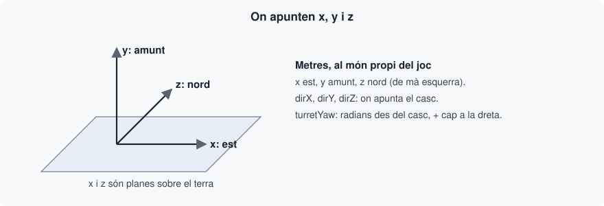

# La taula {#the-table}

Una fila per mostra o esdeveniment, a `<partida>.parquet`: 38 columnes ([Llista de columnes](../columns.md),
generada a partir del codi).

| Columna | Què és |
|---|---|
| `match`, `map` | l'identificador de la batalla; l'identificador del mapa (`99_testmap` a les imatges) |
| `time` | segons des que va començar la gravació (la compte enrere hi és) |
| `battleTime` | segons des que va començar la batalla; negatius durant la compte enrere |
| `event` | què és la fila (més avall) |
| `player`, `team`, `own` | el nom del jugador; l'equip `1` o `2`; `1` a les files del jugador que grava |
| `vehicle`, `type` | el tanc tal com el nomena el joc (`ussr:R144_K_91`); `tank`, o `shell` per a un traçador o una explosió de què no es coneix el tirador (sense jugador) |
| `x`, `y`, `z` | metres: x est, y amunt, z nord (el món propi del joc, de mà esquerra) |
| `dirX`, `dirY`, `dirZ` | cap on apunta el casc, un vector unitari al mateix marc (`dirY` 0: només heading); en un tret o traçador, cap on va volar l'obús |
| `turretYaw` | l'angle de la torreta respecte al heading del casc, en radians, positiu cap a la dreta |
| `gunStep` | l'elevació del canó com un pas de 0-63 entre els límits propis del canó (els límits són les dades del tanc, no de la repetició) |
| `other`, `reason` | l'altre vehicle d'un esdeveniment (assassí, víctima, atacant, objectiu); el número de raó d'atac del joc |
| `value`, `health` | el número de l'esdeveniment (dany, ràfega, velocitat de l'obús, zoom, ordre); la salut després d'un canvi |
| `text` | el nom de la raó, una línia de xat, un mode de càmera, la clau d'una ordre |
| `shot` | l'identificador de l'obús: un tret, el seu traçador i la seva explosió el comparteixen |
| `entity` | l'identificador del vehicle a la repetició |
| `hitComponent`, `hitCode`, `hitU/V/W`, `hitExitU/V/W`, `hitDirX/Y/Z` | només a les files `struck`: on va impactar un obús (vegeu l'esdeveniment `struck` més avall) |
| `pitch`, `roll` | en una posició, la inclinació del casc (radians, positiu amb el morro avall) i el roll, tal com els envia el joc |

| `event` | A la fila de | Què és |
|---|---|---|
| `position` | cada vehicle | unes deu vegades per segon, mentre el client sabia on era |
| `death`, `kill` | la víctima, l'assassí | cada mort dues vegades: on va caure la víctima, i on era l'assassí |
| `hurt`, `damage` | la víctima, l'atacant | un canvi de salut: `value` el dany, `health` el que queda, `reason`/`text` el motiu (`shot`, `fire`, `ramming`, ...) |
| `struck` | la víctima | un obús que la va impactar, també els que van rebotar o no van perforar: una fila per punt impactat, `value` el dany que va fer (a la primera); `hitComponent` el component de col·lisió, `hitU/V/W` on va entrar l'obús i `hitExitU/V/W` on va acabar el seu camí, com a fraccions de la caixa d'aquell component (u dreta, v amunt, w endavant; comprovat amb el rumb de l'atacant), `hitDirX/Y/Z` la manera com va arribar, en el marc del casc, `turretYaw` la torreta de la víctima en aquell moment, `hitCode` un byte enviat amb el punt (no se sap què és: no segueix el dany) |
| `shot` | el tirador | `value` la ràfega; la direcció que va seguir el seu traçador, si no la del casc més la de la torreta |
| `tracer` | el tirador | on es va veure un obús per primer cop i la manera com volava; `value` la seva velocitat en les unitats del joc |
| `impact` | el tirador | on va explotar un obús |
| `chat` | qui envia | `text` la línia |
| `command` | qui envia | una ordre de xat de batalla (atac, ajuda, un punt al mapa), al seu punt quan en té un; `value` el número de l'ordre, `other` el vehicle que nomena |
| `camera`, `zoom`, `lock`, `unlock` | el jugador que grava | el mode de càmera (`sniper`, `arcade`, ...), el zoom, la punteria automàtica activada i desactivada sobre un objectiu |

El peu del Parquet porta les indicacions `heat3d`: Y amunt, Z invertida (de manera que el mapa no es reflecteix),
escala d'unitat 1, un vehicle de set metres d'amplada, `player` com la persona, `team` com el grup, `match` com la
sessió.

---

Part de [3DHeat](https://github.com/Holdi601/3DHeat) ([documentació](https://holdi601.github.io/3DHeat/)). Font: [3DHeat-Ext-WoT](https://github.com/Holdi601/3DHeat-Ext-WoT).
