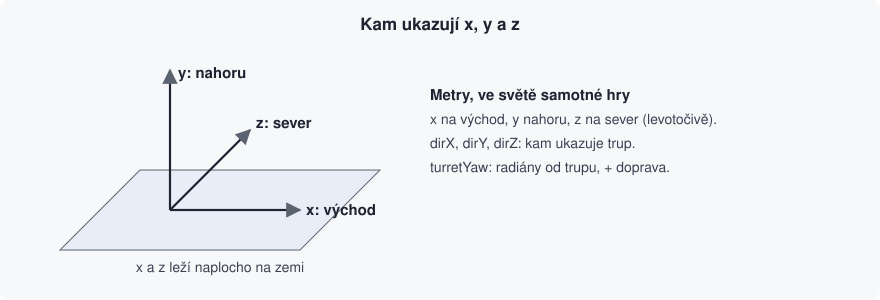

# Tabulka {#the-table}

Jeden řádek na vzorek nebo událost, v `<match>.parquet`: 38 sloupců
([Seznam sloupců](../columns.md), generovaný z kódu).

| Sloupec | Co |
|---|---|
| `match`, `map` | id bitvy; id mapy (`99_testmap` na obrázcích) |
| `time` | sekundy od začátku nahrávání (odpočet je v něm) |
| `battleTime` | sekundy od začátku bitvy; během odpočtu záporné |
| `event` | co řádek je (níže) |
| `player`, `team`, `own` | jméno hráče; tým `1` nebo `2`; `1` na řádcích hráče, který nahrával |
| `vehicle`, `type` | tank tak, jak ho hra pojmenovává (`ussr:R144_K_91`); `tank`, nebo `shell` u stopy nebo výbuchu, jehož střelec není znám (žádný hráč) |
| `x`, `y`, `z` | metry: x na východ, y nahoru, z na sever (vlastní svět hry, levotočivý) |
| `dirX`, `dirY`, `dirZ` | kam ukazuje trup, jednotkový vektor ve stejném rámci (`dirY` 0: jen kurz); u výstřelu nebo stopy, kam střela letěla |
| `turretYaw` | úhel věže od kurzu trupu, radiány, kladný doprava |
| `gunStep` | sklon děla jako krok 0-63 mezi vlastními mezemi děla (meze jsou data tanku, ne replaye) |
| `other`, `reason` | druhé vozidlo události (zabiják, oběť, útočník, cíl); číslo důvodu útoku ve hře |
| `value`, `health` | číslo události (poškození, dávka, rychlost střely, přiblížení, příkaz); zdraví po změně |
| `text` | název důvodu, řádek chatu, režim kamery, klíč příkazu |
| `shot` | id střely: výstřel, jeho stopa a jeho výbuch ho sdílejí |
| `entity` | id vozidla v replayi |
| `hitComponent`, `hitCode`, `hitU/V/W`, `hitExitU/V/W`, `hitDirX/Y/Z` | jen na řádcích `struck`: kde střela zasáhla (viz událost `struck` níže) |
| `pitch`, `roll` | u pozice sklon trupu (radiány, kladný nos dolů) a náklon, tak, jak je hra posílá |

| `event` | Na řádku | Co |
|---|---|---|
| `position` | každého vozidla | asi desetkrát za vteřinu, když klient věděl, kde je |
| `death`, `kill` | oběti, zabijáka | každá smrt dvakrát: kde oběť padla a kde stál zabiják |
| `hurt`, `damage` | oběti, útočníka | změna zdraví: `value` poškození, `health` co zbývá, `reason`/`text` proč (`shot`, `fire`, `ramming`, ...) |
| `struck` | oběti | střela, která ji zasáhla, včetně těch, které se odrazily nebo neprorazily: jeden řádek na zasažený bod, `value` poškození, které způsobila (u prvního); `hitComponent` kolizní komponenta, `hitU/V/W` kam střela vnikla a `hitExitU/V/W` kde její dráha skončila jako zlomky boxu té komponenty (u vpravo, v nahoru, w dopředu; ověřeno proti zaměření útočníka), `hitDirX/Y/Z` odkud přišla v rámci trupu, `turretYaw` věž oběti tehdy, `hitCode` bajt poslaný s bodem (neznámý: nesleduje poškození) |
| `shot` | střelce | `value` dávka; směr, kterým letěla jeho stopa, jinak trup plus věž |
| `tracer` | střelce | kde byla střela poprvé spatřena a jakým směrem letěla; `value` její rychlost v jednotkách hry |
| `impact` | střelce | kde střela vybuchla |
| `chat` | odesílatele | `text` řádek |
| `command` | odesílatele | příkaz bitevního chatu (útok, pomoc, bod na mapě), u svého bodu, je-li nějaký; `value` číslo příkazu, `other` vozidlo, které jmenuje |
| `camera`, `zoom`, `lock`, `unlock` | hráče, který nahrával | režim kamery (`sniper`, `arcade`, ...), přiblížení, automatické míření na cíl zapnuto a vypnuto |

Zápatí Parquet nese nápovědy `heat3d`: Y nahoru, Z obrácené (takže mapa není zrcadlena), měřítko jednotky 1, vozidlo
sedm metrů napříč, `player` jako osoba, `team` jako skupina, `match` jako relace.

---

Součást [3DHeat](https://github.com/Holdi601/3DHeat) ([dokumentace](https://holdi601.github.io/3DHeat/)). Zdroj: [3DHeat-Ext-WoT](https://github.com/Holdi601/3DHeat-Ext-WoT).
