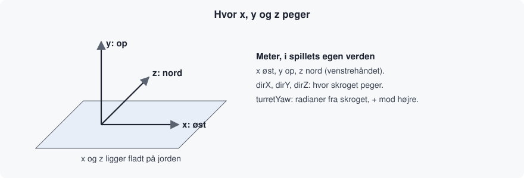

# Tabellen {#the-table}

Én række pr. sample eller begivenhed, i `<match>.parquet`: 38 kolonner
([Kolonneliste](../columns.md), genereret ud fra koden).

| Kolonne | Hvad |
|---|---|
| `match`, `map` | kampens id; kortets id (`99_testmap` på billederne) |
| `time` | sekunder siden optagelsen begyndte (nedtællingen er med) |
| `battleTime` | sekunder siden kampen begyndte; negativ under nedtællingen |
| `event` | hvad rækken er (nedenfor) |
| `player`, `team`, `own` | spillerens navn; hold `1` eller `2`; `1` på den optagende spillers rækker |
| `vehicle`, `type` | tanken, som spillet navngiver den (`ussr:R144_K_91`); `tank`, eller `shell` for et sporstof eller en eksplosion, hvis skytte ikke kendes (ingen spiller) |
| `x`, `y`, `z` | meter: x øst, y op, z nord (spillets egen verden, venstrehåndet) |
| `dirX`, `dirY`, `dirZ` | hvor skroget peger, en enhedsvektor i samme ramme (`dirY` 0: kun heading); ved et skud eller sporstof hvor granaten fløj |
| `turretYaw` | tårnets vinkel fra skrogets heading, radianer, positiv mod højre |
| `gunStep` | kanonens hævning som et trin 0-63 mellem kanonens egne grænser (grænserne er tankens data, ikke replayets) |
| `other`, `reason` | den anden enhed i en begivenhed (dræber, offer, angriber, mål); spillets angrebsårsagsnummer |
| `value`, `health` | begivenhedens tal (skade, skudserie, granathastighed, zoom, kommando); liv efter en ændring |
| `text` | årsagens navn, en chatlinje, en kameratilstand, en kommandos nøgle |
| `shot` | granatens id: et skud, dets sporstof og dets eksplosion deler det |
| `entity` | køretøjets id i replayet |
| `hitComponent`, `hitCode`, `hitU/V/W`, `hitExitU/V/W`, `hitDirX/Y/Z` | kun på `struck`-rækker: hvor en granat ramte (se `struck`-begivenheden nedenfor) |
| `pitch`, `roll` | på en position, skrogets pitch (radianer, positiv med næsen ned) og rulning, som spillet sender dem |

| `event` | På rækken for | Hvad |
|---|---|---|
| `position` | hvert køretøj | ca. ti gange i sekundet, mens klienten vidste, hvor det var |
| `death`, `kill` | offeret, dræberen | hvert dødsfald to gange: hvor offeret faldt, og hvor dræberen stod |
| `hurt`, `damage` | offeret, angriberen | en livsændring: `value` skaden, `health` hvad der er tilbage, `reason`/`text` hvorfor (`shot`, `fire`, `ramming`, ...) |
| `struck` | offeret | en granat, der ramte det, også dem der afprallede eller ikke trængte igennem: én række pr. ramt punkt, `value` den skade, den gjorde (på den første); `hitComponent` kollisionskomponenten, `hitU/V/W` hvor granaten gik ind og `hitExitU/V/W` hvor dens bane endte som brøkdele af komponentens boks (u højre, v op, w frem; kontrolleret mod angriberens pejling), `hitDirX/Y/Z` den måde, den kom ind i skrogets ramme, `turretYaw` offerets tårn dengang, `hitCode` en byte sendt med punktet (ikke kendt: den følger ikke skaden) |
| `shot` | skytten | `value` skudserien; den retning sporstoffet fløj, ellers skrogets plus tårnets |
| `tracer` | skytten | hvor en granat først blev set, og den måde den fløj; `value` dens hastighed i spillets enheder |
| `impact` | skytten | hvor en granat eksploderede |
| `chat` | afsenderen | `text` linjen |
| `command` | afsenderen | en kampchatkommando (angreb, hjælp, et punkt på kortet), ved sit punkt når den har et; `value` kommandoens nummer, `other` det køretøj, den nævner |
| `camera`, `zoom`, `lock`, `unlock` | den optagende spiller | kameratilstanden (`sniper`, `arcade`, ...), zoomen, automatisk sigte til og fra et mål |

Parquet-fodnoten bærer `heat3d`-hints: y op, z vendt (så kortet ikke spejles), enhedsskala 1, et køretøj
syv meter på tværs, `player` som personen, `team` som gruppen, `match` som sessionen.

---

Del af [3DHeat](https://github.com/Holdi601/3DHeat) ([dokumentation](https://holdi601.github.io/3DHeat/)). Kilde: [3DHeat-Ext-WoT](https://github.com/Holdi601/3DHeat-Ext-WoT).
