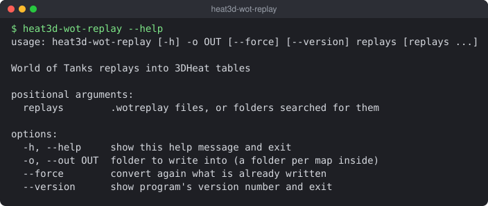

# Installation {#installing}

Neu auf der Kommandozeile? Lies zuerst [Bevor du anfängst](before-you-start.md).
Man braucht Python 3.10 oder neuer; numpy und pyarrow werden mit installiert.

## Schritt für Schritt {#step-by-step}

1. Hol dir den Code: `git clone https://github.com/Holdi601/3DHeat-Ext-WoT.git`,
   oder lade eine ZIP-Datei von [Releases](https://github.com/Holdi601/3DHeat-Ext-WoT/releases)
   herunter und entpacke sie.
2. Öffne ein Terminal in diesem Ordner und tippe `pip install -e .`. Danach ist der
   Befehl `heat3d-wot-replay` in deinem Pfad verfügbar.
3. Prüfe es: `heat3d-wot-replay --version`. Du solltest
   `heat3d-wot-replay 0.1.0` sehen. `heat3d-wot-replay --help` listet die Optionen:

Ohne Installation macht `python -m heat3d_ext_wot ...` im Ordner des Werkzeugs
dasselbe.

Der 3DHeat-Watcher startet diesen Befehl bei neuen Replays, wenn er installiert ist,
und arbeitet auch ohne ihn.

## Aktualisierungen {#updates}

Jeder Start prüft zuerst die GitHub-Releases des Projekts (höchstens eine Anfrage
alle paar Stunden; das hält eine Umwandlung nie an, online oder offline). Ist ein
neueres Release da, fragt der Befehl, bevor er es installiert: Ein `git clone` wird
mit `git pull --ff-only` aktualisiert (abgelehnt, solange du lokale Änderungen hast),
eine heruntergeladene Kopie wird aus dem Archiv des Releases erneuert. `HEAT3D_NO_UPDATE=1` schaltet
die Prüfung und die Aktualisierung ab.

---

Teil von [3DHeat](https://github.com/Holdi601/3DHeat) ([Dokumentation](https://holdi601.github.io/3DHeat/)). Quelle: [3DHeat-Ext-WoT](https://github.com/Holdi601/3DHeat-Ext-WoT).
