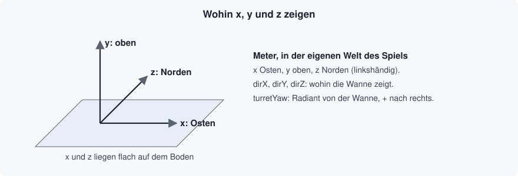

# Die Tabelle {#the-table}

Eine Zeile je Messwert oder Ereignis, in `<match>.parquet`: 38 Spalten
([Spaltenliste](../columns.md), aus dem Code erzeugt).

| Spalte | Was |
|---|---|
| `match`, `map` | die Kennung des Gefechts; die Kennung der Karte (`99_testmap` in den Bildern) |
| `time` | Sekunden seit Beginn der Aufnahme (der Countdown ist darin enthalten) |
| `battleTime` | Sekunden seit Beginn des Gefechts; negativ während des Countdowns |
| `event` | was die Zeile ist (unten) |
| `player`, `team`, `own` | der Name des Spielers; Team `1` oder `2`; `1` auf den Zeilen des aufnehmenden Spielers |
| `vehicle`, `type` | der Panzer, so wie das Spiel ihn nennt (`ussr:R144_K_91`); `tank`, oder `shell` für eine Leuchtspur oder Explosion, deren Schütze nicht bekannt ist (kein Spieler) |
| `x`, `y`, `z` | Meter: x Osten, y oben, z Norden (die eigene Welt des Spiels, linkshändig) |
| `dirX`, `dirY`, `dirZ` | wohin die Wanne zeigt, ein Einheitsvektor im selben Koordinatensystem (`dirY` 0: nur der Kurs); bei einem Schuss oder einer Leuchtspur, wohin die Granate flog |
| `turretYaw` | der Winkel des Turms relativ zum Kurs der Wanne, Radiant, positiv nach rechts |
| `gunStep` | der Höhenwinkel des Geschützes als Schritt 0-63 zwischen den eigenen Grenzen des Geschützes (die Grenzen sind die Daten des Panzers, nicht des Replays) |
| `other`, `reason` | das andere Fahrzeug eines Ereignisses (Killer, Opfer, Angreifer, Ziel); die Nummer des Angriffsgrundes des Spiels |
| `value`, `health` | die Zahl des Ereignisses (Schaden, Feuerstoß, Geschwindigkeit des Geschosses, Zoom, Befehl); Lebenspunkte nach einer Änderung |
| `text` | der Name des Grundes, eine Chatzeile, ein Kameramodus, der Schlüssel eines Befehls |
| `shot` | die Kennung der Granate: ein Schuss, seine Leuchtspur und seine Explosion teilen sie |
| `entity` | die ID des Fahrzeugs im Replay |
| `hitComponent`, `hitCode`, `hitU/V/W`, `hitExitU/V/W`, `hitDirX/Y/Z` | nur bei Zeilen `struck`: wo eine Granate traf (siehe das Ereignis `struck` unten) |
| `pitch`, `roll` | bei einer Position das Nicken (Radiant, positiv mit der Nase nach unten) und das Rollen der Wanne, so wie das Spiel sie sendet |

| `event` | Auf der Zeile von | Was |
|---|---|---|
| `position` | jedem Fahrzeug | etwa zehnmal pro Sekunde, solange der Client wusste, wo es war |
| `death`, `kill` | dem Opfer, dem Killer | jeder Tod zweimal: wo das Opfer fiel, und wo der Killer stand |
| `hurt`, `damage` | dem Opfer, dem Angreifer | eine Lebensänderung: `value` der Schaden, `health` was übrig ist, `reason`/`text` warum (`shot`, `fire`, `ramming`, ...) |
| `struck` | dem Opfer | eine Granate, die es traf, auch solche, die abprallten oder nicht durchdrangen: eine Zeile je getroffenem Punkt, `value` der Schaden, den sie anrichtete (bei der ersten); `hitComponent` die Kollisionskomponente, `hitU/V/W` wo die Granate eindrang und `hitExitU/V/W` wo ihr Weg endete, als Anteile am Kasten dieser Komponente (u rechts, v oben, w vorwärts; geprüft gegen die Peilung des Angreifers), `hitDirX/Y/Z` die Richtung, aus der sie kam, im Koordinatensystem der Wanne, `turretYaw` der damalige Turm des Opfers, `hitCode` ein Byte, das mit dem Punkt gesendet wird (nicht bekannt: es folgt nicht dem Schaden) |
| `shot` | den Schützen | `value` der Feuerstoß; die Richtung, in die seine Leuchtspur flog, sonst die der Wanne plus die des Turms |
| `tracer` | den Schützen | wo eine Granate zuerst gesehen wurde und wie sie flog; `value` ihre Geschwindigkeit in den Einheiten des Spiels |
| `impact` | den Schützen | wo eine Granate explodierte |
| `chat` | den Absender | `text` die Zeile |
| `command` | den Absender | ein Gefechts-Chatbefehl (Angriff, Hilfe, ein Punkt auf der Karte), an seinem Punkt, wenn er einen hat; `value` die Nummer des Befehls, `other` das Fahrzeug, das er nennt |
| `camera`, `zoom`, `lock`, `unlock` | den aufnehmenden Spieler | der Kameramodus (`sniper`, `arcade`, ...), der Zoom, die Zielhilfe ein und aus für ein Ziel |

Die Fußzeile der Parquet-Datei enthält die Hinweise `heat3d`: Y oben, Z gespiegelt (damit die Karte
nicht seitenverkehrt ist), Maßstab 1, ein Fahrzeug sieben Meter breit, `player` als die Person,
`team` als die Gruppe, `match` als die Sitzung.

---

Teil von [3DHeat](https://github.com/Holdi601/3DHeat) ([Dokumentation](https://holdi601.github.io/3DHeat/)). Quelle: [3DHeat-Ext-WoT](https://github.com/Holdi601/3DHeat-Ext-WoT).
