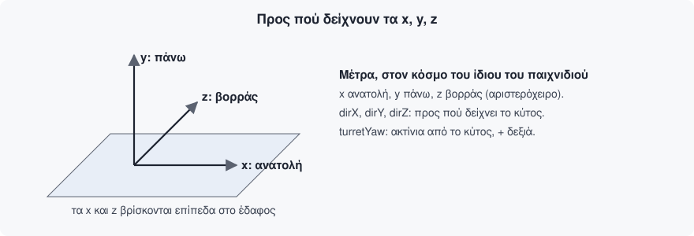

# Ο πίνακας {#the-table}

Μία γραμμή ανά δείγμα ή γεγονός, στο `<match>.parquet`: 38 στήλες
([Λίστα στηλών](../columns.md), παράγεται από τον κώδικα).

| Στήλη | Τι είναι |
|---|---|
| `match`, `map` | το αναγνωριστικό της μάχης· το αναγνωριστικό του χάρτη (`99_testmap` στις εικόνες) |
| `time` | δευτερόλεπτα από την αρχή της εγγραφής (η αντίστροφη μέτρηση είναι μέσα σε αυτό) |
| `battleTime` | δευτερόλεπτα από την αρχή της μάχης· αρνητικά κατά την αντίστροφη μέτρηση |
| `event` | τι είναι η γραμμή (παρακάτω) |
| `player`, `team`, `own` | το όνομα του παίκτη· η ομάδα `1` ή `2`· `1` στις γραμμές του παίκτη που καταγράφει |
| `vehicle`, `type` | το τανκ όπως το ονομάζει το παιχνίδι (`ussr:R144_K_91`)· `tank`, ή `shell` για ίχνος ή έκρηξη του οποίου ο σκοπευτής δεν είναι γνωστός (χωρίς παίκτη) |
| `x`, `y`, `z` | μέτρα: x ανατολή, y πάνω, z βορράς (ο ίδιος κόσμος του παιχνιδιού, αριστερόχειρος) |
| `dirX`, `dirY`, `dirZ` | προς πού δείχνει το κύτος, μοναδιαίο διάνυσμα στο ίδιο σύστημα (`dirY` 0: μόνο heading)· σε βολή ή ίχνος, προς τα πού πέταξε το βλήμα |
| `turretYaw` | η γωνία της πυργίσκου από το heading του κύτους, σε ακτίνια, θετική προς τα δεξιά |
| `gunStep` | η ανύψωση του πυροβόλου ως βήμα 0-63 ανάμεσα στα δικά του όρια (τα όρια είναι δεδομένα του τανκ, όχι του replay) |
| `other`, `reason` | το άλλο όχημα ενός γεγονότος (σκοτωτής, θύμα, επιτιθέμενος, στόχος)· ο αριθμός αιτίας επίθεσης του παιχνιδιού |
| `value`, `health` | ο αριθμός του γεγονότος (ζημιά, ριπή, ταχύτητα βλήματος, ζουμ, εντολή)· η υγεία μετά από μια αλλαγή |
| `text` | το όνομα της αιτίας, μια γραμμή συνομιλίας, μια λειτουργία κάμερας, το κλειδί μιας εντολής |
| `shot` | το αναγνωριστικό του βλήματος: μια βολή, το ίχνος της και η έκρηξή της το μοιράζονται |
| `entity` | το αναγνωριστικό του οχήματος στο replay |
| `hitComponent`, `hitCode`, `hitU/V/W`, `hitExitU/V/W`, `hitDirX/Y/Z` | μόνο στις γραμμές `struck`: πού χτύπησε ένα βλήμα (βλ. το γεγονός `struck` παρακάτω) |
| `pitch`, `roll` | σε μια θέση, η κλίση του κύτους (ακτίνια, θετική με τη μύτη κάτω) και το roll, όπως τα στέλνει το παιχνίδι |

| `event` | Στη γραμμή του | Τι είναι |
|---|---|---|
| `position` | κάθε οχήματος | περίπου δέκα φορές το δευτερόλεπτο, όσο ο πελάτης ήξερε πού βρισκόταν |
| `death`, `kill` | του θύματος, του σκοτωτή | κάθε θάνατος δύο φορές: πού έπεσε το θύμα, και πού στεκόταν ο σκοτωτής |
| `hurt`, `damage` | του θύματος, του επιτιθέμενου | μια αλλαγή υγείας: `value` η ζημιά, `health` τι απέμεινε, `reason`/`text` γιατί (`shot`, `fire`, `ramming`, ...) |
| `struck` | του θύματος | ένα βλήμα που το χτύπησε, και αυτά που αναπήδησαν ή δεν διαπέρασαν επίσης· μία γραμμή για κάθε σημείο που χτυπήθηκε, `value` η ζημιά που έκανε (στην πρώτη)· `hitComponent` το στοιχείο σύγκρουσης, `hitU/V/W` πού μπήκε το βλήμα και `hitExitU/V/W` πού τελείωσε η διαδρομή του, ως κλάσματα του κουτιού εκείνου του στοιχείου (u δεξιά, v πάνω, w μπροστά· ελέγχεται απέναντι στη γωνία του επιτιθέμενου)· `hitDirX/Y/Z` ο τρόπος που μπήκε στο σύστημα του κύτους· `turretYaw` η πυργίσκος του θύματος εκείνη τη στιγμή· `hitCode` ένα byte που στέλνεται με το σημείο (άγνωστο· δεν ακολουθεί τη ζημιά) |
| `shot` | του σκοπευτή | `value` η ριπή· η κατεύθυνση προς την οποία πέταξε το ίχνος του, αλλιώς αυτή του κύτους συν την πυργίσκο |
| `tracer` | του σκοπευτή | όπου φάνηκε πρώτα ένα βλήμα και ο τρόπος που πέταξε· `value` η ταχύτητά του σε μονάδες του παιχνιδιού |
| `impact` | του σκοπευτή | όπου εξερράγη ένα βλήμα |
| `chat` | του αποστολέα | `text` η γραμμή |
| `command` | του αποστολέα | μια εντολή συνομιλίας μάχης (επίθεση, βοήθεια, ένα σημείο στον χάρτη), στο σημείο της όταν έχει σημείο· `value` ο αριθμός της εντολής, `other` το όχημα που ονομάζει |
| `camera`, `zoom`, `lock`, `unlock` | του παίκτη που καταγράφει | η λειτουργία κάμερας (`sniper`, `arcade`, ...), το ζουμ, το αυτόματο σκόπευμα ενεργό και ανενεργό σε στόχο |

Το υποσέλιδο του Parquet φέρει τις οδηγίες `heat3d`: y πάνω, z αναποδογυρισμένο (ώστε ο
χάρτης να μη καθρεφτίζεται), κλίμακα μονάδας 1, ένα όχημα επτά μέτρα πλάτος, το `player` ως
το άτομο, το `team` ως η ομάδα, το `match` ως η συνεδρία.

---

Μέρος του [3DHeat](https://github.com/Holdi601/3DHeat) ([τεκμηρίωση](https://holdi601.github.io/3DHeat/)). Πηγή: [3DHeat-Ext-WoT](https://github.com/Holdi601/3DHeat-Ext-WoT).
