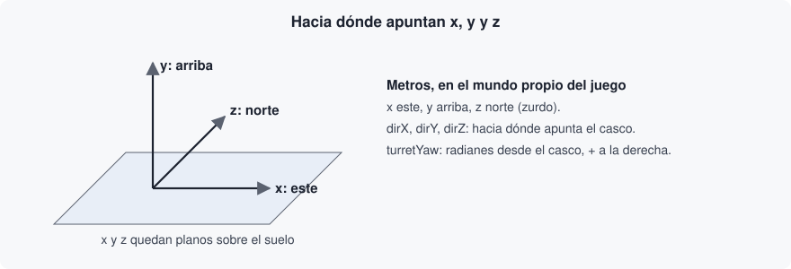

# La tabla {#the-table}

Una fila por muestra o evento, en `<partida>.parquet`: 38 columnas
([Lista de columnas](../columns.md), generada a partir del código).

| Columna | Qué es |
|---|---|
| `match`, `map` | el id de la batalla; el id del mapa (`99_testmap` en las imágenes) |
| `time` | segundos desde que empezó la grabación (la cuenta atrás está incluida) |
| `battleTime` | segundos desde que empezó la batalla; negativo durante la cuenta atrás |
| `event` | qué es la fila (abajo) |
| `player`, `team`, `own` | el nombre del jugador; equipo `1` o `2`; `1` en las filas del jugador que graba |
| `vehicle`, `type` | el tanque tal como lo nombra el juego (`ussr:R144_K_91`); `tank`, o `shell` para un trazador o una explosión cuyo tirador no se conoce (sin jugador) |
| `x`, `y`, `z` | metros: x este, y arriba, z norte (el mundo propio del juego, zurdo) |
| `dirX`, `dirY`, `dirZ` | hacia dónde apunta el casco, un vector unitario en el mismo sistema (`dirY` 0: solo rumbo); en un disparo o trazador, hacia dónde voló el proyectil |
| `turretYaw` | el ángulo de la torreta respecto al rumbo del casco, en radianes, positivo a la derecha |
| `gunStep` | la elevación del cañón como un paso de 0 a 63 entre los límites propios del cañón (los límites son datos del tanque, no de la repetición) |
| `other`, `reason` | el otro vehículo de un evento (asesino, víctima, atacante, objetivo); el número de motivo de ataque del juego |
| `value`, `health` | el número del evento (daño, ráfaga, velocidad del proyectil, zoom, orden); la vida tras un cambio |
| `text` | el nombre del motivo, una línea de chat, un modo de cámara, la clave de una orden |
| `shot` | el id del proyectil: un disparo, su trazador y su explosión lo comparten |
| `entity` | el id del vehículo en la repetición |
| `hitComponent`, `hitCode`, `hitU/V/W`, `hitExitU/V/W`, `hitDirX/Y/Z` | solo en las filas `struck`: dónde golpeó un proyectil (véase el evento `struck` abajo) |
| `pitch`, `roll` | en una posición, el cabeceo del casco (radianes, positivo con la nariz abajo) y el balanceo, tal como los envía el juego |

| `event` | En la fila de | Qué es |
|---|---|---|
| `position` | cada vehículo | unas diez veces por segundo, mientras el cliente sabía dónde estaba |
| `death`, `kill` | la víctima, el asesino | cada muerte dos veces: donde cayó la víctima, y donde estaba el asesino |
| `hurt`, `damage` | la víctima, el atacante | un cambio de vida: `value` el daño, `health` lo que queda, `reason`/`text` por qué (`shot`, `fire`, `ramming`, ...) |
| `struck` | la víctima | un proyectil que la golpeó, también los que rebotaron o no penetraron: una fila por punto golpeado, `value` el daño que hizo (en el primero); `hitComponent` el componente de colisión, `hitU/V/W` por dónde entró el proyectil y `hitExitU/V/W` donde terminó su trayectoria, como fracciones de la caja de ese componente (u derecha, v arriba, w adelante; comprobado con el rumbo del atacante), `hitDirX/Y/Z` la dirección de entrada en el sistema del casco, `turretYaw` la torreta de la víctima en ese momento, `hitCode` un byte enviado con el punto (no se conoce: no sigue al daño) |
| `shot` | el tirador | `value` la ráfaga; la dirección que llevó su trazador, si no la del casco más la de la torreta |
| `tracer` | el tirador | dónde se vio por primera vez un proyectil y la dirección que llevó; `value` su velocidad en las unidades del juego |
| `impact` | el tirador | dónde explotó un proyectil |
| `chat` | quien envía | `text` la línea |
| `command` | quien envía | una orden del chat de batalla (atacar, ayuda, un punto del mapa), en su punto cuando tiene uno; `value` el número de la orden, `other` el vehículo al que nombra |
| `camera`, `zoom`, `lock`, `unlock` | el jugador que graba | el modo de cámara (`sniper`, `arcade`, ...), el zoom, el apuntado automático activado y desactivado sobre un objetivo |

El pie del Parquet lleva las pistas `heat3d`: Y arriba, Z invertida (así el mapa no sale
en espejo), escala de unidad 1, un vehículo de siete metros de ancho, `player` como la
persona, `team` como el grupo, `match` como la sesión.

---

Parte de [3DHeat](https://github.com/Holdi601/3DHeat) ([documentación](https://holdi601.github.io/3DHeat/)). Código fuente: [3DHeat-Ext-WoT](https://github.com/Holdi601/3DHeat-Ext-WoT).
