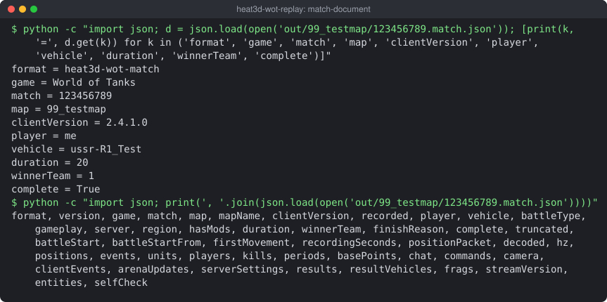

# Mängu dokument {#the-match-document}

`<match>.match.json` hoiab kõike, mida kordus ütleb ja mis ei ole tabeli rida. Vaaturi vahekaart **Matš** loeb seda.
(Kood nimetab seda kokkuvõtteks.)

## Lahing {#the-battle}

| Võti | Mis see on |
|---|---|
| `format`, `version` | `heat3d-wot-match`, `2` |
| `game`, `match`, `map`, `mapName` | `World of Tanks`; lahingu ID; kaardi ID ja tema kuvatav nimi |
| `clientVersion`, `streamVersion` | mängu versioon päisest ja nii, nagu paketivoog seda ütleb |
| `recorded` | millal kordus salvestati, nii nagu mäng seda kirjutab |
| `player`, `vehicle` | salvestajamängija ja tema tank |
| `battleType`, `gameplay`, `server`, `region`, `hasMods` | päise lahingutüübi number, mängurežiim, server, piirkond ja kas modid olid paigaldatud |
| `duration` | lahingu pikkus sekundites, tulemustest |
| `winnerTeam`, `finishReason` | võitev meeskond ja mängu number selle kohta, kuidas lahing lõppes, tulemustest |
| `complete`, `truncated` | tulemused on kordusel; salvestus katkes varakult |
| `battleStart`, `battleStartFrom`, `firstMovement` | lahingu algus sekundites salvestusest; `arena` (areen ütles nii) või `movement` (esimene hetk, kui mõni tank liikus); see esimene liikumine |
| `recordingSeconds` | salvestuse pikkus sekundites |
| `positionPacket`, `hz`, `positions` | pakettinumber, millega asukohad tulid, näidised sekundis, asukohtade read |
| `events` | iga sündmuse tabeli ridade arv |
| `units` | `metres; x east, y up, z north` |
| `decoded` | iga sõnumi liigi jaoks leitud meetodi ja paketi numbrid |

## Mängijad ja sündmused {#players-and-events}

| Võti | Mis see on |
|---|---|
| `players` | üks kirje tanki kohta: nimi, meeskond, tank, klann, näidised, tapmised, tekitatud kahju, ellu jäänud, elueaa; `seen` (lasud ja kahju, mida salvestav klient nägi); päise ja tulemuste kogu kirje ja konto oma |
| `kills` | iga surm: aeg (sekundites), kust aeg tuli (`arena`, `health` või `lifeTime`), ohver, tapja, põhjuse number ja nimi |
| `periods` | lahingu perioodid (ootamine, eelmäng, lahing, järelmäng) serveri lõppaegadega |
| `basePoints` | baasi vallutuse edenemine meeskonna ja baasi kaupa |
| `chat`, `commands` | vestlusread; lahingu vestluskäsud kõigi nende argumentidega |
| `camera`, `clientEvents` | salvestajamängija kaamera režiimid; mida klient enda kohta salvestas (suum, automaatne sihtimine, sihtmärgi vahetused, sõiduki olek) |
| `arenaUpdates` | iga areenu uuendus, dekodeeritud, nii nagu mäng selle saatis |

## Tulemused ja kontrollid {#results-and-checks}

| Võti | Mis see on |
|---|---|
| `serverSettings` | serveri seaded päisest |
| `results`, `resultVehicles`, `frags` | tulemuste ekraan: üldine, isiklik (koos sihtmärkide detailidega), mängijad, kontod; iga tanki tulemuste rida; tapmised mängija kohta |
| `entities` | iga olem, mille voog loob: tema tüübi number ja roll, millal ta tuli kliendi vaatevälja ja millal lahkus |
| `selfCheck` | täielikkuse loendus ([Täielikkus](completeness.md)) ning olemite ja versiooni kontrollid |

---

Osa [3DHeatist](https://github.com/Holdi601/3DHeat) ([dokumentatsioon](https://holdi601.github.io/3DHeat/)). Lähtekood: [3DHeat-Ext-WoT](https://github.com/Holdi601/3DHeat-Ext-WoT).
