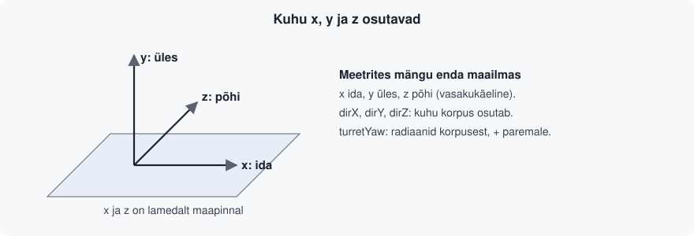

# Tabel {#the-table}

Üks rida iga näidise või sündmuse kohta failis `<match>.parquet`: 38 veergu ([Veergude loend](../columns.md), koodist genereeritud).

| Veerg | Mis see on |
|---|---|
| `match`, `map` | lahingu ID; kaardi ID (`99_testmap` piltidel) |
| `time` | sekundid, mis on möödunud salvestuse algusest (loendus on selles sees) |
| `battleTime` | sekundid, mis on möödunud lahingu algusest; loenduse ajal negatiivne |
| `event` | mis rida on (allpool) |
| `player`, `team`, `own` | mängija nimi; meeskond `1` või `2`; `1` salvestajamängija ridadel |
| `vehicle`, `type` | tank, nii nagu mäng seda nimetab (`ussr:R144_K_91`); `tank`, või `shell` tracer'i või plahvatuse puhul, kelle laskja ei ole teada (mängijat ei ole) |
| `x`, `y`, `z` | meetrid: x ida, y üles, z põhja (mängu enda maailm, vasakukäeline) |
| `dirX`, `dirY`, `dirZ` | kuhu korpus osutab, ühikvektor samas raamistikus (`dirY` 0: ainult suund); lasul või tracer'il, kuhu mürsk lendas |
| `turretYaw` | torni nurk korpuse suunast, radiaanides, positiivne paremale |
| `gunStep` | püssi tõus sammuna 0-63 püssi enda piiride vahel (piirid on tanki andmed, mitte kordusest) |
| `other`, `reason` | sündmuse teine sõiduk (tapja, ohver, ründaja, sihtmärk); mängu rünnaku põhjuse number |
| `value`, `health` | sündmuse number (kahju, pursk, mürsu kiirus, suum, käsk); tervis pärast muutust |
| `text` | põhjuse nimi, vestlusrida, kaamera režiim, käsu võti |
| `shot` | mürsu ID: laskmine, tema tracer ja plahvatus jagavad seda |
| `entity` | sõiduki ID kordusel |
| `hitComponent`, `hitCode`, `hitU/V/W`, `hitExitU/V/W`, `hitDirX/Y/Z` | ainult `struck` ridadel: kuhu mürsk tabas (vt allpool `struck` sündmust) |
| `pitch`, `roll` | asukoha real korpuse tõus (radiaanides, positiivne nina alla) ja rull, nii nagu mäng need saadab |

| `event` | Selle rea juures | Mis see on |
|---|---|---|
| `position` | iga sõiduk | umbes kümme korda sekundis, kui klient teadis, kus see oli |
| `death`, `kill` | ohver, tapja | iga surm kaks korda: kus ohver langes ja kus tapja seisis |
| `hurt`, `damage` | ohver, ründaja | tervise muutus: `value` kahju, `health` mis on järel, `reason`/`text` miks (`shot`, `fire`, `ramming`, ...) |
| `struck` | ohver | mürsk, mis teda tabas, ka need, mis põrkasid või ei läbinud; üks rida punkti kohta, `value` tekitatud kahju (esimesel); `hitComponent` kokkupõrke komponent, `hitU/V/W` kuhu mürsk sisenes ja `hitExitU/V/W` kus tema tee lõppes, komponendi kasti murdosadena (u parem, v üles, w ees; kontrollitud ründaja suuna vastu), `hitDirX/Y/Z` kuidas see sisenes korpuse raamistikus, `turretYaw` ohvri torn siis, `hitCode` bait, mis saadetakse punktiga (ei ole teada: see ei järgi kahju) |
| `shot` | laskja | `value` pursk; suund, kuhu tema tracer lendas, muidu korpuse pluss torni oma |
| `tracer` | laskja | kus mürsk esimest korda nähti ja kuidas ta lendas; `value` tema kiirus mängu ühikutes |
| `impact` | laskja | kus mürsk plahvatas |
| `chat` | saatja | `text` rida |
| `command` | saatja | lahingu vestluskäsk (ründa, abi, punkt kaardil), oma punktis, kui sellel see on; `value` käsu number, `other` sõiduk, mida see nimetab |
| `camera`, `zoom`, `lock`, `unlock` | salvestajamängija | kaamera režiim (`sniper`, `arcade`, ...), suum, automaatne sihtimine sisse ja välja sihtmärgi pealt |

Parquet-i jaluses on `heat3d` vihjed: y üles, z pööratud (nii et kaart ei peegeldu), ühikute skaala 1, sõiduk seitse
meetrit laiune, `player` kui inimene, `team` kui grupp, `match` kui sessioon.

---

Osa [3DHeatist](https://github.com/Holdi601/3DHeat) ([dokumentatsioon](https://holdi601.github.io/3DHeat/)). Lähtekood: [3DHeat-Ext-WoT](https://github.com/Holdi601/3DHeat-Ext-WoT).
