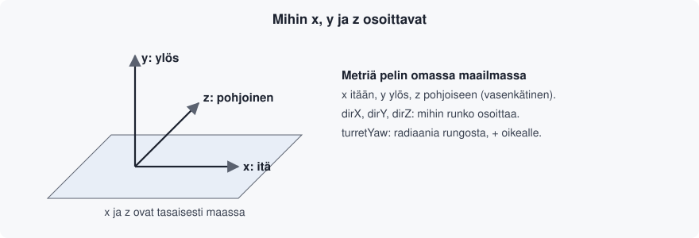

# Taulukko {#the-table}

Yksi rivi näytettä tai tapahtumaa kohden tiedostossa `<match>.parquet`: 38 saraketta
([Sarakeluettelo](../columns.md), luotu koodista).

| Sarake | Mitä se on |
|---|---|
| `match`, `map` | taistelun tunnus; kartan tunnus (`99_testmap` kuvissa) |
| `time` | sekunteja tallennuksen alusta (laskuri on mukana) |
| `battleTime` | sekunteja taistelun alusta; negatiivinen laskurin aikana |
| `event` | mikä rivi on (alla) |
| `player`, `team`, `own` | pelaajan nimi; joukkue `1` tai `2`; `1` tallentavan pelaajan riveillä |
| `vehicle`, `type` | panssarivaunu sellaisena kuin peli sen nimeää (`ussr:R144_K_91`); `tank`, tai `shell` luotisuoralle tai räjähdykselle, jonka ampuja ei ole tiedossa (ei pelaajaa) |
| `x`, `y`, `z` | metrejä: x itään, y ylös, z pohjoiseen (pelin oma maailma, vasenkätinen) |
| `dirX`, `dirY`, `dirZ` | mihin runko osoittaa, yksikkövektori samassa koordinaatistossa (`dirY` 0: vain suunta); laukauksella tai luotisuoralla, mihin kuori lensi |
| `turretYaw` | tornin kulma rungon suunnasta, radiaaneina, positiivinen oikealle |
| `gunStep` | tykin kohoaminen askeleena 0-63 tykin omien rajojen välillä (rajat ovat tankin tietoja, eivät replayn) |
| `other`, `reason` | tapahtuman toinen ajoneuvo (tappaja, uhri, hyökkääjä, kohde); pelin hyökkäyssyyn numero |
| `value`, `health` | tapahtuman numero (vahinko, purske, kuorennopeus, zoom, komento); terveys muutoksen jälkeen |
| `text` | syyn nimi, chat-rivi, kameratila, komennon avain |
| `shot` | kuoren tunnus: laukaus, sen luotisuora ja sen räjähdys jakavat sen |
| `entity` | ajoneuvon tunnus replayssa |
| `hitComponent`, `hitCode`, `hitU/V/W`, `hitExitU/V/W`, `hitDirX/Y/Z` | vain `struck`-riveillä: missä kuori osui (katso alla oleva `struck`-tapahtuma) |
| `pitch`, `roll` | sijainnissa rungon kallistus (radiaaneina, positiivinen nokka alas) ja roll, sellaisina kuin peli ne lähettää |

| `event` | Millä rivillä | Mitä |
|---|---|---|
| `position` | jokainen ajoneuvo | noin kymmenen kertaa sekunnissa, kun asiakas tiesi, missä se oli |
| `death`, `kill` | uhri, tappaja | jokainen kuolema kahdesti: missä uhri kaatui, ja missä tappaja seisoi |
| `hurt`, `damage` | uhri, hyökkääjä | terveyden muutos: `value` vahinko, `health` mitä on jäljellä, `reason`/`text` miksi (`shot`, `fire`, `ramming`, ...) |
| `struck` | uhri | kuori, joka osui siihen, mukaan lukien ne, jotka kimposivat tai eivät läpäisseet: yksi rivi osumapistettä kohden, `value` sen aiheuttama vahinko (ensimmäisellä); `hitComponent` törmäyskomponentti, `hitU/V/W` missä kuori meni sisään ja `hitExitU/V/W` missä sen reitti päättyi komponentin laatikon murtolukuina (u oikealle, v ylös, w eteen; tarkistettu hyökkääjän suuntaa vasten), `hitDirX/Y/Z` tulosuunta rungon koordinaatistossa, `turretYaw` uhrin torni silloin, `hitCode` pisteen mukana lähetetty tavu (ei tiedossa: se ei seuraa vahinkoa) |
| `shot` | ampuja | `value` purske; suunta, johon sen luotisuora lensi, muuten rungon ja tornin suunta |
| `tracer` | ampuja | missä kuori nähtiin ensimmäisen kerran ja mihin suuntaan se lensi; `value` sen nopeus pelin yksiköissä |
| `impact` | ampuja | missä kuori räjähti |
| `chat` | lähettäjä | `text` rivi |
| `command` | lähettäjä | taistelun chat-komento (hyökkäys, apua, piste kartalla), sen pisteessä, kun sillä on sellainen; `value` komennon numero, `other` ajoneuvo, jota se nimeää |
| `camera`, `zoom`, `lock`, `unlock` | tallentava pelaaja | kameratila (`sniper`, `arcade`, ...), zoom, automaattitähtäys päälle ja pois kohteesta |

Parquet-alatunniste kantaa `heat3d`-vihjeet: Y ylös, Z käännetty (jottei kartta peilautu), yksikkömittakaava 1,
ajoneuvo seitsemän metriä poikki, `player` henkilönä, `team` ryhmänä, `match` istuntona.

---

Osa [3DHeatiä](https://github.com/Holdi601/3DHeat) ([dokumentaatio](https://holdi601.github.io/3DHeat/)). Lähde: [3DHeat-Ext-WoT](https://github.com/Holdi601/3DHeat-Ext-WoT).
