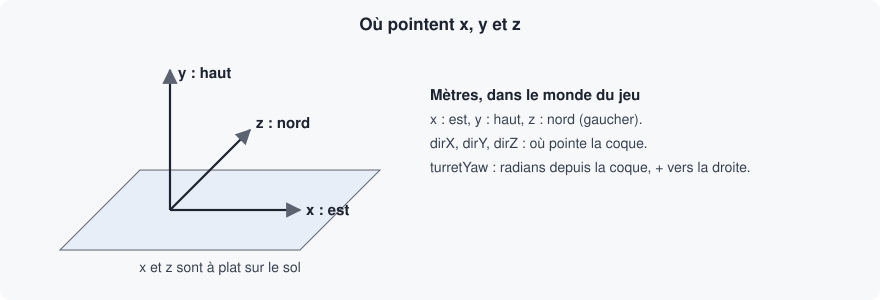

# La table {#the-table}

Une ligne par échantillon ou événement, dans `<match>.parquet` : 38 colonnes
([Liste des colonnes](../columns.md), générée à partir du code).

| Colonne | Contenu |
|---|---|
| `match`, `map` | l'identifiant de la bataille ; l'identifiant de la carte (`99_testmap` sur les images) |
| `time` | secondes depuis le début de l'enregistrement (le compte à rebours y figure) |
| `battleTime` | secondes depuis le début de la bataille ; négatif pendant le compte à rebours |
| `event` | ce que représente la ligne (voir ci-dessous) |
| `player`, `team`, `own` | le nom du joueur ; l'équipe `1` ou `2` ; `1` sur les lignes du joueur qui enregistre |
| `vehicle`, `type` | le char tel que le jeu le nomme (`ussr:R144_K_91`) ; `tank`, ou `shell` pour un traceur ou une explosion dont le tireur est inconnu (aucun joueur) |
| `x`, `y`, `z` | mètres : x est, y haut, z nord (le monde propre au jeu, gaucher) |
| `dirX`, `dirY`, `dirZ` | vers où pointe la coque, un vecteur unitaire dans le même repère (`dirY` 0 : cap seulement) ; sur un tir ou un traceur, là où l'obus a volé |
| `turretYaw` | l'angle de la tourelle par rapport au cap de la coque, en radians, positif vers la droite |
| `gunStep` | l'élévation du canon sous forme de pas de 0 à 63 entre les limites propres du canon (les limites sont les données du char, non celles du replay) |
| `other`, `reason` | l'autre véhicule d'un événement (tueur, victime, attaquant, cible) ; le numéro de raison d'attaque du jeu |
| `value`, `health` | le nombre de l'événement (dégâts, rafale, vitesse de l'obus, zoom, commande) ; les points de vie après un changement |
| `text` | le nom de la raison, une ligne de chat, un mode de caméra, la clé d'une commande |
| `shot` | l'identifiant de l'obus : un tir, son traceur et son explosion le partagent |
| `entity` | l'identifiant du véhicule dans le replay |
| `hitComponent`, `hitCode`, `hitU/V/W`, `hitExitU/V/W`, `hitDirX/Y/Z` | sur les lignes `struck` seulement : où un obus a frappé (voir l'événement `struck` ci-dessous) |
| `pitch`, `roll` | sur une position, le tangage de la coque (radians, positif le nez vers le bas) et le roulis, tels que le jeu les envoie |

| `event` | Sur la ligne de | Contenu |
|---|---|---|
| `position` | chaque véhicule | environ dix fois par seconde, tant que le client savait où il se trouvait |
| `death`, `kill` | la victime, le tueur | chaque mort deux fois : là où la victime est tombée, et là où se tenait le tueur |
| `hurt`, `damage` | la victime, l'attaquant | un changement de points de vie : `value` les dégâts, `health` ce qui reste, `reason`/`text` la cause (`shot`, `fire`, `ramming`, ...) |
| `struck` | la victime | un obus qui l'a frappée, y compris ceux qui ont ricoché ou n'ont pas pénétré : une ligne par point frappé, `value` les dégâts qu'il a causés (sur la première) ; `hitComponent` le composant de collision, `hitU/V/W` l'endroit où l'obus est entré et `hitExitU/V/W` l'endroit où son trajet s'est terminé, en fractions de la boîte de ce composant (u droite, v haut, w avant ; vérifié par rapport au relèvement de l'attaquant), `hitDirX/Y/Z` le sens d'entrée dans le repère de la coque, `turretYaw` la tourelle de la victime à ce moment, `hitCode` un octet envoyé avec le point (inconnu : il ne suit pas les dégâts) |
| `shot` | le tireur | `value` la rafale ; la direction où a volé son traceur, sinon celle de la coque plus celle de la tourelle |
| `tracer` | le tireur | l'endroit où un obus a été vu pour la première fois et le sens de son vol ; `value` sa vitesse dans les unités du jeu |
| `impact` | le tireur | l'endroit où un obus a explosé |
| `chat` | l'expéditeur | `text` la ligne |
| `command` | l'expéditeur | une commande du chat de bataille (attaque, aide, un point sur la carte), à son point lorsqu'elle en a un ; `value` le numéro de la commande, `other` le véhicule qu'elle désigne |
| `camera`, `zoom`, `lock`, `unlock` | le joueur qui enregistre | le mode de caméra (`sniper`, `arcade`, ...), le zoom, la visée automatique activée et désactivée sur une cible |

Le pied du fichier Parquet porte les indications `heat3d` : Y vers le haut, Z retourné (ainsi la carte n'est
pas en miroir), échelle d'unité 1, un véhicule de sept mètres de large, `player` comme la personne, `team`
comme le groupe, `match` comme la session.

---

Une partie de [3DHeat](https://github.com/Holdi601/3DHeat) ([documentation](https://holdi601.github.io/3DHeat/)). Source : [3DHeat-Ext-WoT](https://github.com/Holdi601/3DHeat-Ext-WoT).
