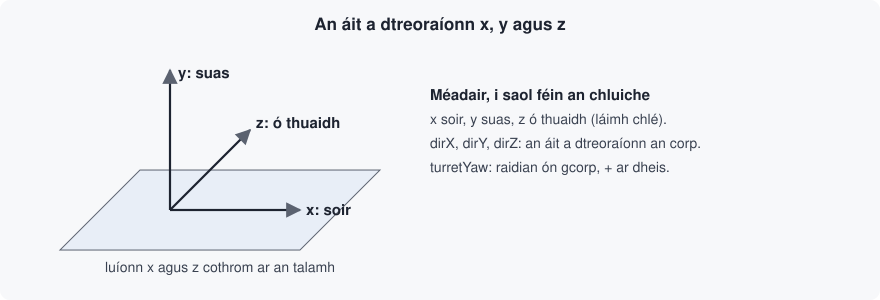

# An tábla {#the-table}

Sraith amháin do gach sampla nó imeacht, i `<match>.parquet`: 38 colún ([Liosta colún](../columns.md), ginte ón gcód).

| Colún | Cad é |
|---|---|
| `match`, `map` | id an chatha; id na léarscáile (`99_testmap` sna pictiúir) |
| `time` | soicindí ó thosaigh an taifeadadh (tá an comhaireamh síos ann) |
| `battleTime` | soicindí ó thosaigh an cath; diúltach le linn an chomhairimh síos |
| `event` | cad é an tsraith (thíos) |
| `player`, `team`, `own` | ainm an imreora; foireann `1` nó `2`; `1` ar shraitheanna an imreora taifeadta |
| `vehicle`, `type` | an tanc mar a ainmníonn an cluiche é (`ussr:R144_K_91`); `tank`, nó `shell` do lorgaire nó pléasc nach eol a lámhachóir (gan imreoir) |
| `x`, `y`, `z` | méadair: x soir, y suas, z ó thuaidh (saol féin an chluiche, láimh chlé) |
| `dirX`, `dirY`, `dirZ` | an áit a dtreoraíonn an corp, veicteoir aonaid sa fhráma céanna (`dirY` 0: treo cothrománach amháin); ar lámhaigh nó lorgaire, an áit ar eitil an sliogán |
| `turretYaw` | uillinn na tuirlinge ó threo an choirp, raidian, dearfach ar dheis |
| `gunStep` | ardú an ghunna mar chéim 0-63 idir teorainneacha an ghunna féin (is sonraí an tanc iad na teorainneacha, ní sonraí na hathsheinme) |
| `other`, `reason` | feithicil eile imeachta (marfóir, íobartach, ionsaitheoir, sprioc); uimhir chúis ionsaithe an chluiche |
| `value`, `health` | uimhir an imeachta (damáiste, pléasc, luas sligéin, formhéadú, ordú); sláinte tar éis athraithe |
| `text` | ainm na cúise, líne chomhrá, mód ceamara, eochair ordaithe |
| `shot` | id an tsligéin: roinneann lámhaigh, a lorgaire agus a phléasc é |
| `entity` | id na feithicle san athsheinm |
| `hitComponent`, `hitCode`, `hitU/V/W`, `hitExitU/V/W`, `hitDirX/Y/Z` | ar shraitheanna `struck` amháin: an áit ar bhuail sliogán (féach an t-imeacht `struck` thíos) |
| `pitch`, `roll` | ar shuíomh, pitch an choirp (raidian, dearfach srón síos) agus roll, mar a sheolann an cluiche iad |

| `event` | Ar shraith de | Cad é |
|---|---|---|
| `position` | gach feithicil | thart ar deich n-uaire sa soicind, fad is eol don chliant cá raibh sí |
| `death`, `kill` | an t-íobartach, an marfóir | gach bás faoi dhó: an áit ar thit an t-íobartach, agus an áit ar sheas an marfóir |
| `hurt`, `damage` | an t-íobartach, an t-ionsaitheoir | athrú sláinte: `value` an damáiste, `health` an méid atá fágtha, `reason`/`text` cén fáth (`shot`, `fire`, `ramming`, ...) |
| `struck` | an t-íobartach | sliogán a bhuail é, iad siúd a preab nó nár threáigh freisin: sraith amháin do gach pointe buailte, `value` an damáiste a rinne sé (ar an gcéad cheann); `hitComponent` an chomhpháirt imbhuailte, `hitU/V/W` an áit ar chuaigh an sliogán isteach agus `hitExitU/V/W` an áit ar chríochnaigh a chosán mar chodáin de bhosca na comhpháirte sin (u ar dheis, v suas, w ar aghaidh; seiceáilte i gcoinne treo an ionsaitheora), `hitDirX/Y/Z` an bealach a tháinig sé isteach i bhfráma an choirp, `turretYaw` tuirlingt an íobartaigh ansin, `hitCode` beart a seoladh leis an bpointe (anaithnid: ní leanann sé an damáiste) |
| `shot` | an lámhachóir | `value` an pléasc; an treo ar eitil a lorgaire, nó threo an choirp móide an tuirlingt ar shlí eile |
| `tracer` | an lámhachóir | an áit ar chonacthas sliogán den chéad uair agus an bealach ar eitil sé; `value` a luas in aonaid an chluiche |
| `impact` | an lámhachóir | an áit ar phléasc sliogán |
| `chat` | an seoltóir | `text` an líne |
| `command` | an seoltóir | ordú comhrá catha (ionsaí, cabhair, pointe ar an léarscáil), ag a phointe nuair atá ceann aige; `value` uimhir an ordaithe, `other` an fheithicil a ainmníonn sé |
| `camera`, `zoom`, `lock`, `unlock` | an t-imreoir taifeadta | mód an cheamara (`sniper`, `arcade`, ...), an formhéadú, uath-aim air agus as sprioc |

Iompraíonn buntásc Parquet leideanna `heat3d`: Y suas, Z iompaithe (mar sin ní scáthánaítear an léarscáil), scála aonaid 1, feithicil seacht méadar ar leithead, `player` mar an duine, `team` mar an ghrúpa, `match` mar an seisiún.

---

Cuid de [3DHeat](https://github.com/Holdi601/3DHeat) ([doiciméadúchán](https://holdi601.github.io/3DHeat/)). Foinse: [3DHeat-Ext-WoT](https://github.com/Holdi601/3DHeat-Ext-WoT).
