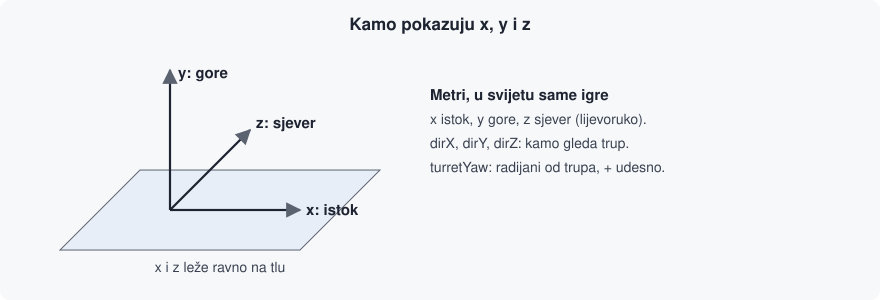

# Tablica {#the-table}

Jedan redak po uzorku ili događaju, u `<match>.parquet`: 38 stupaca
([Popis stupaca](../columns.md), generiran iz koda).

| Stupac | Što |
|---|---|
| `match`, `map` | id bitke; id karte (`99_testmap` na slikama) |
| `time` | sekunde od početka snimanja (u njemu je i odbrojavanje) |
| `battleTime` | sekunde od početka bitke; negativno tijekom odbrojavanja |
| `event` | što redak predstavlja (dolje) |
| `player`, `team`, `own` | ime igrača; tim `1` ili `2`; `1` na retcima igrača koji snima |
| `vehicle`, `type` | tenk kako ga igra imenuje (`ussr:R144_K_91`); `tank`, ili `shell` za trag ili eksploziju čiji strijelac nije poznat (nema igrača) |
| `x`, `y`, `z` | metri: x istok, y gore, z sjever (vlastiti svijet igre, lijevoruk) |
| `dirX`, `dirY`, `dirZ` | kamo pokazuje trup, jedinični vektor u istom okviru (`dirY` 0: samo smjer); na hicu ili tragu gdje je granata letjela |
| `turretYaw` | kut tornja od smjera trupa, radijani, pozitivno udesno |
| `gunStep` | elevacija topa kao korak 0-63 između vlastitih granica topa (granice su podaci tenka, ne snimke) |
| `other`, `reason` | drugo vozilo događaja (ubojica, žrtva, napadač, meta); broj razloga napada igre |
| `value`, `health` | broj događaja (šteta, rafal, brzina granate, zum, naredba); zdravlje nakon promjene |
| `text` | naziv razloga, red razgovora, način kamere, ključ naredbe |
| `shot` | id granate: hitac, njegov trag i njegova eksplozija dijele ga |
| `entity` | id vozila u snimci |
| `hitComponent`, `hitCode`, `hitU/V/W`, `hitExitU/V/W`, `hitDirX/Y/Z` | samo na retcima `struck`: gdje je granata pogodila (vidi događaj `struck` ispod) |
| `pitch`, `roll` | na položaju, nagib (radijani, pozitivno nos dolje) i valjanje trupa, kako ih igra šalje |

| `event` | Na retku | Što |
|---|---|---|
| `position` | svakog vozila | oko deset puta u sekundi, dok je klijent znao gdje je |
| `death`, `kill` | žrtve, ubojice | svaka smrt dvaput: gdje je žrtva pala, i gdje je ubojica stajao |
| `hurt`, `damage` | žrtve, napadača | promjena zdravlja: `value` šteta, `health` što je ostalo, `reason`/`text` zašto (`shot`, `fire`, `ramming`, ...) |
| `struck` | žrtve | granata koja ju je pogodila, i one koje su odbijene ili nisu probile; jedan redak po točki pogotka, `value` šteta koju je napravila (na prvom); `hitComponent` komponenta sudara, `hitU/V/W` gdje je granata ušla i `hitExitU/V/W` gdje je njezina putanja završila, kao djelići kutije te komponente (u desno, v gore, w naprijed; provjereno prema smjeru napadača), `hitDirX/Y/Z` smjer kojim je ušla u okviru trupa, `turretYaw` tada tornjeva žrtve, `hitCode` bajt poslan uz točku (nepoznat: ne prati štetu) |
| `shot` | strijelca | `value` rafal; smjer kojim je letio njegov trag, inače trupa plus tornja |
| `tracer` | strijelca | gdje je granata prvi put viđena i kojim je letjela; `value` njezina brzina u jedinicama igre |
| `impact` | strijelca | gdje je granata eksplodirala |
| `chat` | pošiljatelja | `text` red |
| `command` | pošiljatelja | naredba bitke u razgovoru (napadni, pomoć, točka na karti), na svojoj točki kad je ima; `value` broj naredbe, `other` vozilo koje imenuje |
| `camera`, `zoom`, `lock`, `unlock` | igrača koji snima | način kamere (`sniper`, `arcade`, ...), zum, automatsko ciljanje uključeno i isključeno na cilj |

Podnožje Parqueta nosi `heat3d` upute: Y gore, Z okrenut (da karta nije zrcaljena), jedinica 1, vozilo
široko sedam metara, `player` kao osoba, `team` kao grupa, `match` kao sesija.

---

Dio [3DHeata](https://github.com/Holdi601/3DHeat) ([dokumentacija](https://holdi601.github.io/3DHeat/)). Izvor: [3DHeat-Ext-WoT](https://github.com/Holdi601/3DHeat-Ext-WoT).
