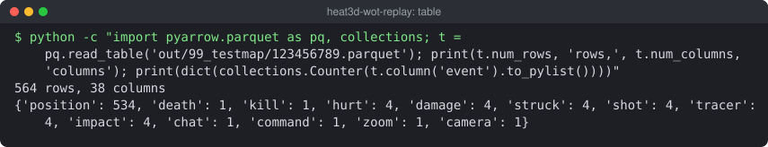
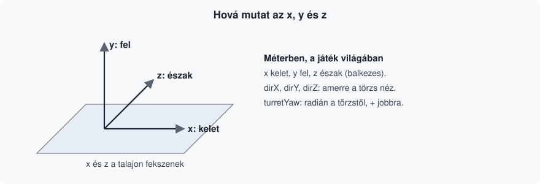

# A táblázat {#the-table}

Mintánként vagy eseményenként egy sor, a `<match>.parquet` fájlban: 38 oszlop
([Oszloplista](../columns.md), a kódból generálva).

| Oszlop | Mi |
|---|---|
| `match`, `map` | a csata azonosítója; a térkép azonosítója (a képeken a `99_testmap`) |
| `time` | másodpercek a felvétel kezdete óta (a visszaszámlálás is benne van) |
| `battleTime` | másodpercek a csata kezdete óta; negatív a visszaszámlálás alatt |
| `event` | mi a sor (lent) |
| `player`, `team`, `own` | a játékos neve; a csapat `1` vagy `2`; `1` a felvevő játékos sorain |
| `vehicle`, `type` | a tank, ahogy a játék nevezi (`ussr:R144_K_91`); `tank`, vagy `shell` egy nyomjelzőnél vagy robbanásnál, amelynek a lövője nem ismert (nincs játékos) |
| `x`, `y`, `z` | méterben: x kelet, y fel, z észak (a játék saját, balkezes világa) |
| `dirX`, `dirY`, `dirZ` | amerre a törzs mutat, egységvektor ugyanabban a koordinátarendszerben (`dirY` 0: csak az irány); lövésnél vagy nyomjelzőnél, amerre a lövedék repült |
| `turretYaw` | a torony szöge a törzs irányához képest, radiánban, jobbra pozitív |
| `gunStep` | az ágyú emelkedése 0-63 közötti lépésben, az ágyú saját határai között (a határok a tank adatai, nem a visszajátszásé) |
| `other`, `reason` | az esemény másik járműve (gyilkos, áldozat, támadó, célpont); a játék támadási okának száma |
| `value`, `health` | az esemény száma (sebzés, sorozat, lövedéksebesség, nagyítás, parancs); az életerő egy változás után |
| `text` | az ok neve, egy chat-sor, egy kameramód, egy parancs kulcsa |
| `shot` | a lövedék azonosítója: egy lövés, a nyomjelzője és a robbanása ugyanazt használja |
| `entity` | a jármű azonosítója a visszajátszásban |
| `hitComponent`, `hitCode`, `hitU/V/W`, `hitExitU/V/W`, `hitDirX/Y/Z` | csak a `struck` sorokon: hol talált be a lövedék (lásd a lent a `struck` eseményt) |
| `pitch`, `roll` | egy pozíción a törzs dőlése (radián, orral lefelé pozitív) és billenése, ahogy a játék küldi |

| `event` | Melyik sor | Mi |
|---|---|---|
| `position` | minden jármű | körülbelül tizedmásodpercenként, amíg a kliens tudta, hol van |
| `death`, `kill` | az áldozat, a gyilkos | minden halál kétszer: ahol az áldozat elesett, és ahol a gyilkos állt |
| `hurt`, `damage` | az áldozat, a támadó | egy életerő-változás: `value` a sebzés, `health` ami maradt, `reason`/`text` az oka (`shot`, `fire`, `ramming`, ...) |
| `struck` | az áldozat | egy lövedék, amely eltalálta, azok is, amelyek lepattantak vagy nem hatoltak át: egy sor egy becsapódási pontra, `value` az általa okozott sebzés (az elsőnél); `hitComponent` az ütközési alkatrész, `hitU/V/W` ahol a lövedék bement, `hitExitU/V/W` ahol az útja véget ért, az adott alkatrész dobozának törtrészeiben (u jobbra, v fel, w előre; a támadó irányszögével ellenőrizve), `hitDirX/Y/Z` a beérkezés iránya a törzs koordinátarendszerében, `turretYaw` az áldozat akkori tornya, `hitCode` a ponttal együtt küldött bájt (nem ismert: nem követi a sebzést) |
| `shot` | a lövő | `value` a sorozat; az irány, amerre a nyomjelzője repült, különben a törzs és a torony összege |
| `tracer` | a lövő | ahol először látták a lövedéket, és ahogy repült; `value` a sebessége a játék egységeiben |
| `impact` | a lövő | ahol a lövedék felrobbant |
| `chat` | a küldő | `text` a sor |
| `command` | a küldő | egy csatachat-parancs (támadás, segítség, egy pont a térképen), ahol van pontja, annál; `value` a parancs száma, `other` a jármű, amelyet megnevez |
| `camera`, `zoom`, `lock`, `unlock` | a felvevő játékos | a kameramód (`sniper`, `arcade`, ...), a nagyítás, az automatikus célzás be- és kikapcsolása egy célponton |

A Parquet lábléce tartalmazza a `heat3d` súgókat: Y felfelé, Z megfordítva (így a térkép nem
tükröződik), egységnyi méretarány, egy jármű hét méter széles, a `player` a személy, a `team` a
csoport, a `match` a munkamenet.

---

A [3DHeat](https://github.com/Holdi601/3DHeat) ([dokumentáció](https://holdi601.github.io/3DHeat/)) része. Forrás: [3DHeat-Ext-WoT](https://github.com/Holdi601/3DHeat-Ext-WoT).
