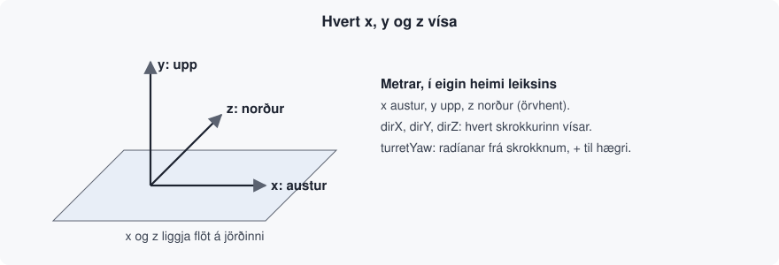

# Taflan {#the-table}

Ein röð fyrir hvert sýni eða atburð, í `<match>.parquet`: 38 dálkar
([Dálkalisti](../columns.md), búinn til úr kóðanum).

| Dálkur | Hvað |
|---|---|
| `match`, `map` | auðkenni bardagans; auðkenni kortsins (`99_testmap` á myndunum) |
| `time` | sekúndur frá því upptakan hófst (niðurtalningin er með) |
| `battleTime` | sekúndur frá því bardaginn hófst; neikvætt meðan á niðurtalningu stendur |
| `event` | hvað röðin er (að neðan) |
| `player`, `team`, `own` | nafn spilarans; lið `1` eða `2`; `1` á röðum upptökumannsins |
| `vehicle`, `type` | skriðdrekinn eins og leikurinn nefnir hann (`ussr:R144_K_91`); `tank`, eða `shell` fyrir ljósrák (tracer) eða sprengingu þar sem skyttan er ekki þekkt (enginn spilari) |
| `x`, `y`, `z` | metrar: x austur, y upp, z norður (eigin heimur leiksins, örvhentur) |
| `dirX`, `dirY`, `dirZ` | hvert skrokkurinn vísar, einingarvigur í sama ramma (`dirY` 0: aðeins stefna); á skoti eða ljósrák hvert skelin flaug |
| `turretYaw` | horn turnsins frá stefnu skrokksins, í radíönum, jákvætt til hægri |
| `gunStep` | hæð byssunnar sem skref 0-63 milli eigin marka byssunnar (mörkin eru gögn skriðdrekans, ekki upptökunnar) |
| `other`, `reason` | hitt farartækið í atburði (drápsmaður, fórnarlamb, árásarmaður, skotmark); númer árásarástæðu leiksins |
| `value`, `health` | tala atburðarins (skaði, hrina, hraði skeljar, aðdráttur, skipun); heilsa eftir breytingu |
| `text` | nafn ástæðunnar, spjalllína, myndavélarhamur, lykill skipunar |
| `shot` | auðkenni skeljarinnar: skot, ljósrák þess og sprenging þess deila því |
| `entity` | auðkenni farartækisins í upptökunni |
| `hitComponent`, `hitCode`, `hitU/V/W`, `hitExitU/V/W`, `hitDirX/Y/Z` | aðeins á `struck` röðum: hvar skel hitti (sjá atburðinn `struck` hér að neðan) |
| `pitch`, `roll` | á stöðu, pitch skrokksins (radíanar, jákvætt nef niður) og roll, eins og leikurinn sendir þau |

| `event` | Á röð hjá | Hvað |
|---|---|---|
| `position` | hverju farartæki | um tíu sinnum á sekúndu, meðan biðlarinn vissi hvar það var |
| `death`, `kill` | fórnarlambinu, drápsmanninum | hvert dauðsfall tvisvar: þar sem fórnarlambið féll, og þar sem drápsmaðurinn stóð |
| `hurt`, `damage` | fórnarlambinu, árásarmanninum | heilsubreyting: `value` skaðinn, `health` það sem er eftir, `reason`/`text` hvers vegna (`shot`, `fire`, `ramming`, ...) |
| `struck` | fórnarlambinu | skel sem hitti það, líka þær sem skutust af eða smugu ekki í gegn: ein röð fyrir hvern punkt sem var hittur, `value` skaðinn sem hún olli (á þeirri fyrstu); `hitComponent` árekstrarhlutinn, `hitU/V/W` hvar skelin fór inn og `hitExitU/V/W` hvar leið hennar endaði sem brot af kassa þess hluta (u hægri, v upp, w fram; athugað gegn stefnu árásarmannsins), `hitDirX/Y/Z` leiðin sem hún kom inn í ramma skrokksins, `turretYaw` turn fórnarlambsins þá, `hitCode` bæti sem er sent með punktinum (ekki þekkt: það fylgir ekki skaðanum) |
| `shot` | skyttunni | `value` hrinan; stefnan sem ljósrák hennar flaug, annars stefna skrokksins plús turnsins |
| `tracer` | skyttunni | hvar skel sást fyrst og leiðin sem hún flaug; `value` hraði hennar í einingum leiksins |
| `impact` | skyttunni | hvar skel sprakk |
| `chat` | sendandanum | `text` línan |
| `command` | sendandanum | skipun í bardagaspjalli (árás, hjálp, punktur á kortinu), á punkti sínum þegar hún hefur einn; `value` númer skipunarinnar, `other` farartækið sem hún nefnir |
| `camera`, `zoom`, `lock`, `unlock` | upptökumanninum | myndavélarhamurinn (`sniper`, `arcade`, ...), aðdrátturinn, sjálfvirk miðun á og af skotmarki |

Fótur Parquet-skrárinnar ber `heat3d` ábendingarnar: Y upp, Z snúið við (svo kortið er
ekki spegilmynd), einingakvarði 1, farartæki sjö metra breitt, `player` sem
manneskjan, `team` sem hópurinn, `match` sem lotan (session).

---

Hluti af [3DHeat](https://github.com/Holdi601/3DHeat) ([skjölun](https://holdi601.github.io/3DHeat/)). Frumkóði: [3DHeat-Ext-WoT](https://github.com/Holdi601/3DHeat-Ext-WoT).
