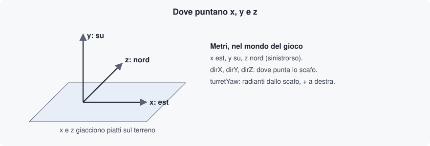

# La tabella {#the-table}

Una riga per campione o evento, in `<match>.parquet`: 38 colonne
([Elenco delle colonne](../columns.md), generato dal codice).

| Colonna | Cosa |
|---|---|
| `match`, `map` | l'id della battaglia; l'id della mappa (`99_testmap` nelle immagini) |
| `time` | secondi da quando è iniziata la registrazione (il conto alla rovescia è incluso) |
| `battleTime` | secondi da quando è iniziata la battaglia; negativi durante il conto alla rovescia |
| `event` | che cosa è la riga (sotto) |
| `player`, `team`, `own` | il nome del giocatore; squadra `1` o `2`; `1` sulle righe del giocatore che registra |
| `vehicle`, `type` | il carro come lo nomina il gioco (`ussr:R144_K_91`); `tank`, oppure `shell` per un traccia-tiro o un'esplosione il cui tiratore non è noto (nessun giocatore) |
| `x`, `y`, `z` | metri: x est, y su, z nord (il mondo proprio del gioco, sinistrorso) |
| `dirX`, `dirY`, `dirZ` | dove punta lo scafo, un vettore unitario nello stesso sistema (`dirY` 0: solo rilevamento); su un tiro o un traccia-tiro, dove è volato il proiettile |
| `turretYaw` | l'angolo della torretta rispetto al rilevamento dello scafo, radianti, positivo verso destra |
| `gunStep` | l'elevazione del cannone come passo 0-63 tra i limiti propri del cannone (i limiti sono dati del carro, non del replay) |
| `other`, `reason` | l'altro veicolo di un evento (assassino, vittima, attaccante, bersaglio); il numero del motivo di attacco del gioco |
| `value`, `health` | il numero dell'evento (danno, raffica, velocità del proiettile, zoom, comando); salute dopo una variazione |
| `text` | il nome del motivo, una riga di chat, una modalità di telecamera, la chiave di un comando |
| `shot` | l'id del proiettile: un tiro, il suo traccia-tiro e la sua esplosione lo condividono |
| `entity` | l'id del veicolo nel replay |
| `hitComponent`, `hitCode`, `hitU/V/W`, `hitExitU/V/W`, `hitDirX/Y/Z` | solo sulle righe `struck`: dove un proiettile ha colpito (vedi l'evento `struck` sotto) |
| `pitch`, `roll` | su una posizione, il beccheggio dello scafo (radianti, positivo con il muso in giù) e il rollio, come li invia il gioco |

| Evento | Sulla riga di | Cosa |
|---|---|---|
| `position` | ogni veicolo | circa dieci volte al secondo, mentre il client sapeva dov'era |
| `death`, `kill` | la vittima, l'assassino | ogni morte due volte: dove è caduta la vittima, e dove si trovava l'assassino |
| `hurt`, `damage` | la vittima, l'attaccante | una variazione di salute: `value` il danno, `health` ciò che resta, `reason`/`text` il perché (`shot`, `fire`, `ramming`, ...) |
| `struck` | la vittima | un proiettile che l'ha colpita, anche quelli rimbalzati o non perforanti: una riga per punto colpito, `value` il danno che ha fatto (sulla prima); `hitComponent` il componente di collisione, `hitU/V/W` dove il proiettile è entrato e `hitExitU/V/W` dove il suo percorso è finito come frazioni della scatola di quel componente (u destra, v su, w avanti; verificato con il rilevamento dell'attaccante), `hitDirX/Y/Z` da dove è arrivato nel sistema dello scafo, `turretYaw` la torretta della vittima in quel momento, `hitCode` un byte inviato con il punto (non noto: non segue il danno) |
| `shot` | il tiratore | `value` la raffica; la direzione in cui è volato il suo traccia-tiro, altrimenti quella dello scafo più quella della torretta |
| `tracer` | il tiratore | dove un proiettile è stato visto per la prima volta e la direzione in cui è volato; `value` la sua velocità nelle unità del gioco |
| `impact` | il tiratore | dove è esploso un proiettile |
| `chat` | il mittente | `text` la riga |
| `command` | il mittente | un comando della chat di battaglia (attacco, aiuto, un punto sulla mappa), nel suo punto quando ne ha uno; `value` il numero del comando, `other` il veicolo che nomina |
| `camera`, `zoom`, `lock`, `unlock` | il giocatore che registra | la modalità di telecamera (`sniper`, `arcade`, ...), lo zoom, la mira automatica accesa e spenta su un bersaglio |

Il piè di pagina del Parquet porta i suggerimenti `heat3d`: Y in alto, Z capovolta (così la mappa
non è specchiata), scala unitaria 1, un veicolo di sette metri di larghezza, `player` come
persona, `team` come gruppo, `match` come sessione.

---

Parte di [3DHeat](https://github.com/Holdi601/3DHeat) ([documentazione](https://holdi601.github.io/3DHeat/)). Fonte: [3DHeat-Ext-WoT](https://github.com/Holdi601/3DHeat-Ext-WoT).
