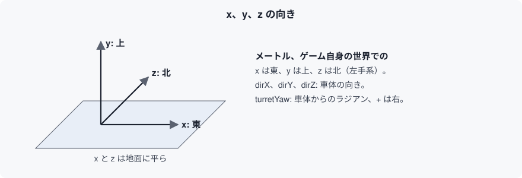

# テーブル {#the-table}

`<match>.parquet` には、サンプルまたはイベント 1 行につき 1 行が入ります: 38 列（[列の一覧](../columns.md)、コードから生成）。

| 列 | 内容 |
|---|---|
| `match`、`map` | 戦闘の ID。マップの ID（図では `99_testmap`） |
| `time` | 録画の開始からの秒数（カウントダウンも含む） |
| `battleTime` | 戦闘の開始からの秒数。カウントダウンの間は負の値 |
| `event` | その行が何か（下を参照） |
| `player`、`team`、`own` | プレイヤーの名前。チーム `1` または `2`。録画しているプレイヤーの行では `1` |
| `vehicle`、`type` | ゲームが名付けたとおりの戦車（`ussr:R144_K_91`）。射手が不明な曳光弾または爆発（プレイヤーがいない）の場合は `tank`、または `shell` |
| `x`、`y`、`z` | メートル: x は東、y は上、z は北（ゲーム自身の世界。左手系） |
| `dirX`、`dirY`、`dirZ` | 車体が向いている方向。同じ座標系の単位ベクトル（`dirY` が 0 の場合は方位だけ）。射撃または曳光弾では、砲弾が飛んだ方向 |
| `turretYaw` | 車体の方位からの砲塔の角度（ラジアン、右が正） |
| `gunStep` | 砲の仰角。砲自身の限界の間の、0〜63 の段階（限界は戦車のデータであり、リプレイのものではない） |
| `other`、`reason` | イベントのもう一方の車両（キラー、犠牲者、攻撃者、目標）。ゲームの攻撃理由の番号 |
| `value`、`health` | イベントの数（ダメージ、連射、砲弾の速さ、ズーム、コマンド）。変化の後の体力 |
| `text` | 理由の名前、チャットの行、カメラのモード、コマンドのキー |
| `shot` | 砲弾の ID。射撃、その曳光弾、その爆発は、これを共有する |
| `entity` | リプレイ内の車両の ID |
| `hitComponent`、`hitCode`、`hitU/V/W`、`hitExitU/V/W`、`hitDirX/Y/Z` | `struck` の行にだけ: 砲弾がどこに当たったか（下の `struck` のイベントを参照） |
| `pitch`、`roll` | 位置の行では、ゲームが送るとおりの車体のピッチ（ラジアン、機首が下がると正）とロール |

| `event` | その行の対象 | 内容 |
|---|---|---|
| `position` | すべての車両 | 約 1 秒に 10 回。クライアントがその位置を知っている間 |
| `death`、`kill` | 犠牲者、キラー | 死亡ごとに 2 回: 犠牲者が倒れた場所と、キラーがいた場所 |
| `hurt`、`damage` | 犠牲者、攻撃者 | 体力の変化: `value` はダメージ、`health` は残り、`reason`/`text` は理由（`shot`、`fire`、`ramming`...） |
| `struck` | 犠牲者 | その車両に当たった砲弾。跳ね返ったもの、貫通しなかったものも含む。1 行は 1 つの当たった点で、`value` はそれが与えたダメージ（最初の行）。`hitComponent` は衝突の部品。`hitU/V/W` は砲弾が入った場所、`hitExitU/V/W` は経路が終わった場所で、その部品の箱に対する割合（u は右、v は上、w は前。攻撃者の方位と照合して確認）。`hitDirX/Y/Z` は車体の座標系で、入ってきた方向。`turretYaw` はそのときの犠牲者の砲塔。`hitCode` はその点と一緒に送られるバイト（意味は不明。ダメージには従わない） |
| `shot` | 射手 | `value` は連射。その曳光弾が飛んだ方向。なければ車体と砲塔の合計 |
| `tracer` | 射手 | 砲弾が最初に見られた場所と、飛んだ方向。`value` はゲームの単位での速さ |
| `impact` | 射手 | 砲弾が爆発した場所 |
| `chat` | 送信者 | `text` はその行 |
| `command` | 送信者 | バトルチャットのコマンド（攻撃、ヘルプ、地図上の地点）。地点があればその場所に。`value` はコマンドの番号、`other` は指された車両 |
| `camera`、`zoom`、`lock`、`unlock` | 録画しているプレイヤー | カメラのモード（`sniper`、`arcade`...）、ズーム、目標の自動照準のオンとオフ |

Parquet のフッターには `heat3d` のヒントが入っています: y が上、z は反転（マップが鏡像にならないように）、単位の尺度は 1、車両の幅は 7 m、`player` は人、`team` はグループ、`match` はセッション。

---

[3DHeat](https://github.com/Holdi601/3DHeat)（[ドキュメント](https://holdi601.github.io/3DHeat/)）の一部です。ソース: [3DHeat-Ext-WoT](https://github.com/Holdi601/3DHeat-Ext-WoT)。
