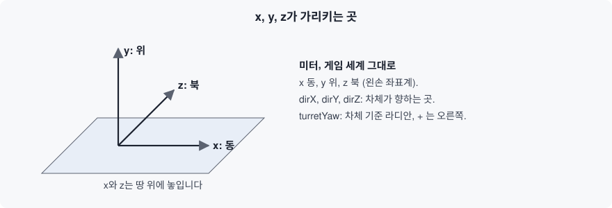

# 테이블 {#the-table}

`<match>.parquet`에는 샘플이나 이벤트마다 한 행이 있습니다. 열은 38개입니다([열 목록](../columns.md), 코드에서 생성됨).

| 열 | 내용 |
|---|---|
| `match`, `map` | 전투의 ID; 맵의 ID(그림에서는 `99_testmap`) |
| `time` | 녹화가 시작된 뒤의 초(카운트다운도 포함됩니다) |
| `battleTime` | 전투가 시작된 뒤의 초; 카운트다운 중에는 음수 |
| `event` | 이 행이 무엇인지(아래 참고) |
| `player`, `team`, `own` | 플레이어의 이름; 팀 `1` 또는 `2`; 녹화한 플레이어의 행에는 `1` |
| `vehicle`, `type` | 게임이 이름 붙인 전차(`ussr:R144_K_91`); 발사자를 알 수 없는(플레이어가 없는) 예광탄이나 폭발에는 `tank` 또는 `shell` |
| `x`, `y`, `z` | 미터: x 동, y 위, z 북(게임 자신의 세계, 왼손 좌표계) |
| `dirX`, `dirY`, `dirZ` | 차체가 향하는 곳; 같은 좌표계의 단위 벡터(`dirY` 0: 방위만). 사격이나 예광탄에서는 포탄이 날아간 방향 |
| `turretYaw` | 차체의 방위에서 본 포탑의 각도, 라디안, 오른쪽이 양수 |
| `gunStep` | 포 자신의 한계 사이에서 0-63 단계로 나타낸 포의 고각(한계는 전차의 데이터이지 리플레이의 것이 아닙니다) |
| `other`, `reason` | 이벤트의 다른 차량(공격자, 피해자, 가해자, 목표); 게임의 공격 이유 번호 |
| `value`, `health` | 이벤트의 수치(피해, 연사, 포탄 속도, 줌, 명령); 변화 뒤의 체력 |
| `text` | 이유의 이름, 채팅 줄, 카메라 모드, 명령의 키 |
| `shot` | 포탄의 ID: 사격, 그 예광탄, 그 폭발이 같은 것을 공유합니다 |
| `entity` | 리플레이에서의 차량 ID |
| `hitComponent`, `hitCode`, `hitU/V/W`, `hitExitU/V/W`, `hitDirX/Y/Z` | `struck` 행에만: 포탄이 어디를 맞혔는지(아래 `struck` 이벤트 참고) |
| `pitch`, `roll` | 위치 행에서, 게임이 보내는 그대로의 차체 피치(라디안, 기수가 아래로 가면 양수)와 롤 |

| `event` | 어느 차량의 행에 | 내용 |
|---|---|---|
| `position` | 모든 차량 | 초당 약 열 번. 클라이언트가 그 위치를 알고 있는 동안 |
| `death`, `kill` | 피해자, 공격자 | 사망은 두 번 기록됩니다: 피해자가 쓰러진 곳과, 공격자가 서 있던 곳 |
| `hurt`, `damage` | 피해자, 공격자 | 체력 변화: `value`는 피해, `health`는 남은 체력, `reason`/`text`는 이유(`shot`, `fire`, `ramming`, ...) |
| `struck` | 피해자 | 그것을 맞힌 포탄. 튕기거나 관통하지 못한 포탄도 포함합니다. 한 점이 맞을 때마다 한 행이고, `value`는 그것이 준 피해(첫 행에). `hitComponent`는 충돌 구성 요소. `hitU/V/W`는 포탄이 들어간 곳, `hitExitU/V/W`는 그 경로가 끝난 곳으로, 그 구성 요소 상자의 비율로 나타냅니다(u 오른쪽, v 위, w 앞; 공격자의 방위와 맞는지 확인했습니다). `hitDirX/Y/Z`는 차체 좌표계에서 포탄이 들어온 방향. `turretYaw`는 그때의 피해자 포탑. `hitCode`는 점과 함께 보내진 바이트(뜻은 알 수 없습니다; 피해를 따르지 않습니다) |
| `shot` | 발사자 | `value`는 연사; 예광탄이 날아간 방향, 없으면 차체와 포탑을 합한 방향 |
| `tracer` | 발사자 | 포탄이 처음 보인 곳과 날아간 방향; `value`는 게임 단위의 속도 |
| `impact` | 발사자 | 포탄이 터진 곳 |
| `chat` | 보낸 사람 | `text`는 그 줄 |
| `command` | 보낸 사람 | 전투 채팅 명령(공격, 도움, 지도의 한 지점). 지점이 있으면 그 지점에; `value`는 명령의 번호, `other`는 그것이 가리키는 차량 |
| `camera`, `zoom`, `lock`, `unlock` | 녹화한 플레이어 | 카메라 모드(`sniper`, `arcade`, ...), 줌, 목표에 대한 자동 조준 켬과 끔 |

Parquet 바닥글에는 `heat3d` 힌트가 있습니다: Y가 위, Z가 뒤집힘(그래서 맵이 거울에 비치지 않습니다), 단위 배율 1, 차량은 폭 7 m, `player`는 사람, `team`은 집단, `match`는 세션.

---

[3DHeat](https://github.com/Holdi601/3DHeat)의 일부([문서](https://holdi601.github.io/3DHeat/)). 소스: [3DHeat-Ext-WoT](https://github.com/Holdi601/3DHeat-Ext-WoT).
