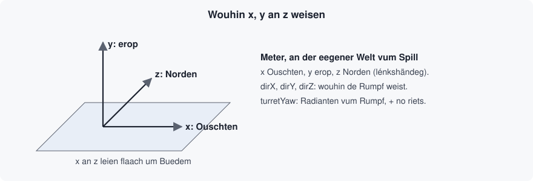

# D'Tabell {#the-table}

Eng Zeil pro Echantillon oder Evenement, an `<match>.parquet`: 38 Kolonnen
([Kolonnelëscht](../columns.md), aus dem Code generéiert).

| Kolonn | Wat |
|---|---|
| `match`, `map` | d'ID vum Gefecht; d'ID vun der Kaart (`99_testmap` op de Biller) |
| `time` | Sekonne vum Ufank vun der Opnam un (de Countdown ass dran) |
| `battleTime` | Sekonne vum Ufank vum Gefecht un; negativ während dem Countdown |
| `event` | wat d'Zeil ass (ënnen) |
| `player`, `team`, `own` | den Numm vum Spiller; Team `1` oder `2`; `1` op den Zeile vum opuelende Spiller |
| `vehicle`, `type` | de Panzer, wéi d'Spill en nennt (`ussr:R144_K_91`); `tank`, oder `shell` fir e Leuchtspur oder eng Explosioun, där hire Schëtze net bekannt ass (kee Spiller) |
| `x`, `y`, `z` | Meter: x Ouschten, y erop, z Norden (dem Spill seng eege Welt, lénkshändeg) |
| `dirX`, `dirY`, `dirZ` | wouhin de Rumpf weist, en Eenheetsvecteur am selwechte System (`dirY` 0: nëmmen Heading); bei engem Schoss oder Leuchtspur, wouhin d'Granat geflunn ass |
| `turretYaw` | dem Turm säi Wénkel vum Heading vum Rumpf, Radianten, no riets positiv |
| `gunStep` | d'Elevatioun vun der Kanoun als Schrëtt 0-63 tëscht de eegene Limite vun der Kanoun (d'Limite si Daten vum Panzer, net vum Replay) |
| `other`, `reason` | dat anert Gefier vun engem Evenement (Killer, Affer, Ugräifer, Zil); d'Nummer vum Ugrëffsgrond vum Spill |
| `value`, `health` | d'Zuel vum Evenement (Schued, Stouss, Granatgeschwindegkeet, Zoom, Kommando); d'Liewen no enger Ännerung |
| `text` | den Numm vum Grond, eng Chat-Zeil, e Kameramodus, dem Kommando säi Schlëssel |
| `shot` | d'ID vun der Granat: e Schoss, säi Leuchtspur a seng Explosioun deelen se |
| `entity` | d'ID vum Gefier am Replay |
| `hitComponent`, `hitCode`, `hitU/V/W`, `hitExitU/V/W`, `hitDirX/Y/Z` | nëmmen op `struck`-Zeilen: wou eng Granat getraff huet (kuck dat `struck`-Evenement ënnen) |
| `pitch`, `roll` | bei enger Positioun, dem Rumpf seng Pitch (Radianten, Nues erof positiv) a Roll, wéi d'Spill se schéckt |

| `event` | Op der Zeil vun | Wat |
|---|---|---|
| `position` | all Gefier | ongeféier zéngmol d'Sekonn, solaang de Client wousst, wou et war |
| `death`, `kill` | dem Affer, dem Killer | all Doud zweemol: wou d'Affer gefall ass, a wou de Killer stoung |
| `hurt`, `damage` | dem Affer, dem Ugräifer | eng Liewensännerung: `value` de Schued, `health` wat bleift, `reason`/`text` firwat (`shot`, `fire`, `ramming`, ...) |
| `struck` | dem Affer | eng Granat, déi et getraff huet, och déi, déi ofgeprallt sinn oder net duerchgeschloen hunn: eng Zeil pro getraffene Punkt, `value` de Schued, deen et gemaach huet (op der éischter); `hitComponent` d'Kollisiounskomponent, `hitU/V/W` wou d'Granat era ass an `hitExitU/V/W` wou säi Wee opgehal huet, als Bruchdeeler vun der Këscht vun där Komponent (u riets, v erop, w no vir; géint dem Ugräifer säi Peilung gepréift), `hitDirX/Y/Z` de Wee, wéi se erakoum, am System vum Rumpf, `turretYaw` dem Affer säin Turm deemools, `hitCode` e Byte, dat mam Punkt geschéckt gëtt (net bekannt: et follegt dem Schued net) |
| `shot` | dem Schëtze | `value` de Stouss; d'Richtung, an där säi Leuchtspur geflunn ass, soss dem Rumpf seng plus dem Turm seng |
| `tracer` | dem Schëtze | wou eng Granat fir d'éischt gesi gouf a wéi se geflunn ass; `value` hir Geschwindegkeet an den Eenheeten vum Spill |
| `impact` | dem Schëtze | wou eng Granat explodéiert ass |
| `chat` | dem Sender | `text` d'Zeil |
| `command` | dem Sender | e Kommando vum Gefechtschat (Ugrëff, Hëllef, e Punkt op der Kaart), un sengem Punkt, wann en een huet; `value` d'Nummer vum Kommando, `other` d'Gefier, dat en nennt |
| `camera`, `zoom`, `lock`, `unlock` | dem opuelende Spiller | de Kameramodus (`sniper`, `arcade`, ...), den Zoom, Auto-Zil un an aus op e Zil |

De Parquet-Fouss dréit d'`heat3d`-Hiweiser: Y erop, Z ëmgedréint (sou datt d'Kaart net
gespigelt ass), Eenheetsskala 1, e Gefier siwe Meter breet, `player` als
Persoun, `team` als Grupp, `match` als Sessioun.

---

Deel vun [3DHeat](https://github.com/Holdi601/3DHeat) ([Dokumentatioun](https://holdi601.github.io/3DHeat/)). Quell: [3DHeat-Ext-WoT](https://github.com/Holdi601/3DHeat-Ext-WoT).
