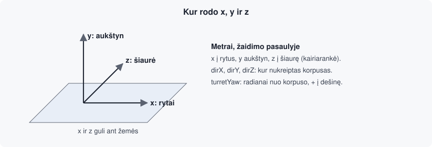

# Lentelė {#the-table}

Viena eilutė kiekvienam pavyzdžiui ar įvykiui `<match>.parquet` faile: 38 stulpeliai
([Stulpelių sąrašas](../columns.md), sugeneruotas iš kodo).

| Stulpelis | Ką reiškia |
|---|---|
| `match`, `map` | mūšio id; žemėlapio id (paveikslėliuose - `99_testmap`) |
| `time` | sekundės nuo įrašymo pradžios (jame yra atskaita) |
| `battleTime` | sekundės nuo mūšio pradžios; atskaitos metu - neigiamos |
| `event` | kas yra eilutė (žr. žemiau) |
| `player`, `team`, `own` | žaidėjo vardas; komanda `1` arba `2`; `1` įrašančio žaidėjo eilutėse |
| `vehicle`, `type` | tankas, kaip jį vadina žaidimas (`ussr:R144_K_91`); `tank`, arba `shell` trasuojančiam sviediniui ar sprogimui, kurio šaulys nežinomas (nėra žaidėjo) |
| `x`, `y`, `z` | metrai: x - į rytus, y - aukštyn, z - į šiaurę (žaidimo paties pasaulis, kairiarankis) |
| `dirX`, `dirY`, `dirZ` | kur nukreiptas korpusas, vienetinis vektorius tame pačiame rėmelyje (`dirY` 0: tik kryptis); šūvyje ar trasoje - kur skrido sviedinys |
| `turretYaw` | bokštelio kampas nuo korpuso krypties, radianais, teigiamas į dešinę |
| `gunStep` | patrankos pakėlimas kaip žingsnis 0-63 tarp pačios patrankos ribų (ribos yra tanko duomenys, ne įrašo) |
| `other`, `reason` | kito vieneto įvykis (žudikas, auka, atakuotojas, taikinys); žaidimo atakos priežasties numeris |
| `value`, `health` | įvykio skaičius (žala, serija, sviedinio greitis, priartinimas, komanda); sveikata po pokyčio |
| `text` | priežasties vardas, pokalbio eilutė, kameros režimas, komandos raktas |
| `shot` | sviedinio id: šūvis, jo trasa ir sprogimas turi tą patį |
| `entity` | vieneto id įraše |
| `hitComponent`, `hitCode`, `hitU/V/W`, `hitExitU/V/W`, `hitDirX/Y/Z` | tik `struck` eilutėse: kur sviedinys trenkė (žr. žemiau `struck` įvykį) |
| `pitch`, `roll` | pozicijoje - korpuso kėlimas (radianais, teigiamas nosis žemyn) ir posūkis, kaip juos siunčia žaidimas |

| `event` | Kurios eilutės | Ką reiškia |
|---|---|---|
| `position` | kiekvienas vienetas | maždaug dešimt kartų per sekundę, kol klientas žinojo, kur jis yra |
| `death`, `kill` | auka, žudikas | kiekviena žūtis dukart: kur auka krito ir kur stovėjo žudikas |
| `hurt`, `damage` | auka, atakuotojas | sveikatos pokytis: `value` - žala, `health` - kas liko, `reason`/`text` - kodėl (`shot`, `fire`, `ramming`, ...) |
| `struck` | auka | sviedinys, kuris trenkė į ją, taip pat tie, kurie atšoko ar neprasiskverbė: viena eilutė vienam taškui, kur smogė, `value` - žala, kurią jis padarė (pirmajam); `hitComponent` - susidūrimo komponentas, `hitU/V/W` - kur sviedinys įėjo, o `hitExitU/V/W` - kur baigėsi jo kelias, kaip tam komponentui dėžės dalys (u - dešinė, v - aukštyn, w - pirmyn; patikrinta pagal atakuotojo kryptį), `hitDirX/Y/Z` - kaip jis įėjo korpuso rėmelyje, `turretYaw` - aukos bokštelis tuo metu, `hitCode` - baitas, siunčiamas su tašku (nežinomas: jis neseka žalos) |
| `shot` | šaulys | `value` - serija; kryptis, kuria skrido jo trasa, kitu atveju korpuso plius bokštelio |
| `tracer` | šaulys | kur sviedinys buvo pirmą kartą pastebėtas ir kaip jis skrido; `value` - jo greitis žaidimo vienetais |
| `impact` | šaulys | kur sviedinys sprogo |
| `chat` | siuntėjas | `text` - eilutė |
| `command` | siuntėjas | mūšio pokalbio komanda (atakuoti, pagalba, taškas žemėlapyje), jo taške, kai jis turi tašką; `value` - komandos numeris, `other` - technika, kurią ji nurodo |
| `camera`, `zoom`, `lock`, `unlock` | įrašantis žaidėjas | kameros režimas (`sniper`, `arcade`, ...), priartinimas, automatinis taikymas įjungtas ir išjungtas į taikinį |

Parquet poraštė neša `heat3d` užuominas: Y aukštyn, Z apverstas (kad žemėlapis nebūtų veidrodinis), vieneto mastelis 1,
technika septynių metrų pločio, `player` kaip asmuo, `team` kaip grupė, `match` kaip sesija.

---

Dalis [3DHeat](https://github.com/Holdi601/3DHeat) ([dokumentacija](https://holdi601.github.io/3DHeat/)). Šaltinis: [3DHeat-Ext-WoT](https://github.com/Holdi601/3DHeat-Ext-WoT).
