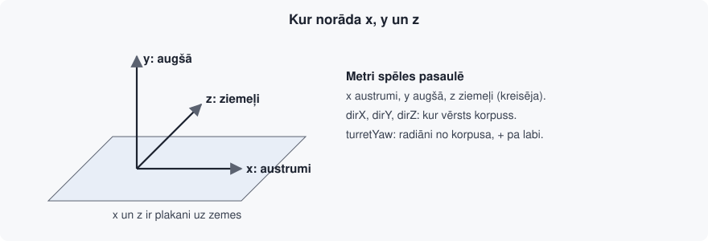

# Tabula {#the-table}

Viena rinda katram paraugam vai notikumam `<match>.parquet` failā: 38 kolonnas ([Kolonnu saraksts](../columns.md), ģenerēts no koda).

| Kolonna | Ko tā nozīmē |
|---|---|
| `match`, `map` | kaujas ID; kartes ID (`99_testmap` attēlos) |
| `time` | sekundes kopš ieraksta sākuma (skaitīšana atpakaļ ir iekļauta) |
| `battleTime` | sekundes kopš kaujas sākuma; negatīvas skaitīšanas laikā |
| `event` | kas ir šī rinda (zemāk) |
| `player`, `team`, `own` | spēlētāja vārds; komanda `1` vai `2`; `1` ierakstošā spēlētāja rindās |
| `vehicle`, `type` | tanks, kā to nosauc spēle (`ussr:R144_K_91`); `tank`, vai `shell` trasierim vai sprādzienam, kura šāvējs nav zināms (nav spēlētāja) |
| `x`, `y`, `z` | metri: x uz austrumiem, y uz augšu, z uz ziemeļiem (spēles pašas pasaule, kreisēja) |
| `dirX`, `dirY`, `dirZ` | kurp vērsts korpuss, vienības vektors tajā pašā koordinātu sistēmā (`dirY` 0: tikai virziens); uz šāviena vai trasiera — kurp šāviņš lidoja |
| `turretYaw` | torņa leņķis no korpusa virziena, radiānos, pozitīvs pa labi |
| `gunStep` | lielgabala pacēlums kā solis 0–63 starp paša lielgabala robežām (robežas ir tanka dati, ne atkārtojuma) |
| `other`, `reason` | notikuma otra vienība (slepkava, upuris, uzbrucējs, mērķis); spēles uzbrukuma iemesla numurs |
| `value`, `health` | notikuma skaitlis (bojājums, uzliesmojums, šāviņa ātrums, tālummaiņa, komanda); veselība pēc izmaiņas |
| `text` | iemesla nosaukums, tērzēšanas rinda, kameras režīms, komandas atslēga |
| `shot` | šāviņa ID: šāviens, tā trasieris un tā sprādziens to dala |
| `entity` | transportlīdzekļa ID atkārtojumā |
| `hitComponent`, `hitCode`, `hitU/V/W`, `hitExitU/V/W`, `hitDirX/Y/Z` | tikai `struck` rindās: kur šāviņš trāpīja (skat. zemāk `struck` notikumu) |
| `pitch`, `roll` | pozīcijā — korpusa pitch (radiānos, pozitīvs deguns uz leju) un roll, kā tos sūta spēle |

| `event` | Rindā, kas attiecas uz | Ko nozīmē |
|---|---|---|
| `position` | katru transportlīdzekli | apmēram desmit reizes sekundē, kamēr klients zināja, kur tas ir |
| `death`, `kill` | upuri, slepkavu | katra nāve divreiz: kur upuris krita un kur stāvēja slepkava |
| `hurt`, `damage` | upuri, uzbrucēju | veselības izmaiņa: `value` bojājums, `health` kas atlicis, `reason`/`text` kāpēc (`shot`, `fire`, `ramming`, ...) |
| `struck` | upuri | šāviņš, kas to trāpīja, arī tie, kas atlēca vai neiekļuva: viena rinda uz trāpījuma punktu, `value` bojājums, ko tas nodarīja (pirmajā); `hitComponent` sadursmes komponente, `hitU/V/W` kur šāviņš ienāca un `hitExitU/V/W` kur tā ceļš beidzās kā daļas no šīs komponentes kastes (u pa labi, v uz augšu, w uz priekšu; pārbaudīts pret uzbrucēja leņķi), `hitDirX/Y/Z` kā tas ienāca korpusa koordinātu sistēmā, `turretYaw` upura tornis tajā brīdī, `hitCode` baits, kas sūtīts kopā ar punktu (nav zināms: tas neseko bojājumam) |
| `shot` | šāvējs | `value` sērija; virziens, kurā lidoja tā trasieris, citādi korpusa un torņa |
| `tracer` | šāvējs | kur šāviņš pirmo reizi tika redzēts un kā tas lidoja; `value` tā ātrums spēles vienībās |
| `impact` | šāvējs | kur šāviņš sprāga |
| `chat` | sūtītāju | `text` rinda |
| `command` | sūtītāju | kaujas tērzēšanas komanda (uzbrukt, palīdzība, punkts kartē), tās punktā, ja tam ir punkts; `value` komandas numurs, `other` transportlīdzeklis, ko tā nosauc |
| `camera`, `zoom`, `lock`, `unlock` | ierakstošo spēlētāju | kameras režīms (`sniper`, `arcade`, ...), tālummaiņa, automātiskā mērķēšana ieslēgta un izslēgta uz mērķa |

Parquet kājene nes `heat3d` norādes: Y uz augšu, Z apgriezts (lai karte nebūtu spoguļattēls), vienības mērogs 1, transportlīdzeklis septiņus metrus plats, `player` kā cilvēks, `team` kā grupa, `match` kā sesija.

---

Daļa no [3DHeat](https://github.com/Holdi601/3DHeat) ([dokumentācija](https://holdi601.github.io/3DHeat/)). Avots: [3DHeat-Ext-WoT](https://github.com/Holdi601/3DHeat-Ext-WoT).
