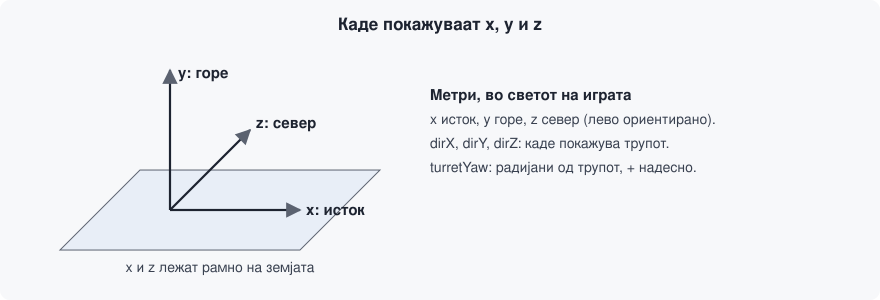

# Табелата {#the-table}

Еден ред за секој примерок или настан, во `<match>.parquet`: 38 колони ([Список на колони](../columns.md), генериран од кодот).

| Колона | Што |
|---|---|
| `match`, `map` | идот на битката; идот на мапата (`99_testmap` на сликите) |
| `time` | секунди од почетокот на снимањето (одбројувањето е вклучено) |
| `battleTime` | секунди од почетокот на битката; негативно за време на одбројувањето |
| `event` | што е редот (подолу) |
| `player`, `team`, `own` | името на играчот; тим `1` или `2`; `1` на редовите на снимачкиот играч |
| `vehicle`, `type` | тенкот како што го именува играта (`ussr:R144_K_91`); `tank`, или `shell` за трасер или експлозија чиј стрелец не е познат (нема играч) |
| `x`, `y`, `z` | метри: x исток, y горе, z север (сопствениот свет на играта, лево ориентиран) |
| `dirX`, `dirY`, `dirZ` | каде покажува трупот, единичен вектор во истиот систем (`dirY` 0: само насока); на истрел или трасер каде летал проектилот |
| `turretYaw` | аголот на куполата од насоката на трупот, радијани, позитивно надесно |
| `gunStep` | елевацијата на топот како чекор 0-63 меѓу границите на самиот топ (границите се податоци на тенкот, не на снимката) |
| `other`, `reason` | другото возило на настан (убиец, жртва, напаѓач, цел); бројот на причината за напад на играта |
| `value`, `health` | бројот на настанот (штета, рафал, брзина на проектил, зум, команда); здравјето по промена |
| `text` | името на причината, линија од разговор, режим на камера, клуч на команда |
| `shot` | идот на проектилот: истрелот, неговиот трасер и неговата експлозија го делат |
| `entity` | идот на возилото во снимката |
| `hitComponent`, `hitCode`, `hitU/V/W`, `hitExitU/V/W`, `hitDirX/Y/Z` | само на редови `struck`: каде погодил проектил (видете го настанот `struck` подолу) |
| `pitch`, `roll` | на позиција, pitch на трупот (радијани, позитивно носот надолу) и roll, како што ги праќа играта |

| `event` | На редот на | Што |
|---|---|---|
| `position` | секое возило | околу десет пати во секунда, додека клиентот знаел каде е |
| `death`, `kill` | жртвата, убиецот | секоја смрт двапати: каде паднала жртвата, и каде стоел убиецот |
| `hurt`, `damage` | жртвата, напаѓачот | промена на здравјето: `value` штетата, `health` што останало, `reason`/`text` зошто (`shot`, `fire`, `ramming`, ...) |
| `struck` | жртвата | проектил што ја погодил, и оние што отскокнале или не пробиле: еден ред по погодена точка, `value` штетата што ја направил (на првиот); `hitComponent` компонентата за судир, `hitU/V/W` каде влегол проектилот и `hitExitU/V/W` каде завршила неговата патека како делови од кутијата на таа компонента (u десно, v горе, w напред; проверено наспроти правецот на напаѓачот), `hitDirX/Y/Z` патот по кој влегол во системот на трупот, `turretYaw` куполата на жртвата тогаш, `hitCode` бајт пратен со точката (не е познат: не ја следи штетата) |
| `shot` | стрелецот | `value` рафалот; насоката по која летал неговиот трасер, инаку онаа на трупот плус куполата |
| `tracer` | стрелецот | каде проектил бил прв пат виден и патот по кој летал; `value` неговата брзина во единици на играта |
| `impact` | стрелецот | каде проектил експлодирал |
| `chat` | испраќачот | `text` линијата |
| `command` | испраќачот | команда од разговорот во битка (напад, помош, точка на мапата), на нејзината точка кога има; `value` бројот на командата, `other` возилото што го именува |
| `camera`, `zoom`, `lock`, `unlock` | снимачкиот играч | режимот на камерата (`sniper`, `arcade`, ...), зумот, автоматското целење вклучено и исклучено врз цел |

Подножјето на Parquet ги носи упатствата `heat3d`: Y горе, Z превртено (за мапата да не е огледана), размер на единица 1, возило широко седум метри, `player` како лице, `team` како група, `match` како сесија.

---

Дел од [3DHeat](https://github.com/Holdi601/3DHeat) ([документација](https://holdi601.github.io/3DHeat/)). Извор: [3DHeat-Ext-WoT](https://github.com/Holdi601/3DHeat-Ext-WoT).
