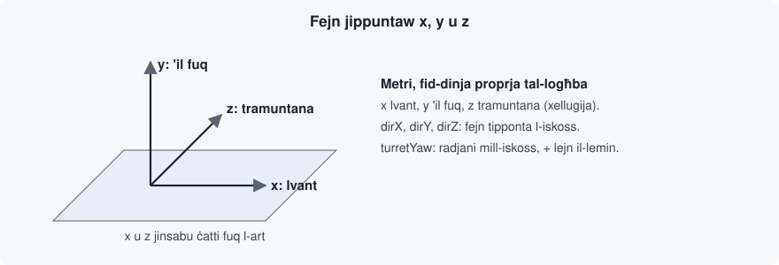

# It-tabella {#the-table}

Ringiela waħda għal kull kampjun jew avveniment, f'`<match>.parquet`: 38 kolonna
([Lista tal-kolonni](../columns.md), iġġenerata mill-kodiċi).

| Kolonna | X'inhi |
|---|---|
| `match`, `map` | l-id tal-battalja; l-id tal-mappa (`99_testmap` fl-istampi) |
| `time` | sekondi minn meta bdiet ir-reġistrazzjoni (il-countdown hu inkluż) |
| `battleTime` | sekondi minn meta bdiet il-battalja; negattiv waqt il-countdown |
| `event` | x'inhi r-ringiela (hawn taħt) |
| `player`, `team`, `own` | isem il-plejer; tim `1` jew `2`; `1` fuq ir-ringieli tal-plejer li rreġistra |
| `vehicle`, `type` | it-tank kif jinsmieh il-logħba (`ussr:R144_K_91`); `tank`, jew `shell` għal tracer jew splużjoni li x-xutter tagħha mhuwiex magħruf (ebda plejer) |
| `x`, `y`, `z` | metri: x lvant, y 'il fuq, z tramuntana (id-dinja tal-logħba nnifisha, xellugija) |
| `dirX`, `dirY`, `dirZ` | fejn tipponta l-iskoss, vettur unità fl-istess qafas (`dirY` 0: direzzjoni biss); fuq sparatura jew tracer fejn tajjar il-qoxra |
| `turretYaw` | l-angolu tat-turret mid-direzzjoni tal-iskoss, radjani, pożittiv lejn il-lemin |
| `gunStep` | l-elevazzjoni tal-kanun bħala pass 0-63 bejn il-limiti tal-kanun stess (il-limiti huma d-dejta tat-tank, mhux tar-ripetizzjoni) |
| `other`, `reason` | il-vettura l-oħra ta' avveniment (qattiel, vittma, attakkant, mira); in-numru tar-raġuni tal-attakk tal-logħba |
| `value`, `health` | in-numru tal-avveniment (ħsara, sensiela, veloċità tal-qoxra, zoom, kmand); is-saħħa wara bidla |
| `text` | l-isem tar-raġuni, linja taċ-chat, modalità tal-kamera, ċavetta ta' kmand |
| `shot` | l-id tal-qoxra: sparatura, it-tracer tagħha u l-isplużjoni tagħha jaqsmuh |
| `entity` | l-id tal-vettura fir-ripetizzjoni |
| `hitComponent`, `hitCode`, `hitU/V/W`, `hitExitU/V/W`, `hitDirX/Y/Z` | fuq ringieli `struck` biss: fejn laqtet qoxra (ara l-avveniment `struck` hawn taħt) |
| `pitch`, `roll` | fuq pożizzjoni, il-pitch tal-iskoss (radjani, pożittiv meta t-tarf ta' quddiem jaqa') u r-roll, kif jibagħthom il-logħba |

| `event` | Fuq ir-ringiela ta' | X'inhu |
|---|---|---|
| `position` | kull vettura | madwar għaxar darbiet fit-tieni, sakemm il-klijent kien jaf fejn kienet |
| `death`, `kill` | il-vittma, il-qattiel | kull mewt darbtejn: fejn waqgħet il-vittma, u fejn kien il-qattiel |
| `hurt`, `damage` | il-vittma, l-attakkant | bidla fis-saħħa: `value` il-ħsara, `health` dak li fadal, `reason`/`text` għaliex (`shot`, `fire`, `ramming`, ...) |
| `struck` | il-vittma | qoxra li laqtitha, anke dawk li qabżu lura jew ma qasmux: ringiela għal kull punt laqtet, `value` il-ħsara li għamlet (fl-ewwel); `hitComponent` il-komponent tal-kolliżjoni, `hitU/V/W` fejn daħlet il-qoxra u `hitExitU/V/W` fejn spiċċa t-triq tagħha bħala frazzjonijiet tal-kaxxa ta' dak il-komponent (u lejn il-lemin, v 'il fuq, w 'il quddiem; ivverifikat mal-bearing tal-attakkant), `hitDirX/Y/Z` kif daħlet fil-qafas tal-iskoss, `turretYaw` it-turret tal-vittma dak il-ħin, `hitCode` byte mibgħut mal-punt (mhux magħruf: ma jsegwix il-ħsara) |
| `shot` | ix-xutter | `value` is-sensiela; id-direzzjoni li tajjar it-tracer tiegħu, inkella dik tal-iskoss flimkien ma' dik tat-turret |
| `tracer` | ix-xutter | fejn deher l-ewwel qoxra u t-triq li tajjar; `value` il-veloċità tagħha fl-unitajiet tal-logħba |
| `impact` | ix-xutter | fejn splodiet qoxra |
| `chat` | min bagħat | `text` il-linja |
| `command` | min bagħat | kmand taċ-chat tal-battalja (attakka, għajnuna, punt fuq il-mappa), fil-punt tiegħu meta jkollu; `value` in-numru tal-kmand, `other` il-vettura li jsemmi |
| `camera`, `zoom`, `lock`, `unlock` | il-plejer li rreġistra | il-modalità tal-kamera (`sniper`, `arcade`, ...), iz-zoom, l-awto-aim mixgħul u mitfi fuq mira |

It-tarf tal-Parquet iġorr is-suġġerimenti `heat3d`: Y 'il fuq, Z maqlub (biex il-mappa
ma tkunx mirja), skala unità 1, vettura ta' seba' metri wiesgħa, `player` bħala
persuna, `team` bħala grupp, `match` bħala sessjoni.

---

Parti mid-[3DHeat](https://github.com/Holdi601/3DHeat) ([dokumentazzjoni](https://holdi601.github.io/3DHeat/)). Sors: [3DHeat-Ext-WoT](https://github.com/Holdi601/3DHeat-Ext-WoT).
