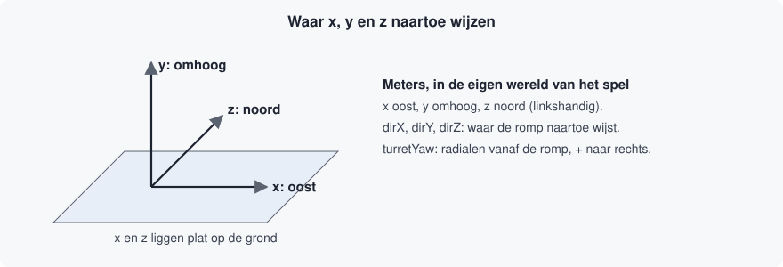

# De tabel {#the-table}

Eén rij per sample of gebeurtenis, in `<match>.parquet`: 38 kolommen
([Kolomlijst](../columns.md), gegenereerd uit de code).

| Kolom | Wat |
|---|---|
| `match`, `map` | het id van het gevecht; het id van de kaart (`99_testmap` op de afbeeldingen) |
| `time` | seconden sinds het opnemen begon (het aftellen zit erin) |
| `battleTime` | seconden sinds het gevecht begon; negatief tijdens het aftellen |
| `event` | wat de rij is (hieronder) |
| `player`, `team`, `own` | de naam van de speler; team `1` of `2`; `1` op de rijen van de opnemende speler |
| `vehicle`, `type` | de tank zoals het spel hem noemt (`ussr:R144_K_91`); `tank`, of `shell` voor een tracer of explosie waarvan de schutter niet bekend is (geen speler) |
| `x`, `y`, `z` | meters: x oost, y omhoog, z noord (de eigen wereld van het spel, linkshandig) |
| `dirX`, `dirY`, `dirZ` | waar de romp naartoe wijst, een eenheidsvector in hetzelfde stelsel (`dirY` 0: alleen heading); bij een schot of tracer de richting waarin het projectiel vloog |
| `turretYaw` | de hoek van de toren ten opzichte van de heading van de romp, in radialen, positief naar rechts |
| `gunStep` | de hoogte van het kanon als stap 0-63 tussen de eigen grenzen van het kanon (de grenzen zijn de gegevens van de tank, niet van de replay) |
| `other`, `reason` | het andere voertuig van een gebeurtenis (killer, slachtoffer, aanvaller, doel); het reden-nummer van de aanval volgens het spel |
| `value`, `health` | het getal van de gebeurtenis (schade, salvo, snelheid van het projectiel, zoom, commando); gezondheid na een wijziging |
| `text` | de naam van de reden, een chatregel, een cameramodus, de sleutel van een commando |
| `shot` | het id van het projectiel: een schot, zijn tracer en zijn explosie delen het |
| `entity` | het id van het voertuig in de replay |
| `hitComponent`, `hitCode`, `hitU/V/W`, `hitExitU/V/W`, `hitDirX/Y/Z` | alleen op `struck`-rijen: waar een projectiel trof (zie de gebeurtenis `struck` hieronder) |
| `pitch`, `roll` | op een positie: de helling (pitch) en rol van de romp (radialen, positief neus omlaag), zoals het spel ze stuurt |

| `event` | Op de rij van | Wat |
|---|---|---|
| `position` | elk voertuig | ongeveer tien keer per seconde, zolang de client wist waar het was |
| `death`, `kill` | het slachtoffer, de killer | elke dood tweemaal: waar het slachtoffer viel, en waar de killer stond |
| `hurt`, `damage` | het slachtoffer, de aanvaller | een wijziging van gezondheid: `value` de schade, `health` wat er nog is, `reason`/`text` waarom (`shot`, `fire`, `ramming`, ...) |
| `struck` | het slachtoffer | een projectiel dat het trof, ook die die afketsten of niet doordrongen: één rij per punt dat getroffen werd, `value` de schade die het deed (op de eerste); `hitComponent` het botsingsonderdeel, `hitU/V/W` waar het projectiel binnenkwam en `hitExitU/V/W` waar zijn pad eindigde als breuken van de doos van dat onderdeel (u rechts, v omhoog, w vooruit; gecontroleerd tegen de peiling van de aanvaller), `hitDirX/Y/Z` de richting waaruit het kwam in het stelsel van de romp, `turretYaw` de toren van het slachtoffer op dat moment, `hitCode` een byte die bij het punt gestuurd wordt (niet bekend: hij volgt de schade niet) |
| `shot` | de schutter | `value` het salvo; de richting waarin zijn tracer vloog, anders die van de romp plus die van de toren |
| `tracer` | de schutter | waar een projectiel voor het eerst gezien werd en de richting waarin het vloog; `value` zijn snelheid in de eenheden van het spel |
| `impact` | de schutter | waar een projectiel ontplofte |
| `chat` | de afzender | `text` de regel |
| `command` | de afzender | een commando in de gevechtschat (aanvallen, help, een punt op de kaart), op zijn punt als het er een heeft; `value` het nummer van het commando, `other` het voertuig dat het noemt |
| `camera`, `zoom`, `lock`, `unlock` | de opnemende speler | de cameramodus (`sniper`, `arcade`, ...), de zoom, automatisch richten aan en uit op een doel |

De voettekst van het Parquet-bestand draagt de leesinstructies van `heat3d`: Y omhoog, Z gespiegeld (zodat de kaart
niet gespiegeld is), eenheidsschaal 1, een voertuig zeven meter breed, `player` als de persoon, `team`
als de groep, `match` als de sessie.

---

Onderdeel van [3DHeat](https://github.com/Holdi601/3DHeat) ([documentatie](https://holdi601.github.io/3DHeat/)). Bron: [3DHeat-Ext-WoT](https://github.com/Holdi601/3DHeat-Ext-WoT).
