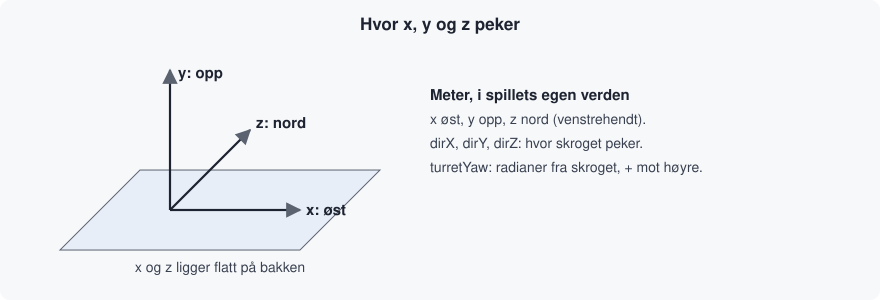

# Tabellen {#the-table}

Én rad per sample eller hendelse, i `<kamp>.parquet`: 38 kolonner
([Kolonneliste](../columns.md), generert fra koden).

| Kolonne | Hva |
|---|---|
| `match`, `map` | slagets ID; kartets ID (`99_testmap` i bildene) |
| `time` | sekunder siden opptaket startet (nedtellingen er med) |
| `battleTime` | sekunder siden slaget startet; negativ under nedtellingen |
| `event` | hva raden er (under) |
| `player`, `team`, `own` | spillerens navn; lag `1` eller `2`; `1` på opptakspilotens rader |
| `vehicle`, `type` | tanken slik spillet kaller den (`ussr:R144_K_91`); `tank`, eller `shell` for et sporstoff eller en eksplosjon der skytteren ikke er kjent (ingen spiller) |
| `x`, `y`, `z` | meter: x øst, y opp, z nord (spillets egen verden, venstrehendt) |
| `dirX`, `dirY`, `dirZ` | hvor skroget peker, en enhetsvektor i samme ramme (`dirY` 0: bare retning); på et skudd eller sporstoff der granaten fløy |
| `turretYaw` | tårnets vinkel fra skrogets retning, radianer, positiv mot høyre |
| `gunStep` | kanonens hevning som et steg 0-63 mellom kanonens egne grenser (grensene er tankens data, ikke replayens) |
| `other`, `reason` | den andre enheten i en hendelse (dreper, offer, angriper, mål); spillets angrepsårsaksnummer |
| `value`, `health` | hendelsens tall (skade, skuddserie, granathastighet, zoom, kommando); helse etter en endring |
| `text` | årsakens navn, en chat-linje, en kameramodus, en kommandonøkkel |
| `shot` | granatens ID: et skudd, dets sporstoff og dets eksplosjon deler den |
| `entity` | kjøretøyets ID i replayen |
| `hitComponent`, `hitCode`, `hitU/V/W`, `hitExitU/V/W`, `hitDirX/Y/Z` | bare på `struck`-rader: hvor en granat traff (se hendelsen `struck` under) |
| `pitch`, `roll` | på en posisjon, skrogets stigning (radianer, positiv med nesen ned) og rull, slik spillet sender dem |

| `event` | På raden til | Hva |
|---|---|---|
| `position` | hvert kjøretøy | ca. ti ganger i sekundet, mens klienten visste hvor det var |
| `death`, `kill` | offeret, dreperen | hvert dødsfall to ganger: der offeret falt, og der dreperen sto |
| `hurt`, `damage` | offeret, angriperen | en helseendring: `value` skaden, `health` det som er igjen, `reason`/`text` hvorfor (`shot`, `fire`, `ramming`, ...) |
| `struck` | offeret | en granat som traff det, også de som spratt av eller ikke trengte gjennom: én rad per treffpunkt, `value` skaden det gjorde (på den første); `hitComponent` kollisjonskomponenten, `hitU/V/W` der granaten gikk inn og `hitExitU/V/W` der dens bane endte, som brøker av komponentens boks (u høyre, v opp, w forover; kontrollert mot angriperens peiling), `hitDirX/Y/Z` veien den kom inn i skrogets ramme, `turretYaw` offerets tårn da, `hitCode` en byte sendt med punktet (ikke kjent: den følger ikke skaden) |
| `shot` | skytteren | `value` skuddserien; retningen sporstoffet fløy, ellers skrogets pluss tårnets |
| `tracer` | skytteren | der en granat først ble sett og veien den fløy; `value` dens hastighet i spillets enheter |
| `impact` | skytteren | der en granat eksploderte |
| `chat` | avsenderen | `text` linjen |
| `command` | avsenderen | en kommando i slagchatten (angrip, hjelp, et punkt på kartet), på sitt punkt når det har et; `value` kommandoens nummer, `other` kjøretøyet den nevner |
| `camera`, `zoom`, `lock`, `unlock` | opptakspiloten | kameramodusen (`sniper`, `arcade`, ...), zoomen, sikteassistanse på og av for et mål |

Parquet-bunnteksten bærer `heat3d`-hintene: y opp, z snudd (så kartet ikke speiles), enhetsskala 1, et kjøretøy
sju meter på tvers, `player` som personen, `team` som gruppen, `match` som økten.

---

Del av [3DHeat](https://github.com/Holdi601/3DHeat) ([dokumentasjon](https://holdi601.github.io/3DHeat/)). Kilde: [3DHeat-Ext-WoT](https://github.com/Holdi601/3DHeat-Ext-WoT).
