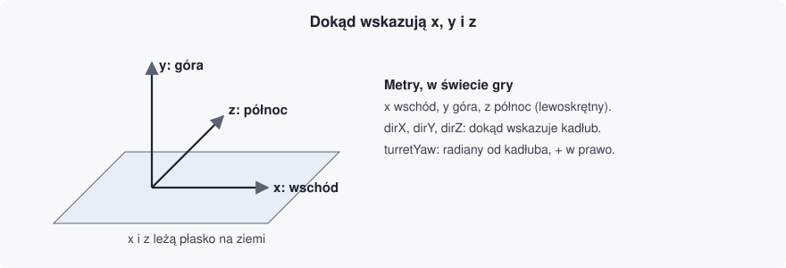

# Tabela {#the-table}

Jeden wiersz na próbkę lub zdarzenie, w `<match>.parquet`: 38 kolumn
([Lista kolumn](../columns.md), generowana z kodu).

| Kolumna | Co to jest |
|---|---|
| `match`, `map` | identyfikator bitwy; identyfikator mapy (`99_testmap` na obrazkach) |
| `time` | sekundy od rozpoczęcia nagrania (odliczanie też w nim jest) |
| `battleTime` | sekundy od rozpoczęcia bitwy; ujemne podczas odliczania |
| `event` | czym jest wiersz (poniżej) |
| `player`, `team`, `own` | nazwa gracza; drużyna `1` lub `2`; `1` w wierszach nagrywającego gracza |
| `vehicle`, `type` | czołg tak, jak nazywa go gra (`ussr:R144_K_91`); `tank`, albo `shell` dla smugi lub wybuchu, którego strzelec nie jest znany (brak gracza) |
| `x`, `y`, `z` | metry: x na wschód, y w górę, z na północ (świat samej gry, lewoskrętny) |
| `dirX`, `dirY`, `dirZ` | dokąd wskazuje kadłub, wektor jednostkowy w tym samym układzie (`dirY` 0: sam kurs); przy strzale lub smudze – dokąd leciał pocisk |
| `turretYaw` | kąt wieży względem kursu kadłuba, w radianach, dodatni w prawo |
| `gunStep` | podniesienie działa jako krok 0-63 między własnymi ograniczeniami działa (ograniczenia są w danych czołgu, a nie w replayu) |
| `other`, `reason` | drugi pojazd zdarzenia (zabójca, ofiara, atakujący, cel); numer powodu ataku w grze |
| `value`, `health` | liczba zdarzenia (obrażenia, seria, prędkość pocisku, zoom, komenda); zdrowie po zmianie |
| `text` | nazwa powodu, linia czatu, tryb kamery, klucz komendy |
| `shot` | identyfikator pocisku: strzał, jego smuga i jego wybuch mają ten sam |
| `entity` | identyfikator pojazdu w replayu |
| `hitComponent`, `hitCode`, `hitU/V/W`, `hitExitU/V/W`, `hitDirX/Y/Z` | tylko w wierszach `struck`: gdzie pocisk uderzył (zob. zdarzenie `struck` poniżej) |
| `pitch`, `roll` | przy pozycji: pochylenie kadłuba (radiany, dodatnie w dół dziobem) i przechył, tak jak wysyła je gra |

| `event` | W wierszu | Co to jest |
|---|---|---|
| `position` | każdego pojazdu | około dziesięć razy na sekundę, gdy klient wiedział, gdzie jest |
| `death`, `kill` | ofiary, zabójcy | każdy zgon dwa razy: gdzie upadła ofiara i gdzie stał zabójca |
| `hurt`, `damage` | ofiary, atakującego | zmiana zdrowia: `value` obrażenia, `health` co zostało, `reason`/`text` dlaczego (`shot`, `fire`, `ramming`, ...) |
| `struck` | ofiary | pocisk, który w nią uderzył, także te, które odbiły się lub nie przebiły: jeden wiersz na punkt uderzenia, `value` obrażenia, które zadał (w pierwszym); `hitComponent` komponent kolizji, `hitU/V/W` miejsce wejścia pocisku i `hitExitU/V/W` miejsce, w którym skończyła się jego droga, jako ułamki pudełka tego komponentu (u w prawo, v w górę, w do przodu; sprawdzone względem kierunku atakującego), `hitDirX/Y/Z` kierunek wejścia w układzie kadłuba, `turretYaw` wieża ofiary wtedy, `hitCode` bajt wysłany z punktem (nieznany: nie idzie za obrażeniami) |
| `shot` | strzelec | `value` seria; kierunek, w którym leciała jego smuga, a w przeciwnym razie kadłuba plus wieży |
| `tracer` | strzelec | miejsce, w którym pocisk został po raz pierwszy zobaczony, i kierunek jego lotu; `value` jego prędkość w jednostkach gry |
| `impact` | strzelec | miejsce, w którym pocisk wybuchł |
| `chat` | nadawca | `text` linia |
| `command` | nadawca | komenda czatu bitewnego (atak, pomoc, punkt na mapie), w jej punkcie, gdy go ma; `value` numer komendy, `other` pojazd, którego dotyczy |
| `camera`, `zoom`, `lock`, `unlock` | nagrywający gracz | tryb kamery (`sniper`, `arcade`, ...), zoom, automatyczne celowanie włączone i wyłączone wobec celu |

Stopka pliku Parquet niesie wskazówki `heat3d`: Y w górę, Z odwrócone (żeby mapa
nie była odbita), skala jednostek 1, czołg siedem metrów szerokości, `player` jako
osoba, `team` jako grupa, `match` jako sesja.

---

Część [3DHeat](https://github.com/Holdi601/3DHeat) ([dokumentacja](https://holdi601.github.io/3DHeat/)). Źródło: [3DHeat-Ext-WoT](https://github.com/Holdi601/3DHeat-Ext-WoT).
