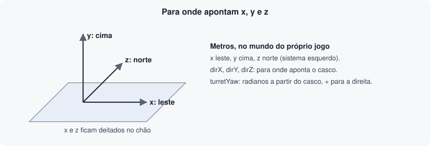

# A tabela {#the-table}

Uma linha por amostra ou evento, em `<match>.parquet`: 38 colunas ([Lista de colunas](../columns.md), gerada a partir do código).

| Coluna | O que é |
|---|---|
| `match`, `map` | o id da batalha; o id do mapa (`99_testmap` nas figuras) |
| `time` | segundos desde o início da gravação (a contagem regressiva está nele) |
| `battleTime` | segundos desde o início da batalha; negativos durante a contagem regressiva |
| `event` | o que a linha representa (abaixo) |
| `player`, `team`, `own` | o nome do jogador; equipe `1` ou `2`; `1` nas linhas do jogador que grava |
| `vehicle`, `type` | o tanque como o jogo o nomeia (`ussr:R144_K_91`); `tank`, ou `shell` para um traçante ou explosão cujo atirador não é conhecido (sem jogador) |
| `x`, `y`, `z` | metros: x para leste, y para cima, z para norte (o mundo próprio do jogo, de sistema esquerdo) |
| `dirX`, `dirY`, `dirZ` | para onde aponta o casco, um vetor unitário no mesmo referencial (`dirY` 0: só o rumo); num tiro ou traçante, para onde o projétil voou |
| `turretYaw` | o ângulo da torre em relação ao rumo do casco, em radianos, positivo para a direita |
| `gunStep` | a elevação do canhão como um passo de 0 a 63 entre os limites próprios do canhão (os limites são dados do tanque, não do replay) |
| `other`, `reason` | o outro veículo de um evento (abatedor, vítima, atacante, alvo); o número do motivo de ataque do jogo |
| `value`, `health` | o número do evento (dano, rajada, velocidade do projétil, zoom, comando); a vida depois de uma mudança |
| `text` | o nome do motivo, uma linha de chat, um modo de câmera, a chave de um comando |
| `shot` | o id do projétil: um tiro, o seu traçante e a sua explosão o compartilham |
| `entity` | o id do veículo no replay |
| `hitComponent`, `hitCode`, `hitU/V/W`, `hitExitU/V/W`, `hitDirX/Y/Z` | só nas linhas `struck`: onde um projétil atingiu (veja o evento `struck` abaixo) |
| `pitch`, `roll` | numa posição, a arfagem do casco (radianos, positiva com o nariz para baixo) e o rolamento, como o jogo os envia |

| `event` | Na linha de | O que é |
|---|---|---|
| `position` | cada veículo | cerca de dez vezes por segundo, enquanto o cliente sabia onde ele estava |
| `death`, `kill` | a vítima, o abatedor | cada morte duas vezes: onde a vítima caiu, e onde estava o abatedor |
| `hurt`, `damage` | a vítima, o atacante | uma mudança de vida: `value` o dano, `health` o que restou, `reason`/`text` o porquê (`shot`, `fire`, `ramming`, ...) |
| `struck` | a vítima | um projétil que a atingiu, incluindo os que ricochetearam ou não penetraram: uma linha por ponto atingido, `value` o dano que causou (na primeira); `hitComponent` o componente de colisão, `hitU/V/W` por onde o projétil entrou e `hitExitU/V/W` onde seu caminho terminou, como frações da caixa desse componente (u direita, v para cima, w para a frente; conferido contra o rumo do atacante), `hitDirX/Y/Z` o sentido por que entrou no referencial do casco, `turretYaw` a torre da vítima naquele momento, `hitCode` um byte enviado com o ponto (não conhecido: não acompanha o dano) |
| `shot` | o atirador | `value` a rajada; a direção em que o seu traçante voou, senão a do casco mais a da torre |
| `tracer` | o atirador | onde um projétil foi visto pela primeira vez e o sentido em que voou; `value` a sua velocidade nas unidades do jogo |
| `impact` | o atirador | onde um projétil explodiu |
| `chat` | o remetente | `text` a linha |
| `command` | o remetente | um comando do chat de batalha (atacar, ajuda, um ponto no mapa), no seu ponto quando tem um; `value` o número do comando, `other` o veículo que ele nomeia |
| `camera`, `zoom`, `lock`, `unlock` | o jogador que grava | o modo de câmera (`sniper`, `arcade`, ...), o zoom, a mira automática ligada e desligada num alvo |

O rodapé do Parquet traz as dicas `heat3d`: Y para cima, Z invertido (para o mapa não sair
espelhado), escala de unidade 1, um veículo com sete metros de largura, `player` como a pessoa,
`team` como o grupo, `match` como a sessão.

---

Parte do [3DHeat](https://github.com/Holdi601/3DHeat) ([documentação](https://holdi601.github.io/3DHeat/)). Código: [3DHeat-Ext-WoT](https://github.com/Holdi601/3DHeat-Ext-WoT).
