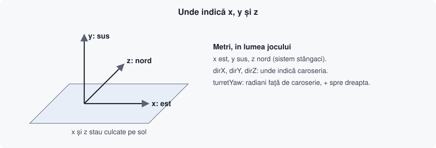

# Tabelul {#the-table}

Un rând pentru fiecare eșantion sau eveniment, în `<match>.parquet`: 38 de coloane
([Lista coloanelor](../columns.md), generată din cod).

| Coloană | Ce este |
|---|---|
| `match`, `map` | id-ul bătăliei; id-ul hărții (`99_testmap` în imagini) |
| `time` | secunde de la începutul înregistrării (numărătoarea inversă este în ea) |
| `battleTime` | secunde de la începutul bătăliei; negative în timpul numărătorii inverse |
| `event` | ce este rândul (mai jos) |
| `player`, `team`, `own` | numele jucătorului; echipa `1` sau `2`; `1` pe rândurile jucătorului care înregistrează |
| `vehicle`, `type` | tancul așa cum îl numește jocul (`ussr:R144_K_91`); `tank`, sau `shell` pentru un trasor sau o explozie al cărei trăgător nu este cunoscut (fără jucător) |
| `x`, `y`, `z` | metri: x est, y sus, z nord (lumea proprie a jocului, sistem stângaci) |
| `dirX`, `dirY`, `dirZ` | unde indică caroseria, un vector unitar în același cadru (`dirY` 0: doar cursul); la un foc sau un trasor, unde a zburat obuzul |
| `turretYaw` | unghiul turelei față de cursul caroseriei, radiani, pozitiv spre dreapta |
| `gunStep` | înălțimea tunului ca un pas 0-63 între limitele proprii ale tunului (limitele sunt datele tancului, nu ale replay-ului) |
| `other`, `reason` | celălalt vehicul al unui eveniment (ucigaș, victimă, atacator, țintă); numărul motivului de atac al jocului |
| `value`, `health` | numărul evenimentului (daune, rafală, viteza obuzului, zoom, comandă); viața după o schimbare |
| `text` | numele motivului, o linie de chat, un mod de cameră, cheia unei comenzi |
| `shot` | id-ul obuzului: un foc, trasorul său și explozia sa îl împart |
| `entity` | id-ul vehiculului în replay |
| `hitComponent`, `hitCode`, `hitU/V/W`, `hitExitU/V/W`, `hitDirX/Y/Z` | doar la rândurile `struck`: unde a lovit un obuz (vedeți evenimentul `struck` de mai jos) |
| `pitch`, `roll` | la o poziție, tangajul caroseriei (radiani, pozitiv cu nasul în jos) și rularea, cum le trimite jocul |

| `event` | Pe rândul cui | Ce este |
|---|---|---|
| `position` | fiecare vehicul | de aproximativ zece ori pe secundă, cât timp clientul știa unde era |
| `death`, `kill` | victima, ucigașul | fiecare moarte de două ori: unde a căzut victima, și unde stătea ucigașul |
| `hurt`, `damage` | victima, atacatorul | o schimbare de viață: `value` daunele, `health` ce rămâne, `reason`/`text` de ce (`shot`, `fire`, `ramming`, ...) |
| `struck` | victima | un obuz care a lovit-o, și cele care au ricoșat sau nu au pătruns: un rând pentru fiecare punct lovit, `value` daunele pe care le-a făcut (la primul); `hitComponent` componenta de coliziune, `hitU/V/W` unde a intrat obuzul și `hitExitU/V/W` unde s-a terminat traiectoria sa, ca fracții din cutia acelei componente (u dreapta, v sus, w înainte; verificat față de direcția atacatorului), `hitDirX/Y/Z` felul în care a venit în cadrul caroseriei, `turretYaw` turela victimei atunci, `hitCode` un octet trimis cu punctul (nu se știe: nu urmează daunele) |
| `shot` | trăgătorul | `value` rafala; direcția în care a zburat trasorul său, altfel cea a caroseriei plus cea a turelei |
| `tracer` | trăgătorul | unde a fost văzut întâia oară un obuz și felul în care a zburat; `value` viteza sa în unitățile jocului |
| `impact` | trăgătorul | unde a explodat un obuz |
| `chat` | expeditorul | `text` linia |
| `command` | expeditorul | o comandă de chat din bătălie (atac, ajutor, un punct pe hartă), la punctul său când are unul; `value` numărul comenzii, `other` vehiculul pe care îl numește |
| `camera`, `zoom`, `lock`, `unlock` | jucătorul care înregistrează | modul camerei (`sniper`, `arcade`, ...), zoomul, ținta automată pornită și oprită pe o țintă |

Subsolul Parquet poartă indiciile `heat3d`: Y sus, Z întors (ca harta să nu fie
oglindită), scara unității 1, un vehicul de șapte metri în diametru, `player` ca persoană, `team` ca grup, `match` ca sesiune.

---

Parte din [3DHeat](https://github.com/Holdi601/3DHeat) ([documentație](https://holdi601.github.io/3DHeat/)). Sursă: [3DHeat-Ext-WoT](https://github.com/Holdi601/3DHeat-Ext-WoT).
