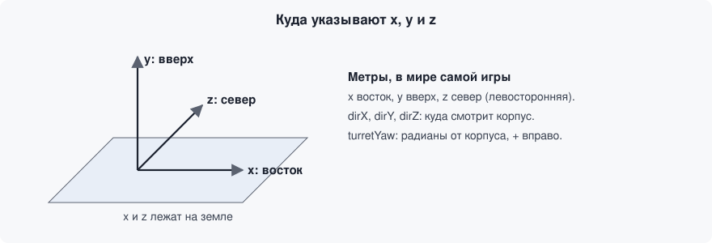

# Таблица {#the-table}

Одна строка на выборку или событие, в `<match>.parquet`: 38 столбцов
([Список столбцов](../columns.md), создан из кода).

| Столбец | Что |
|---|---|
| `match`, `map` | id боя; id карты (`99_testmap` на картинках) |
| `time` | секунды с начала записи (в них входит обратный отсчёт) |
| `battleTime` | секунды с начала боя; отрицательные во время обратного отсчёта |
| `event` | что означает строка (ниже) |
| `player`, `team`, `own` | имя игрока; команда `1` или `2`; `1` в строках игрока, который записал реплей |
| `vehicle`, `type` | танк, как его называет игра (`ussr:R144_K_91`); `tank`, или `shell` для трассера или взрыва, чей стрелявший неизвестен (нет игрока) |
| `x`, `y`, `z` | метры: x — восток, y — вверх, z — север (собственный мир игры, левосторонний) |
| `dirX`, `dirY`, `dirZ` | куда смотрит корпус, единичный вектор в той же системе (`dirY` 0: только курс); у выстрела или трассера — куда полетел снаряд |
| `turretYaw` | угол башни относительно курса корпуса, радианы, положительный вправо |
| `gunStep` | возвышение орудия как шаг 0-63 между собственными пределами орудия (пределы — данные танка, а не реплея) |
| `other`, `reason` | другая техника события (убийца, жертва, атакующий, цель); номер причины атаки игры |
| `value`, `health` | число события (урон, очередь, скорость снаряда, приближение, команда); здоровье после изменения |
| `text` | название причины, строка чата, режим камеры, ключ команды |
| `shot` | id снаряда: выстрел, его трассер и его взрыв имеют общий id |
| `entity` | id техники в реплее |
| `hitComponent`, `hitCode`, `hitU/V/W`, `hitExitU/V/W`, `hitDirX/Y/Z` | только в строках `struck`: куда пришёлся снаряд (см. событие `struck` ниже) |
| `pitch`, `roll` | у положения — тангаж корпуса (радианы, положительный — нос вниз) и крен, как их присылает игра |

| `event` | В чьей строке | Что |
|---|---|---|
| `position` | каждой техники | около десяти раз в секунду, пока клиент знал, где она |
| `death`, `kill` | жертвы, убийцы | каждая смерть дважды: где упала жертва и где стоял убийца |
| `hurt`, `damage` | жертвы, атакующего | изменение здоровья: `value` — урон, `health` — что осталось, `reason`/`text` — почему (`shot`, `fire`, `ramming`, ...) |
| `struck` | жертвы | снаряд, который в неё попал, в том числе отскочивший или не пробивший; одна строка на точку попадания, `value` — нанесённый им урон (в первой); `hitComponent` — компонент столкновения, `hitU/V/W` — где снаряд вошёл, а `hitExitU/V/W` — где закончился его путь, как доли коробки этого компонента (u — вправо, v — вверх, w — вперёд; сверено с пеленгом атакующего); `hitDirX/Y/Z` — с какой стороны пришёл в системе корпуса; `turretYaw` — башня жертвы в тот момент; `hitCode` — байт, присланный с точкой (неизвестен: он не следует за уроном) |
| `shot` | стрелявший | `value` — очередь; направление, куда полетел его трассер, иначе — корпуса плюс башни |
| `tracer` | стрелявший | где снаряд был замечен впервые и как он летел; `value` — его скорость в единицах игры |
| `impact` | стрелявший | где взорвался снаряд |
| `chat` | отправителя | `text` — строка |
| `command` | отправителя | команда боевого чата (атака, помощь, точка на карте), в её точке, если она есть; `value` — номер команды, `other` — техника, которую она называет |
| `camera`, `zoom`, `lock`, `unlock` | игрока, который записал реплей | режим камеры (`sniper`, `arcade`, ...), приближение, автоприцеливание включено и выключено на цель |

В подвале Parquet лежат подсказки `heat3d`: y вверх, z перевёрнуто (поэтому карта не отражена),
масштаб единиц 1, техника шириной семь метров, `player` — как человек, `team` — как группа, `match` —
как сессия.

---

Часть [3DHeat](https://github.com/Holdi601/3DHeat) ([документация](https://holdi601.github.io/3DHeat/)). Исходный код: [3DHeat-Ext-WoT](https://github.com/Holdi601/3DHeat-Ext-WoT).
