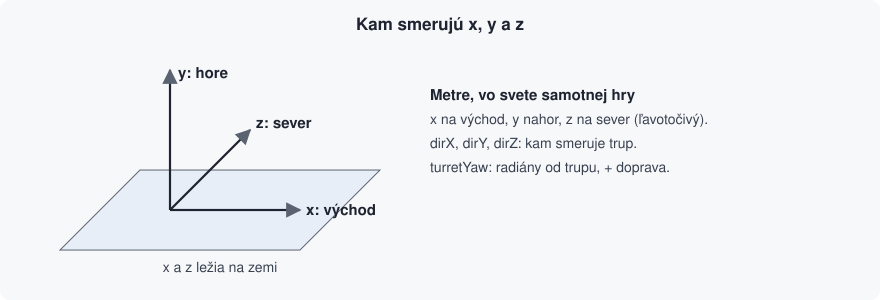

# Tabuľka {#the-table}

Jeden riadok na vzorku alebo udalosť, v `<match>.parquet`: 38 stĺpcov
([Zoznam stĺpcov](../columns.md), generovaný z kódu).

| Stĺpec | Čo |
|---|---|
| `match`, `map` | id bitky; id mapy (`99_testmap` na obrázkoch) |
| `time` | sekundy od začiatku nahrávania (odpočítavanie je v nich zahrnuté) |
| `battleTime` | sekundy od začiatku bitky; záporné počas odpočítavania |
| `event` | čo riadok je (nižšie) |
| `player`, `team`, `own` | meno hráča; tím `1` alebo `2`; `1` na riadkoch hráča, ktorý replay nahral |
| `vehicle`, `type` | tank tak, ako ho hra pomenúva (`ussr:R144_K_91`); `tank`, alebo `shell` pri stope alebo výbuchu, ktorých strelec nie je známy (žiadny hráč) |
| `x`, `y`, `z` | metre: x na východ, y nahor, z na sever (svet hry, ľavotočivý) |
| `dirX`, `dirY`, `dirZ` | kam smeruje trup, jednotkový vektor v tom istom systéme (`dirY` 0: len smer); pri výstrele alebo stope, kam letela strela |
| `turretYaw` | uhol veže od smeru trupu, radiány, kladný doprava |
| `gunStep` | sklon dela ako krok 0-63 medzi jeho vlastnými hranicami (hranice sú údaje tanku, nie replaye) |
| `other`, `reason` | druhé vozidlo udalosti (vrah, obeť, útočník, cieľ); číslo dôvodu útoku podľa hry |
| `value`, `health` | číslo udalosti (poškodenie, dávka, rýchlosť strely, priblíženie, príkaz); zdravie po zmene |
| `text` | názov dôvodu, riadok chatu, režim kamery, kľúč príkazu |
| `shot` | id strely: výstrel, jeho stopa a jeho výbuch ho zdieľajú |
| `entity` | id vozidla v replaye |
| `hitComponent`, `hitCode`, `hitU/V/W`, `hitExitU/V/W`, `hitDirX/Y/Z` | len riadky `struck`: kam strela zasiahla (pozri udalosť `struck` nižšie) |
| `pitch`, `roll` | pri polohe sklon trupu (radiány, kladný nos nadol) a náklon, tak, ako ich hra posiela |

| `event` | Na riadku | Čo |
|---|---|---|
| `position` | každé vozidlo | asi desaťkrát za sekundu, kým klient vedel, kde je |
| `death`, `kill` | obeť, vrah | každá smrť dvakrát: kde obeť padla a kde stál vrah |
| `hurt`, `damage` | obeť, útočník | zmena zdravia: `value` poškodenie, `health` čo zostalo, `reason`/`text` prečo (`shot`, `fire`, `ramming`, ...) |
| `struck` | obeť | strela, ktorá ju zasiahla, aj tie, čo sa odrazili alebo neprenikli: jeden riadok na bod zásahu, `value` poškodenie, ktoré spôsobil (na prvom); `hitComponent` kolízny komponent, `hitU/V/W` kde strela vnikla a `hitExitU/V/W` kde sa jej dráha skončila ako zlomky boxu tohto komponentu (u doprava, v nahor, w dopredu; overené oproti uhlu útočníka), `hitDirX/Y/Z` ako prišla v súradniciach trupu, `turretYaw` veža obete vtedy, `hitCode` bajt poslaný s bodom (nie je známy: nesleduje poškodenie) |
| `shot` | strelec | `value` dávka; smer, ktorým letela jeho stopa, inak smer trupu plus veže |
| `tracer` | strelec | kde sa strela prvýkrát videla a akým smerom letela; `value` jej rýchlosť v jednotkách hry |
| `impact` | strelec | kde strela vybuchla |
| `chat` | odosielateľ | `text` riadok |
| `command` | odosielateľ | príkaz bojového chatu (útok, pomoc, bod na mape), na svojom bode, ak ho má; `value` číslo príkazu, `other` vozidlo, ktoré pomenúva |
| `camera`, `zoom`, `lock`, `unlock` | hráč, ktorý replay nahral | režim kamery (`sniper`, `arcade`, ...), priblíženie, automatické mierenie na cieľ zapnuté a vypnuté |

Päta Parquet nesie nápovedy `heat3d`: Y nahor, Z otočené (aby mapa nebola zrkadlová), mierka jednotky 1, vozidlo sedem metrov
široké, `player` ako osoba, `team` ako skupina, `match` ako relácia.

---

Súčasť [3DHeat](https://github.com/Holdi601/3DHeat) ([dokumentácia](https://holdi601.github.io/3DHeat/)). Zdroj: [3DHeat-Ext-WoT](https://github.com/Holdi601/3DHeat-Ext-WoT).
