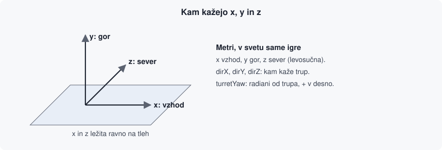

# Tabela {#the-table}

Ena vrstica na vzorec ali dogodek, v `<match>.parquet`: 38 stolpcev ([Seznam stolpcev](../columns.md), ustvarjen iz kode).

| Stolpec | Kaj |
|---|---|
| `match`, `map` | identifikator bitke; identifikator zemljevida (`99_testmap` na slikah) |
| `time` | sekunde od začetka snemanja (odštevanje je vključeno) |
| `battleTime` | sekunde od začetka bitke; negativno med odštevanjem |
| `event` | vrsta vrstice (spodaj) |
| `player`, `team`, `own` | ime igralca; ekipa `1` ali `2`; `1` na vrsticah igralca, ki je snemal |
| `vehicle`, `type` | tank, kot ga imenuje igra (`ussr:R144_K_91`); `tank`, ali `shell` za sled ali eksplozijo, katere strelec ni znan (brez igralca) |
| `x`, `y`, `z` | metri: x vzhod, y gor, z sever (igrin lasten svet, levosučen) |
| `dirX`, `dirY`, `dirZ` | kamor kaže trup, enotski vektor v istem okviru (`dirY` 0: samo smer); pri strelu ali sledi, kamor je letel izstrelek |
| `turretYaw` | kot stolpa glede na smer trupa, radiani, pozitiven v desno |
| `gunStep` | naklon topa kot korak 0-63 med lastnima mejama topa (meji sta podatek tanka, ne posnetka) |
| `other`, `reason` | drugo vozilo dogodka (ubijalec, žrtev, napadalec, tarča); igrina številka razloga napada |
| `value`, `health` | število dogodka (škoda, rafal, hitrost izstrelka, zoom, ukaz); zdravje po spremembi |
| `text` | ime razloga, vrstica klepeta, način kamere, ključ ukaza |
| `shot` | identifikator izstrelka: strel, njegova sled in njegova eksplozija ga delijo |
| `entity` | id vozila v posnetku |
| `hitComponent`, `hitCode`, `hitU/V/W`, `hitExitU/V/W`, `hitDirX/Y/Z` | samo pri vrsticah `struck`: kam je izstrelek zadel (glejte dogodek `struck` spodaj) |
| `pitch`, `roll` | pri položaju naklon trupa (radiani, pozitiven nos navzdol) in zvitek, kot ju pošilja igra |

| `event` | Na vrstici | Kaj |
|---|---|---|
| `position` | vsako vozilo | približno desetkrat na sekundo, medtem ko je odjemalec vedel, kje je |
| `death`, `kill` | žrtev, ubijalec | vsaka smrt dvakrat: kje je žrtev padla in kje je stal ubijalec |
| `hurt`, `damage` | žrtev, napadalec | sprememba zdravja: `value` škoda, `health` kar je ostalo, `reason`/`text` zakaj (`shot`, `fire`, `ramming`, ...) |
| `struck` | žrtev | izstrelek, ki jo je zadel, tudi tisti, ki so se odbili ali niso prodrli: ena vrstica na točko zadetka, `value` škoda, ki jo je naredil (na prvi); `hitComponent` komponenta trka, `hitU/V/W` kje je izstrelek vstopil in `hitExitU/V/W` kje je njegova pot končala, kot deleži škatle te komponente (u desno, v gor, w naprej; preverjeno z napadalčevim kotom); `hitDirX/Y/Z` smer vstopa v okviru trupa; `turretYaw` takratni stolp žrtve; `hitCode` bajt, poslan s točko (ni znan: ne sledi škodi) |
| `shot` | strelec | `value` rafal; smer, v kateri je letela njegova sled, sicer trup plus stolp |
| `tracer` | strelec | kje je bil izstrelek prvič viden in kako je letel; `value` njegova hitrost v igrinih enotah |
| `impact` | strelec | kje je izstrelek eksplodiral |
| `chat` | pošiljatelj | `text` vrstica |
| `command` | pošiljatelj | ukaz klepeta bojnega polja (napad, pomoč, točka na zemljevidu), na svoji točki, kadar jo ima; `value` številka ukaza, `other` vozilo, ki ga imenuje |
| `camera`, `zoom`, `lock`, `unlock` | igralec, ki je snemal | način kamere (`sniper`, `arcade`, ...), zoom, samodejno ciljanje vklopljeno in izklopljeno na tarči |

Noga Parquet nosi namige `heat3d`: y gor, z obrnjen (zato zemljevid ni zrcaljen), enota 1, vozilo sedem metrov
široko, `player` kot oseba, `team` kot skupina, `match` kot seja.

---

Del [3DHeat](https://github.com/Holdi601/3DHeat) ([dokumentacija](https://holdi601.github.io/3DHeat/)). Vir: [3DHeat-Ext-WoT](https://github.com/Holdi601/3DHeat-Ext-WoT).
