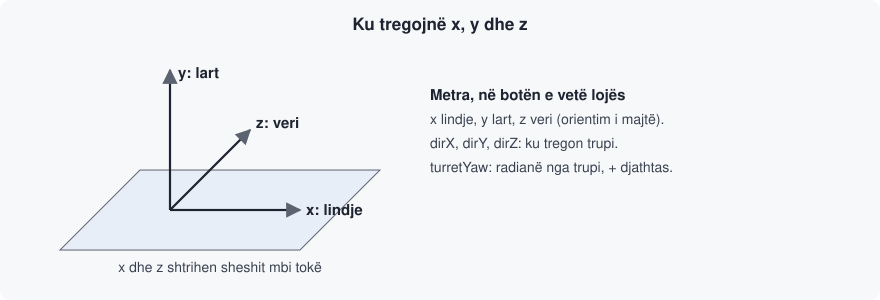

# Tabela {#the-table}

Një rresht për çdo mostër ose ngjarje, te `<match>.parquet`: 38 kolona
([Lista e kolonave](../columns.md), e gjeneruar nga kodi).

| Kolona | Çfarë |
|---|---|
| `match`, `map` | ID e betejës; ID e hartës (`99_testmap` në pamjet) |
| `time` | sekonda që nga fillimi i regjistrimit (numërimi mbrapsht është brenda) |
| `battleTime` | sekonda që nga fillimi i betejës; negative gjatë numërimit mbrapsht |
| `event` | çfarë është rreshti (më poshtë) |
| `player`, `team`, `own` | emri i lojtarit; skuadra `1` ose `2`; `1` në rreshtat e lojtarit që regjistron |
| `vehicle`, `type` | tanku siç e emërton loja (`ussr:R144_K_91`); `tank`, ose `shell` për një gjurmë plumbi ose shpërthim gjuajtësi i të cilit nuk dihet (pa lojtar) |
| `x`, `y`, `z` | metra: x lindje, y lart, z veri (bota e vetë lojës, me orientim të majtë) |
| `dirX`, `dirY`, `dirZ` | ku tregon trupi, një vektor njësi në të njëjtin kuadër (`dirY` 0: vetëm heading); në një të shtënë ose gjurmë plumbi, ku fluturoi predha |
| `turretYaw` | këndi i kupolës nga heading i trupit, radianë, pozitiv djathtas |
| `gunStep` | ngritja e topit si hap 0-63 midis kufijve të vetë topit (kufijtë janë të dhëna të tankut, jo të riluajtjes) |
| `other`, `reason` | mjeti tjetër i një ngjarjeje (vrasësi, viktima, sulmuesi, objektivi); numri i arsyes së sulmit të lojës |
| `value`, `health` | numri i ngjarjes (dëmi, breshëria, shpejtësia e predhës, zmadhimi, komanda); shëndeti pas një ndryshimi |
| `text` | emri i arsyes, një rresht bisede, një mënyrë kamere, çelësi i një komande |
| `shot` | ID e predhës: një e shtënë, gjurma e saj dhe shpërthimi i saj e ndajnë |
| `entity` | ID e mjetit në riluajtje |
| `hitComponent`, `hitCode`, `hitU/V/W`, `hitExitU/V/W`, `hitDirX/Y/Z` | vetëm në rreshtat `struck`: ku goditi një predhë (shih ngjarjen `struck` më poshtë) |
| `pitch`, `roll` | në një pozicion, pitch i trupit (radianë, pozitiv me hundën poshtë) dhe roll, siç i dërgon loja |

| `event` | Në rreshtin e | Çfarë |
|---|---|---|
| `position` | çdo mjeti | rreth dhjetë herë në sekondë, ndërsa klienti dinte ku ishte |
| `death`, `kill` | viktimës, vrasësit | çdo vdekje dy herë: ku ra viktima, dhe ku qëndronte vrasësi |
| `hurt`, `damage` | viktimës, sulmuesit | një ndryshim shëndeti: `value` dëmi, `health` çfarë mbetet, `reason`/`text` pse (`shot`, `fire`, `ramming`, ...) |
| `struck` | viktimës | një predhë që e goditi, edhe ato që u hodhën prapa ose nuk depërtuan: një rresht për pikë goditjeje, `value` dëmi që bëri (te i pari); `hitComponent` komponenti i përplasjes, `hitU/V/W` ku hyri predha dhe `hitExitU/V/W` ku mbaroi shtegu i saj si pjesë të kutisë së atij komponenti (u djathtas, v lart, w përpara; kontrolluar ndaj drejtimit të sulmuesit), `hitDirX/Y/Z` drejtimi nga hyri në kuadrin e trupit, `turretYaw` kupola e viktimës atëherë, `hitCode` një bajt i dërguar me pikën (nuk dihet: nuk ndjek dëmin) |
| `shot` | gjuajtësit | `value` breshëria; drejtimi ku fluturoi gjurma e tij, përndryshe ai i trupit plus kupolës |
| `tracer` | gjuajtësit | ku u pa për herë të parë një predhë dhe drejtimi ku fluturoi; `value` shpejtësia e saj në njësitë e lojës |
| `impact` | gjuajtësit | ku shpërtheu një predhë |
| `chat` | dërguesit | `text` rreshti |
| `command` | dërguesit | një komandë e bisedës së betejës (sulmo, ndihmë, një pikë në hartë), në pikën e saj kur ka; `value` numri i komandës, `other` mjeti që emërton |
| `camera`, `zoom`, `lock`, `unlock` | lojtarit që regjistron | mënyra e kamerës (`sniper`, `arcade`, ...), zmadhimi, synimi automatik ndezur dhe fikur mbi një objektiv |

Fundi i Parquet mban udhëzimet `heat3d`: Y lart, Z i kthyer (që harta të mos
jetë e pasqyruar), shkalla e njësisë 1, një mjet shtatë metra i gjerë, `player` si
personi, `team` si grupi, `match` si sesioni.

---

Pjesë e [3DHeat](https://github.com/Holdi601/3DHeat) ([dokumentacioni](https://holdi601.github.io/3DHeat/)). Burimi: [3DHeat-Ext-WoT](https://github.com/Holdi601/3DHeat-Ext-WoT).
