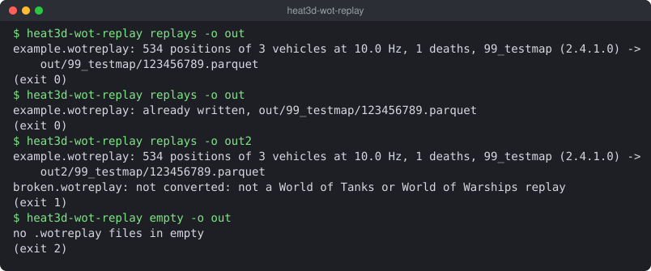

# Претварање реплеја {#converting-replays}

## Корак по корак {#step-by-step}

1. **Укључите снимање** у игри: Settings > General > Record battles.
   Од тада игра чува сваку битку у фасцикли `replays` ваше инсталације World
   of Tanks-а, на пример `C:\Games\World_of_Tanks_EU\replays`.
2. **Отворите терминал** у фасцикли у коју резултати могу да иду
   ([Пре почетка](before-you-start.md)).
3. **Покрените конвертор** над датотекама реплеја, или над фасциклама у којима
   се оне налазе:

   ```bash
   heat3d-wot-replay "C:\Games\World_of_Tanks_EU\replays" -o out
   heat3d-wot-replay a.wotreplay b.wotreplay -o out
   ```

   `out` се прави у фасцикли у којој је ваш терминал.
4. **Прочитајте шта пише.** Требало би да видите по један ред за сваки реплеј,
   на крају с табелом коју је записао.
5. **Отворите резултат** у 3DHeat приказачу: `out/<map>/<match>.parquet` на
   картици Топлотна мапа, а `<match>.match.json` на картици Меч. Или их
   прочитајте било којим Parquet или JSON читачем.



Слика приказује покретање на реплеју који тестови граде у коду (нема правог
реплеја):

- реплеј претворен: `<file>: <n> positions of <n> vehicles at <rate> Hz, <n> deaths, <map> (<client version>) -> <table>`;
- покренуто поново, већ записани меч се прескаче: `<file>: already written, <table>`;
- датотека која није реплеј: `<file>: not converted: <why>` (на излазу за грешке;
  излазни статус 1, остали реплеји се и даље претварају);
- реплеј није нађен: `no .wotreplay files in <folders>` (излазни статус 2).

## Опције {#options}

| Опција | Подразумевано | Шта ради |
|---|---|---|
| `replays` (једна или више) | - | `.wotreplay` датотеке, или фасцикле у којима се оне траже (и подфасцикле) |
| `-o`, `--out` | обавезно | фасцикла у коју се пише: унутра по фасцикла за сваку мапу |
| `--force` | искључено | поново претвори оно што је већ записано |
| `--version` | - | исписује `heat3d-wot-replay <version>` и зауставља се |
| `-h`, `--help` | - | исписује опције и зауставља се |

Опције онако како их програм исписује: [Референца команди](../cli-reference.md).

## Шта се записује {#what-is-written}

Само засебне датотеке: овај конвертор не пише `.3dheat` датотеку (приказач
их може спаковати у једну: [Једна датотека по мечу](https://holdi601.github.io/3DHeat/container.html)).
По реплеју, у `out/<map>/`:

| Датотека | Шта је |
|---|---|
| `<match>.parquet` | табела: позиција сваког тенка током времена и сваки догађај где се десио ([Табела](table.md)) |
| `<match>.match.json` | документ меча: мапа, верзија клијента, играчи, убиства, резултати и све остало ([Документ меча](match-document.md)) |
| `<match>.messages.parquet` | пратећа датотека: свака ставка реплеја коју прве две датотеке не садрже у целости ([Потпуност](completeness.md)) |

`<match>` је сопствени ид битке, или име датотеке кад је снимање стало пре
резултата.

## Излазни статус {#exit-status}

`0` кад су сви реплеји претворени или прескочени, `1` кад је било неуспешних
(остали се и даље претварају), `2` кад ниједна датотека реплеја није нађена.

---

Део [3DHeat](https://github.com/Holdi601/3DHeat) ([документација](https://holdi601.github.io/3DHeat/)). Извор: [3DHeat-Ext-WoT](https://github.com/Holdi601/3DHeat-Ext-WoT).
