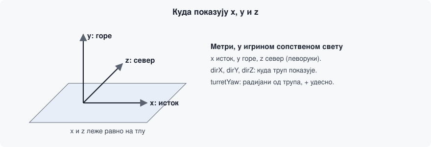

# Табела {#the-table}

Један ред по узорку или догађају, у `<match>.parquet`: 38 колона
([Списак колона](../columns.md), генерисано из кода).

| Колона | Шта је |
|---|---|
| `match`, `map` | ид битке; ид мапе (`99_testmap` на сликама) |
| `time` | секунде од почетка снимања (одбројавање је у њој) |
| `battleTime` | секунде од почетка битке; негативно за време одбројавања |
| `event` | шта ред представља (испод) |
| `player`, `team`, `own` | име играча; тим `1` или `2`; `1` у редовима снимајућег играча |
| `vehicle`, `type` | тенк како га игра назива (`ussr:R144_K_91`); `tank`, или `shell` за трасер или експлозију чији пуцач није познат (нема играча) |
| `x`, `y`, `z` | метри: x исток, y горе, z север (игрин сопствени свет, леворуки) |
| `dirX`, `dirY`, `dirZ` | куда труп показује, јединични вектор у истом систему (`dirY` 0: само правац); код пуцња или трасера куда је зрно летело |
| `turretYaw` | угао топа од правца трупа, радијани, позитиван удесно |
| `gunStep` | дизање топа као корак 0-63 између сопствених граница топа (границе су податак о тенку, а не о реплеју) |
| `other`, `reason` | друго возило у догађају (убица, жртва, нападач, мета); игрин број разлога напада |
| `value`, `health` | број догађаја (штета, рафал, брзина зрна, зум, команда); здравље после промене |
| `text` | име разлога, ред ћаскања, режим камере, кључ команде |
| `shot` | ид зрна: пуцањ, његов трасер и експлозија га деле |
| `entity` | ид возила у реплеју |
| `hitComponent`, `hitCode`, `hitU/V/W`, `hitExitU/V/W`, `hitDirX/Y/Z` | само у редовима `struck`: где је зрно погодило (види догађај `struck` испод) |
| `pitch`, `roll` | на позицији, нагиб трупа (радијани, позитиван нос надоле) и валљање, онако како их игра шаље |

| `event` | На реду | Шта је |
|---|---|---|
| `position` | сваког возила | око десет пута у секунди, док је клијент знао где је |
| `death`, `kill` | жртве, убице | свака смрт два пута: где је жртва пала, и где је убица стајао |
| `hurt`, `damage` | жртве, нападача | промена здравља: `value` штета, `health` шта је остало, `reason`/`text` зашто (`shot`, `fire`, `ramming`, ...) |
| `struck` | жртве | зрно које ју је погодило, и она која су се одбила или нису пробила: по један ред за тачку поготка, `value` штета коју је направила (на првом); `hitComponent` компонента судара, `hitU/V/W` где је зрно ушло и `hitExitU/V/W` где је његова путања стала, као удео у кутији те компоненте (u десно, v горе, w напред; проверено према правцу нападача), `hitDirX/Y/Z` начин на који је ушло у систему трупа, `turretYaw` тада жртвин заокрет топа, `hitCode` бајт послат уз тачку (није познат: не прати штету) |
| `shot` | пуцача | `value` рафал; правац којим је његов трасер летео, иначе трупа плус топа |
| `tracer` | пуцача | где је зрно први пут виђено и како је летело; `value` његова брзина у јединицама игре |
| `impact` | пуцача | где је зрно експлодирало |
| `chat` | пошиљаоца | `text` ред |
| `command` | пошиљаоца | команда битког ћаскања (напад, помоћ, тачка на мапи), на својој тачки кад је има; `value` игрин број команде, `other` возило које именује |
| `camera`, `zoom`, `lock`, `unlock` | снимајућег играча | режим камере (`sniper`, `arcade`, ...), зум, аутоматско нишањење укључено и искључено на мети |

Подножје Parquet датотеке носи `heat3d` наговештаје: Y горе, Z окренуто (да мапа
не буде огледална), јединична скала 1, возило широко седам метара, `player` као
особа, `team` као група, `match` као сесија.

---

Део [3DHeat](https://github.com/Holdi601/3DHeat) ([документација](https://holdi601.github.io/3DHeat/)). Извор: [3DHeat-Ext-WoT](https://github.com/Holdi601/3DHeat-Ext-WoT).
