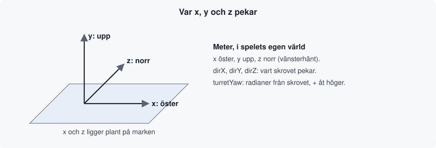

# Tabellen {#the-table}

En rad per mätpunkt eller händelse, i `<match>.parquet`: 38 kolumner
([Kolumnlista](../columns.md), genererad från koden).

| Kolumn | Vad |
|---|---|
| `match`, `map` | stridens id; kartans id (`99_testmap` på bilderna) |
| `time` | sekunder sedan inspelningen började (nedräkningen ingår) |
| `battleTime` | sekunder sedan striden började; negativt under nedräkningen |
| `event` | vad raden är (nedan) |
| `player`, `team`, `own` | spelarens namn; lag `1` eller `2`; `1` på den inspelande spelarens rader |
| `vehicle`, `type` | stridsvagnen så som spelet namnger den (`ussr:R144_K_91`); `tank`, eller `shell` för ett spårämne eller en explosion vars skytt inte är känd (ingen spelare) |
| `x`, `y`, `z` | meter: x öster, y upp, z norr (spelets egen värld, vänsterhänt) |
| `dirX`, `dirY`, `dirZ` | vart skrovet pekar, en enhetsvektor i samma system (`dirY` 0: bara kurs); på ett skott eller spårämne där granaten flög |
| `turretYaw` | tornets vinkel från skrovets kurs, radianer, positiv åt höger |
| `gunStep` | kanonens höjd som ett steg 0-63 mellan kanonens egna gränser (gränserna är stridsvagnens data, inte reprisets) |
| `other`, `reason` | den andra stridsvagnen i en händelse (dödare, offer, angripare, mål); spelets nummer för angreppsorsaken |
| `value`, `health` | händelsens tal (skada, skur, granathastighet, zoom, kommando); hälsa efter en ändring |
| `text` | orsakens namn, en chattrad, ett kameraläge, ett kommandos nyckel |
| `shot` | granatens id: ett skott, dess spårämne och dess explosion delar det |
| `entity` | fordonets id i repriset |
| `hitComponent`, `hitCode`, `hitU/V/W`, `hitExitU/V/W`, `hitDirX/Y/Z` | endast på `struck`-rader: var en granat träffade (se händelsen `struck` nedan) |
| `pitch`, `roll` | på en position, skrovets stigning (radianer, positiv nos nedåt) och rulle, så som spelet skickar dem |

| `event` | På raden för | Vad |
|---|---|---|
| `position` | varje fordon | ungefär tio gånger per sekund, medan klienten visste var det var |
| `death`, `kill` | offret, dödaren | varje dödsfall två gånger: där offret föll, och där dödaren stod |
| `hurt`, `damage` | offret, angriparen | en hälsoförändring: `value` skadan, `health` det som är kvar, `reason`/`text` varför (`shot`, `fire`, `ramming`, ...) |
| `struck` | offret | en granat som träffade det, även de som studsade eller inte trängde igenom: en rad per träffad punkt, `value` skadan den gjorde (på den första); `hitComponent` kollisionskomponenten, `hitU/V/W` var granaten gick in och `hitExitU/V/W` där dess väg slutade som bråkdelar av komponentens låda (u höger, v upp, w framåt; kontrollerad mot angriparens riktning), `hitDirX/Y/Z` hur den kom in i skrovets system, `turretYaw` offrets torn då, `hitCode` en byte som skickas med punkten (inte känd: den följer inte skadan) |
| `shot` | skytten | `value` skuren; riktningen spårämnet flög, annars skrovets plus tornets |
| `tracer` | skytten | där en granat först sågs och vägen den flög; `value` dess hastighet i spelets enheter |
| `impact` | skytten | där en granat exploderade |
| `chat` | avsändaren | `text` raden |
| `command` | avsändaren | ett stridschattkommando (anfall, hjälp, en punkt på kartan), vid sin punkt när det har en; `value` kommandots nummer, `other` fordonet det namnger |
| `camera`, `zoom`, `lock`, `unlock` | den inspelande spelaren | kameraläget (`sniper`, `arcade`, ...), zoomen, sikthjälp på och av mot ett mål |

Parquet-sidfoten bär `heat3d`-tipsen: y upp, z vänd (så kartan inte speglas), enhet
skala 1, ett fordon sju meter brett, `player` som personen, `team` som gruppen, `match`
som sessionen.

---

Del av [3DHeat](https://github.com/Holdi601/3DHeat) ([dokumentation](https://holdi601.github.io/3DHeat/)). Källa: [3DHeat-Ext-WoT](https://github.com/Holdi601/3DHeat-Ext-WoT).
