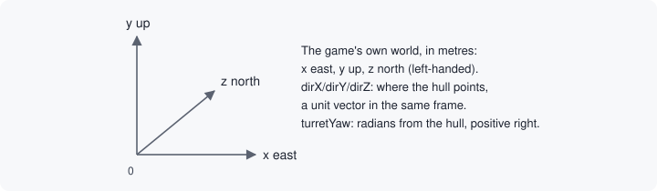

# The table

One row per sample or event, in `<match>.parquet`: 38 columns
([Column list](columns.md), generated from the code).

| Column | What |
|---|---|
| `match`, `map` | the battle's id; the map's id (`99_testmap` in the pictures) |
| `time` | seconds since the recording began (the countdown is in it) |
| `battleTime` | seconds since the battle began; negative during the countdown |
| `event` | what the row is (below) |
| `player`, `team`, `own` | the player's name; team `1` or `2`; `1` on the recording player's rows |
| `vehicle`, `type` | the tank as the game names it (`ussr:R144_K_91`); `tank`, or `shell` for a tracer or explosion whose shooter is not known (no player) |
| `x`, `y`, `z` | metres: x east, y up, z north (the game's own world, left-handed) |
| `dirX`, `dirY`, `dirZ` | where the hull points, a unit vector in the same frame (`dirY` 0: heading only); on a shot or tracer where the shell flew |
| `turretYaw` | the turret's angle from the hull's heading, radians, positive to the right |
| `gunStep` | the gun's elevation as a step 0-63 between the gun's own limits (the limits are the tank's data, not the replay's) |
| `other`, `reason` | the other vehicle of an event (killer, victim, attacker, target); the game's attack reason number |
| `value`, `health` | the event's number (damage, burst, shell speed, zoom, command); health after a change |
| `text` | the reason's name, a chat line, a camera mode, a command's key |
| `shot` | the shell's id: a shot, its tracer and its explosion share it |
| `entity` | the vehicle's id in the replay |
| `hitComponent`, `hitCode`, `hitU/V/W`, `hitExitU/V/W`, `hitDirX/Y/Z` | on `struck` rows only: where a shell struck (see the `struck` event below) |
| `pitch`, `roll` | on a position, the hull's pitch (radians, positive nose down) and roll, as the game sends them |

| `event` | On the row of | What |
|---|---|---|
| `position` | every vehicle | about ten times a second, while the client knew where it was |
| `death`, `kill` | the victim, the killer | each death twice: where the victim fell, and where the killer stood |
| `hurt`, `damage` | the victim, the attacker | a health change: `value` the damage, `health` what is left, `reason`/`text` why (`shot`, `fire`, `ramming`, ...) |
| `struck` | the victim | a shell that struck it, those that bounced or did not penetrate too: one row a point struck, `value` the damage it did (on the first); `hitComponent` the collision component, `hitU/V/W` where the shell went in and `hitExitU/V/W` where its path ended as fractions of that component's box (u right, v up, w forward; checked against the attacker's bearing), `hitDirX/Y/Z` the way it came in the hull's frame, `turretYaw` the victim's turret then, `hitCode` a byte sent with the point (not known: it does not follow the damage) |
| `shot` | the shooter | `value` the burst; the direction its tracer flew, else the hull's plus the turret's |
| `tracer` | the shooter | where a shell was first seen and the way it flew; `value` its speed in the game's units |
| `impact` | the shooter | where a shell exploded |
| `chat` | the sender | `text` the line |
| `command` | the sender | a battle chat command (attack, help, a point on the map), at its point when it has one; `value` the command's number, `other` the vehicle it names |
| `camera`, `zoom`, `lock`, `unlock` | the recording player | the camera mode (`sniper`, `arcade`, ...), the zoom, auto-aim on and off a target |

The Parquet footer carries the `heat3d` hints: Y up, Z flipped (so the map is
not mirrored), unit scale 1, a vehicle seven metres across, `player` as the
person, `team` as the group, `match` as the session.

---

Part of [3DHeat](https://github.com/Holdi601/3DHeat) ([documentation](https://holdi601.github.io/3DHeat/)). Source: [3DHeat-Ext-WoT](https://github.com/Holdi601/3DHeat-Ext-WoT).
