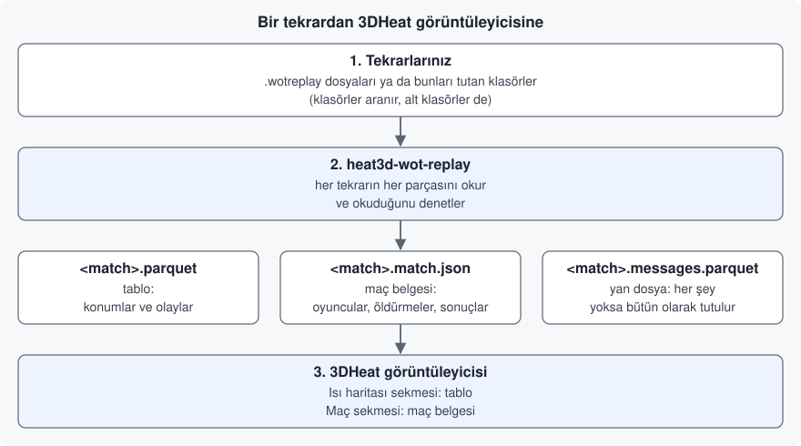

# 3DHeat World of Tanks tekrarları {#dheat-world-of-tanks-replays}

**Bu nedir?** World of Tanks, oynadığınız her savaşı bir tekrar dosyası olarak kaydedebilir.
Bu araç bu dosyaları bir tabloya ve bir maç belgesine (savaşın özetine) çevirir;
[3DHeat görüntüleyicisi](https://holdi601.github.io/3DHeat/) bunları 3B olarak gösterir: her tankın
nereye sürdüğü, ateş ettiği ve vurulduğu.

**Neden kullanmalısınız?** Bir savaşı üstten, her tank aynı anda görünecek şekilde yeniden izlemek için;
yüzlerce savaş boyunca sizin ve diğerlerinin nerede sürdüğünü, savaştığını ve öldüğünü gösteren ısı
haritaları için; ya da tekrarı kendi betiklerinizle okumak için, çünkü çıktı düz Parquet ve JSON'dur.

**Örnek:** Girdi bir tekrar dosyası, çıktı bir tablo ve bir maç belgesi:



## Hızlı başlangıç {#quick-start}

Komut satırına yeni misiniz? Önce [Başlamadan önce](before-you-start.md) sayfasını okuyun.

```bash
git clone https://github.com/Holdi601/3DHeat-Ext-WoT.git
cd 3DHeat-Ext-WoT
pip install -e .
heat3d-wot-replay "<World of Tanks>/replays" -o out
```

Her tekrar için bir satır görmelisiniz; sonunda yazdığı dosya yer alır:
`... -> out/<map>/<match>.parquet`. Bu dosyayı ve yanındaki `<match>.match.json` dosyasını
3DHeat görüntüleyicisinde açın.

## Bu belgeler {#this-documentation}

| Sayfa | Neyi anlatır |
|---|---|
| [Başlamadan önce](before-you-start.md) | Python, bir terminal ve başarının neye benzediği |
| [Kurulum](installing.md) | kurulum, denetim, güncellemeler |
| [Tekrarları çevirme](converting.md) | adım adım, her seçenek, iletiler, çıkış durumu |
| [Tablo](table.md) | `<match>.parquet` dosyasının her sütunu ve olayı |
| [Maç belgesi](match-document.md) | `<match>.match.json` dosyasının her anahtarı |
| [Tekrarı nasıl okur](how-it-reads.md) | biçim ve okumanın nasıl denetlendiği |
| [Tamlık](completeness.md) | yan dosya ve öz denetim |
| [Koşullar ve lisans](terms.md) | Wargaming'in koşulları, lisans, kaynaklar |
| [Komut başvurusu](../cli-reference.md), [Sütun listesi](../columns.md) | koddan üretilmiştir |

## 3DHeat'in parçası {#part-of-3dheat}

Bu dönüştürücü, [3DHeat](https://github.com/Holdi601/3DHeat) araçlarından biridir.
3DHeat, gerçek zamanlı bir 3B telemetri ve tekrar görüntüleyicisidir
([belgeler](https://holdi601.github.io/3DHeat/)). Görüntüleyici tabloyu Isı haritası sekmesinde,
maç belgesini Maç sekmesinde açar. Bir maçın dosyalarını tek bir dosyada da paketleyebilir:
[Bir maç tek dosyada](https://holdi601.github.io/3DHeat/container.html). Her dönüştürücünün
tutması gerekenler: [Dönüştürücüler her şeyi tutar](https://holdi601.github.io/3DHeat/converters.html).

Dönüştürücü, 3DHeat Watcher'dan bilerek ayrı tutulur: tekrarlar şifrelidir ve Wargaming'in
koşulları geniştir ([Koşullar ve lisans](terms.md)). Bu araç bir gün kaldırılmak zorunda kalırsa
başka hiçbir şey onunla birlikte gitmez. Watcher kuruluysa bunu çalıştırır, ama bu araç olmadan da çalışır.

| Araç | Ne yapar | Kaynak | Belgeler |
|---|---|---|---|
| 3DHeat görüntüleyicisi | verileri 3B gösterir: ısı haritaları, tekrarlar, yarış analizi | [3DHeat](https://github.com/Holdi601/3DHeat) | [site](https://holdi601.github.io/3DHeat/) |
| GameFiles | oyunların taşıdığı dosyalardan pistler ve haritalar | [3DHeat-GameFiles](https://github.com/Holdi601/3DHeat-GameFiles) | [site](https://holdi601.github.io/3DHeat-GameFiles/) |
| GameCapture | tur telemetrisi ve oyun videosundan yeniden kurulan haritalar | [3DHeat-GameCapture](https://github.com/Holdi601/3DHeat-GameCapture) | [site](https://holdi601.github.io/3DHeat-GameCapture/) |
| Unreal Exporter | bir haritayı dışa aktaran bir Unreal Editor eklentisi | [3DHeat-UnrealExporter](https://github.com/Holdi601/3DHeat-UnrealExporter) | [site](https://holdi601.github.io/3DHeat-UnrealExporter/) |
| CS2 | Counter-Strike 2 demoları ve haritaları | [3DHeat-CS2](https://github.com/Holdi601/3DHeat-CS2) | [site](https://holdi601.github.io/3DHeat-CS2/) |
| Watcher | oynarken oyunların yayımladıklarını kaydeder | [3DHeat-Watcher](https://github.com/Holdi601/3DHeat-Watcher) | [site](https://holdi601.github.io/3DHeat-Watcher/) |
| War Thunder tekrarları | `.wrpl` tekrarları ve War Thunder haritaları | [3DHeat-Ext-WarThunder](https://github.com/Holdi601/3DHeat-Ext-WarThunder) | [site](https://holdi601.github.io/3DHeat-Ext-WarThunder/) |
| World of Tanks tekrarları | `.wotreplay` tekrarları | [3DHeat-Ext-WoT](https://github.com/Holdi601/3DHeat-Ext-WoT) | [site](https://holdi601.github.io/3DHeat-Ext-WoT/) |
| World of Warships tekrarları | `.wowsreplay` tekrarları | [3DHeat-Ext-WoWs](https://github.com/Holdi601/3DHeat-Ext-WoWs) | [site](https://holdi601.github.io/3DHeat-Ext-WoWs/) |
| Squad demoları | Squad sunucu demoları | [3DHeat-Ext-Squad](https://github.com/Holdi601/3DHeat-Ext-Squad) | [site](https://holdi601.github.io/3DHeat-Ext-Squad/) |
| DCS haritaları | DCS World haritaları 3B harita olarak | [3DHeat-Ext-DCS](https://github.com/Holdi601/3DHeat-Ext-DCS) | [site](https://holdi601.github.io/3DHeat-Ext-DCS/) |
| IL-2 haritaları | IL-2 Great Battles haritaları 3B harita olarak | [3DHeat-Ext-IL2](https://github.com/Holdi601/3DHeat-Ext-IL2) | [site](https://holdi601.github.io/3DHeat-Ext-IL2/) |

---

Kaynak: [3DHeat-Ext-WoT](https://github.com/Holdi601/3DHeat-Ext-WoT). [3DHeat](https://github.com/Holdi601/3DHeat) parçası ([belgeler](https://holdi601.github.io/3DHeat/)).
