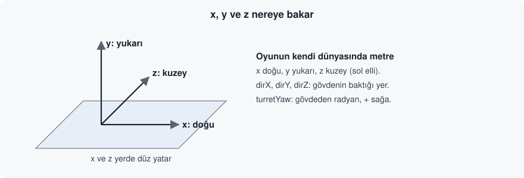

# Tablo {#the-table}

`<match>.parquet` dosyasında örnek ya da olay başına bir satır: 38 sütun
([Sütun listesi](../columns.md), koddan üretilmiştir).

| Sütun | Ne |
|---|---|
| `match`, `map` | savaşın kimliği; haritanın kimliği (resimlerde `99_testmap`) |
| `time` | kaydın başlamasından beri saniye (geri sayım da içindedir) |
| `battleTime` | savaşın başlamasından beri saniye; geri sayım sırasında negatif |
| `event` | satırın ne olduğu (aşağıda) |
| `player`, `team`, `own` | oyuncunun adı; takım `1` ya da `2`; kayıt oyuncusunun satırlarında `1` |
| `vehicle`, `type` | oyunun adlandırdığı haliyle tank (`ussr:R144_K_91`); `tank`, ya da atıcısı bilinmeyen (oyuncu yok) bir izleyici ya da patlama için `shell` |
| `x`, `y`, `z` | metre: x doğu, y yukarı, z kuzey (oyunun kendi dünyası, sol elli) |
| `dirX`, `dirY`, `dirZ` | gövdenin baktığı yer, aynı çerçevede bir birim vektör (`dirY` 0: yalnızca yön); bir atışta ya da izleyicide merminin uçtuğu yer |
| `turretYaw` | taretin açısı gövdenin yönünden, radyan, sağa pozitif |
| `gunStep` | topun yükselmesi, topun kendi sınırları arasında 0-63 arası bir adım (sınırlar tankın verisidir, tekrarın değil) |
| `other`, `reason` | bir olayın diğer aracı (öldüren, kurban, saldıran, hedef); oyunun saldırı nedeni numarası |
| `value`, `health` | olayın sayısı (hasar, patlama, mermi hızı, yakınlaştırma, komut); bir değişiklikten sonraki can |
| `text` | nedenin adı, bir sohbet satırı, bir kamera modu, bir komutun anahtarı |
| `shot` | merminin kimliği: bir atış, izleyicisi ve patlaması bunu paylaşır |
| `entity` | tekrardaki aracın kimliği |
| `hitComponent`, `hitCode`, `hitU/V/W`, `hitExitU/V/W`, `hitDirX/Y/Z` | yalnızca `struck` satırlarında: merminin nereye çarptığı (aşağıdaki `struck` olayına bakın) |
| `pitch`, `roll` | bir konumda, gövdenin eğimi (radyan, burun aşağı pozitif) ve yalpası, oyunun gönderdiği gibi |

| `event` | Hangi satırda | Ne |
|---|---|---|
| `position` | her araç | saniyede yaklaşık on kez, istemci yerini bildiği sürece |
| `death`, `kill` | kurban, öldüren | her ölüm iki kez: kurbanın düştüğü yer ve öldürenin durduğu yer |
| `hurt`, `damage` | kurban, saldıran | bir can değişikliği: `value` hasar, `health` kalan, `reason`/`text` nedeni (`shot`, `fire`, `ramming`, ...) |
| `struck` | kurban | ona çarpan bir mermi; sekenler ya da delmeyenler de dahil: bir noktaya çarpan başına bir satır, `value` verdiği hasar (ilkinde); `hitComponent` çarpışma bileşeni, `hitU/V/W` merminin girdiği yer ve `hitExitU/V/W` yolunun bittiği yer, o bileşenin kutusunun kesirleri olarak (u sağ, v yukarı, w ileri; saldıranın yönüne göre denetlendi), `hitDirX/Y/Z` gövde çerçevesinde geldiği yön, `turretYaw` kurbanın o andaki tareti, `hitCode` noktayla gönderilen bir bayt (bilinmiyor: hasarı izlemez) |
| `shot` | atıcı | `value` patlama; izleyicisinin uçtuğu yön, yoksa gövdenin artı taretin yönü |
| `tracer` | atıcı | bir merminin ilk görüldüğü yer ve uçuş yönü; `value` oyunun birimlerindeki hızı |
| `impact` | atıcı | bir merminin patladığı yer |
| `chat` | gönderen | `text` satırı |
| `command` | gönderen | bir savaş sohbeti komutu (saldır, yardım, harita üzerinde bir nokta), varsa noktasında; `value` komutun numarası, `other` adlandırdığı araç |
| `camera`, `zoom`, `lock`, `unlock` | kayıt oyuncusu | kamera modu (`sniper`, `arcade`, ...), yakınlaştırma, bir hedefe otomatik nişan açık ve kapalı |

Parquet altbilgisi `heat3d` ipuçlarını taşır: Y yukarı, Z ters çevrilmiş (böylece harita aynalanmaz), birim ölçeği 1,
bir araç yedi metre genişliğinde, `player` kişi olarak, `team` grup olarak, `match` oturum olarak.

---

[3DHeat](https://github.com/Holdi601/3DHeat) parçası ([belgeler](https://holdi601.github.io/3DHeat/)). Kaynak: [3DHeat-Ext-WoT](https://github.com/Holdi601/3DHeat-Ext-WoT).
