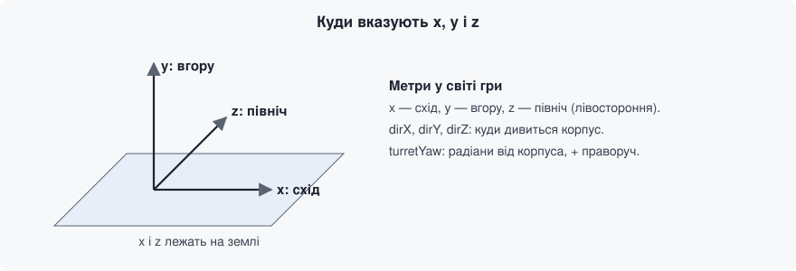

# Таблиця {#the-table}

Один рядок на відлік або подію, у `<match>.parquet`: 38 колонок
([Список колонок](../columns.md), створений з коду).

| Колонка | Що це |
|---|---|
| `match`, `map` | ідентифікатор бою; ідентифікатор карти (`99_testmap` на малюнках) |
| `time` | секунди від початку запису (відлік до старту теж у ньому) |
| `battleTime` | секунди від початку бою; від'ємні під час відліку |
| `event` | що це за рядок (нижче) |
| `player`, `team`, `own` | назва гравця; команда `1` або `2`; `1` у рядках гравця, що записав повтор |
| `vehicle`, `type` | танк, як його називає гра (`ussr:R144_K_91`); `tank`, або `shell` для трасера чи вибуху, чий стрілець невідомий (немає гравця) |
| `x`, `y`, `z` | метри: x — на схід, y — вгору, z — на північ (власний світ гри, лівосторонній) |
| `dirX`, `dirY`, `dirZ` | куди дивиться корпус, одиничний вектор у тій самій системі координат (`dirY` 0: лише курс); для пострілу або трасера — куди полетів снаряд |
| `turretYaw` | кут башти відносно курсу корпуса, радіани, додатний — праворуч |
| `gunStep` | піднесення гармати як крок 0-63 між власними межами гармати (межі — це дані танка, а не повтору) |
| `other`, `reason` | інша техніка події (вбивця, жертва, атакуючий, ціль); номер причини атаки гри |
| `value`, `health` | число події (шкода, серія, швидкість снаряда, масштаб, команда); здоров'я після зміни |
| `text` | назва причини, рядок чату, режим камери, ключ команди |
| `shot` | ідентифікатор снаряда: постріл, його трасер і його вибух мають спільний |
| `entity` | ідентифікатор техніки в повторі |
| `hitComponent`, `hitCode`, `hitU/V/W`, `hitExitU/V/W`, `hitDirX/Y/Z` | лише в рядках `struck`: куди влучив снаряд (див. подію `struck` нижче) |
| `pitch`, `roll` | для положення — тангаж корпуса (радіани, додатний — ніс униз) і крен, як їх надсилає гра |

| `event` | У рядку чого | Що це |
|---|---|---|
| `position` | кожної техніки | приблизно десять разів на секунду, поки клієнт знав, де вона |
| `death`, `kill` | жертви, вбивці | кожна смерть двічі: де впала жертва і де стояв вбивця |
| `hurt`, `damage` | жертви, атакуючого | зміна здоров'я: `value` — шкода, `health` — що лишилося, `reason`/`text` — чому (`shot`, `fire`, `ramming`, ...) |
| `struck` | жертви | снаряд, що в неї влучив, у тому числі ті, що відскочили або не пробили: один рядок на точку влучання, `value` — шкода, яку він завдав (на першому); `hitComponent` — компонент зіткнення, `hitU/V/W` — де снаряд увійшов, а `hitExitU/V/W` — де закінчився його шлях, як частки коробки цього компонента (u — праворуч, v — вгору, w — вперед; перевірено за пеленгом атакуючого); `hitDirX/Y/Z` — з якого боку прилетів у системі координат корпуса; `turretYaw` — башта жертви тоді; `hitCode` — байт, що надсилається з точкою (невідомий: він не йде за шкодою) |
| `shot` | стрільця | `value` — черга; напрямок, куди полетів його трасер, інакше корпус плюс башта |
| `tracer` | стрільця | де снаряд вперше побачили і як він летів; `value` — його швидкість в одиницях гри |
| `impact` | стрільця | де вибухнув снаряд |
| `chat` | відправника | `text` — рядок |
| `command` | відправника | команда чату бою (атака, допомога, точка на карті), у її точці, коли вона її має; `value` — номер команди, `other` — техніка, яку вона називає |
| `camera`, `zoom`, `lock`, `unlock` | гравця, що записав повтор | режим камери (`sniper`, `arcade`, ...), масштаб, автонаведення увімкнено і вимкнено на ціль |

Нижній колонтитул файлу Parquet несе підказки `heat3d`: Y вгору, Z перевернуто (тож
карта не відзеркалена), масштаб одиниць 1, танк сім метрів завширшки, `player` як
людина, `team` як група, `match` як сесія.

---

Частина [3DHeat](https://github.com/Holdi601/3DHeat) ([документація](https://holdi601.github.io/3DHeat/)). Джерело: [3DHeat-Ext-WoT](https://github.com/Holdi601/3DHeat-Ext-WoT).
