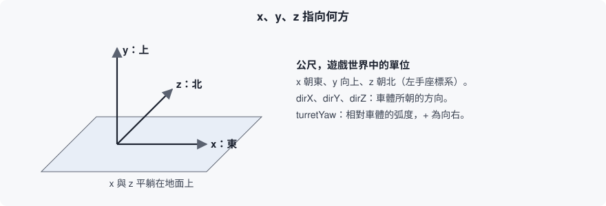

# 表格 {#the-table}

`<match>.parquet` 中每個取樣或事件一列，共 38 個欄位（[欄位清單](../columns.md)，由程式碼產生）。

| 欄位 | 內容 |
|---|---|
| `match`、`map` | 戰鬥的 id；地圖的 id（圖中為 `99_testmap`） |
| `time` | 自錄製開始起的秒數（倒數也包含在內） |
| `battleTime` | 自戰鬥開始起的秒數；倒數期間為負值 |
| `event` | 此列是什麼（見下文） |
| `player`、`team`、`own` | 玩家的名稱；隊伍 `1` 或 `2`；錄製玩家的列為 `1` |
| `vehicle`、`type` | 遊戲所命名的坦克（`ussr:R144_K_91`）；若射手不明（沒有玩家），曳光彈或爆炸的類型為 `tank` 或 `shell` |
| `x`、`y`、`z` | 公尺：x 朝東、y 向上、z 朝北（遊戲自己的世界，左手座標系） |
| `dirX`、`dirY`、`dirZ` | 車體所朝的方向，同一座標系中的單位向量（`dirY` 為 0：只有航向）；在射擊或曳光彈上，則為砲彈飛行的方向 |
| `turretYaw` | 砲塔相對於車體航向的角度，弧度，向右為正 |
| `gunStep` | 砲管的仰角，為砲管自身極限之間的 0-63 步距（極限來自坦克的資料，而非回放） |
| `other`、`reason` | 事件中的另一輛載具（擊殺者、受害者、攻擊者、目標）；遊戲的攻擊原因編號 |
| `value`、`health` | 事件的數值（傷害、連發、砲彈速度、縮放、指令）；變化後的血量 |
| `text` | 原因的名稱、一行聊天、攝影機模式、指令的鍵 |
| `shot` | 砲彈的 id：一次射擊、其曳光彈與其爆炸共用此 id |
| `entity` | 回放中載具的 id |
| `hitComponent`、`hitCode`、`hitU/V/W`、`hitExitU/V/W`、`hitDirX/Y/Z` | 僅限 `struck` 列：砲彈擊中的位置（見下方 `struck` 事件） |
| `pitch`、`roll` | 在位置上，車體的俯仰（弧度，機頭向下為正）與橫滾，即遊戲送出的數值 |

| `event` | 記在哪一列上 | 內容 |
|---|---|---|
| `position` | 每輛載具 | 客戶端知道其位置時，約每秒十次 |
| `death`、`kill` | 受害者、擊殺者 | 每次陣亡記錄兩次：受害者倒下之處，以及擊殺者所在之處 |
| `hurt`、`damage` | 受害者、攻擊者 | 血量變化：`value` 為傷害，`health` 為剩餘血量，`reason`/`text` 為原因（`shot`、`fire`、`ramming`……） |
| `struck` | 受害者 | 擊中它的一發砲彈，包括被彈開或未穿透的：每個被擊中的點一列，`value` 為它造成的傷害（在第一列上）；`hitComponent` 為碰撞元件，`hitU/V/W` 為砲彈射入之處，`hitExitU/V/W` 為其路徑結束之處，以該元件的方框的比例表示（u 向右、v 向上、w 向前；已與攻擊者的方位核對），`hitDirX/Y/Z` 為其射入車體座標系時的方向，`turretYaw` 為當時受害者的砲塔，`hitCode` 為隨該點送出的一個位元組（未知：它不會隨傷害變化） |
| `shot` | 射手 | `value` 為連發；曳光彈飛行的方向，否則為車體加上砲塔的方向 |
| `tracer` | 射手 | 砲彈首次被看到之處及其飛行方向；`value` 為其以遊戲單位表示的速度 |
| `impact` | 射手 | 砲彈爆炸之處 |
| `chat` | 發送者 | `text` 為該行內容 |
| `command` | 發送者 | 戰鬥聊天指令（攻擊、求助、地圖上的一個點），若有位置則記在該點；`value` 為指令的編號，`other` 為它所指的載具 |
| `camera`、`zoom`、`lock`、`unlock` | 錄製玩家 | 攝影機模式（`sniper`、`arcade`……）、縮放，以及自動瞄準目標的開啟與關閉 |

Parquet 的結尾帶有 `heat3d` 提示：Y 向上、Z 翻轉（因此地圖不會被鏡像）、單位比例為 1、載具寬七公尺、`player` 為人、`team` 為群組、`match` 為工作階段。

---

屬於 [3DHeat](https://github.com/Holdi601/3DHeat)（[說明文件](https://holdi601.github.io/3DHeat/)）的一部分。來源：[3DHeat-Ext-WoT](https://github.com/Holdi601/3DHeat-Ext-WoT)。
