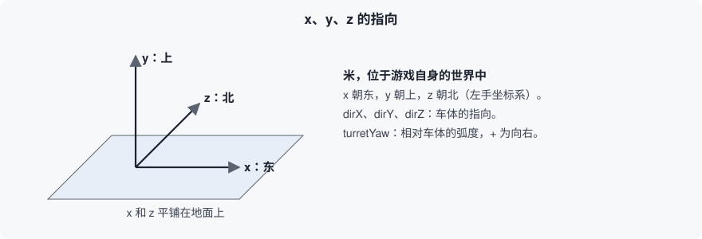

# 表格 {#the-table}

`<对局>.parquet` 中每个采样或事件占一行：共 38 列（[列清单](../columns.md)，由代码生成）。

| 列 | 内容 |
|---|---|
| `match`、`map` | 战斗的 ID；地图的 ID（图片中为 `99_testmap`） |
| `time` | 自录制开始以来的秒数（倒计时也包含在内） |
| `battleTime` | 自战斗开始以来的秒数；倒计时期间为负数 |
| `event` | 该行是什么（见下文） |
| `player`、`team`、`own` | 玩家名称；队伍 `1` 或 `2`；在录像播放者的行上为 `1` |
| `vehicle`、`type` | 游戏给出的坦克名称（`ussr:R144_K_91`）；`tank`，或者对于射击者未知（没有玩家）的曳光弹或爆炸，则为 `shell` |
| `x`、`y`、`z` | 米：x 朝东，y 朝上，z 朝北（游戏自身的世界，左手坐标系） |
| `dirX`、`dirY`、`dirZ` | 车体朝向的方向，为同一坐标系中的单位向量（`dirY` 为 0 时仅表示航向）；对于射击或曳光弹，则为炮弹飞行的方向 |
| `turretYaw` | 炮塔相对于车体航向的角度，单位为弧度，向右为正 |
| `gunStep` | 火炮的仰角，为其自身极限之间的 0-63 步进（极限值来自坦克的数据，而不是录像） |
| `other`、`reason` | 事件中的另一辆载具（击杀者、受害者、攻击者、目标）；游戏的攻击原因编号 |
| `value`、`health` | 事件的数值（伤害、连发、炮弹速度、变焦、命令）；变化之后的生命值 |
| `text` | 原因的名称、一行聊天、一种相机模式、一个命令的键 |
| `shot` | 炮弹的 ID：一次射击、其曳光弹和其爆炸共用该 ID |
| `entity` | 录像中载具的 ID |
| `hitComponent`、`hitCode`、`hitU/V/W`、`hitExitU/V/W`、`hitDirX/Y/Z` | 仅限 `struck` 行：炮弹在何处命中（见下文 `struck` 事件） |
| `pitch`、`roll` | 位置行上，车体的俯仰（弧度，机头朝下为正）和横滚，按游戏发送的原样记录 |

| `event` | 位于哪一行上 | 内容 |
|---|---|---|
| `position` | 每辆载具 | 大约每秒十次，在客户端知道其位置时 |
| `death`、`kill` | 受害者、击杀者 | 每次死亡记录两行：受害者倒下的位置，以及击杀者所在的位置 |
| `hurt`、`damage` | 受害者、攻击者 | 生命值变化：`value` 为伤害，`health` 为剩余生命值，`reason`/`text` 为原因（`shot`、`fire`、`ramming` 等） |
| `struck` | 受害者 | 击中它的炮弹，包括弹开或未穿透的炮弹：每个命中点一行，`value` 为它造成的伤害（在第一行上）；`hitComponent` 为碰撞组件，`hitU/V/W` 为炮弹进入的位置，`hitExitU/V/W` 为其路径终止的位置，以该组件包围盒的比例表示（u 向右，v 向上，w 向前；已与攻击者的方位核对），`hitDirX/Y/Z` 为其在车体坐标系中射入的方向，`turretYaw` 为当时受害者的炮塔，`hitCode` 为随命中点发送的一个字节（含义未知：它不随伤害变化） |
| `shot` | 射击者 | `value` 为连发；曳光弹飞行的方向，否则为车体加炮塔的方向 |
| `tracer` | 射击者 | 炮弹首次被看到的位置及其飞行方向；`value` 为其速度，以游戏单位计 |
| `impact` | 射击者 | 炮弹爆炸的位置 |
| `chat` | 发送者 | `text` 为该行内容 |
| `command` | 发送者 | 一条战斗聊天命令（进攻、求助、地图上的一个点），若有位置则记录在其所在的点上；`value` 为该命令的编号，`other` 为它所指的载具 |
| `camera`、`zoom`、`lock`、`unlock` | 录像播放者 | 相机模式（`sniper`、`arcade` 等）、变焦、对某一目标开启和关闭自动瞄准 |

Parquet 的页脚携带 `heat3d` 提示：Y 朝上，Z 取反（因此地图不会被镜像）、单位比例为 1、载具宽七米、`player` 表示人、`team` 表示分组、`match` 表示会话。

---

本页是 [3DHeat](https://github.com/Holdi601/3DHeat) 的一部分（[文档](https://holdi601.github.io/3DHeat/)）。来源：[3DHeat-Ext-WoT](https://github.com/Holdi601/3DHeat-Ext-WoT)。
